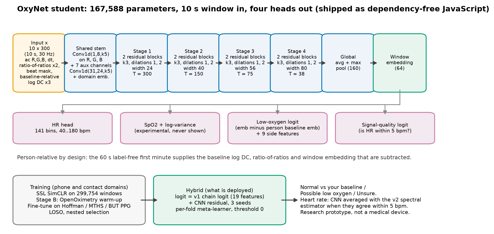
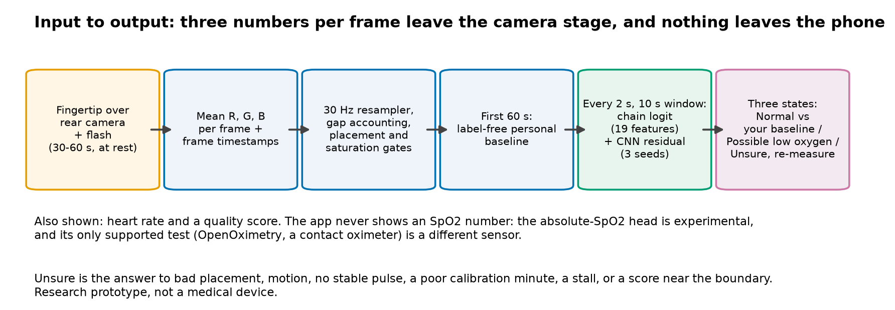
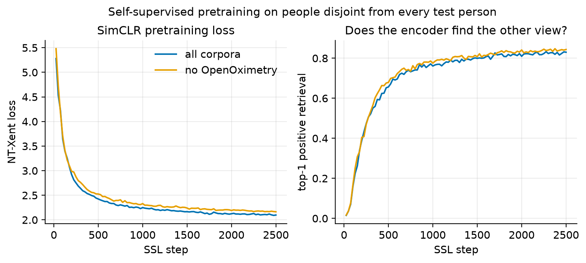
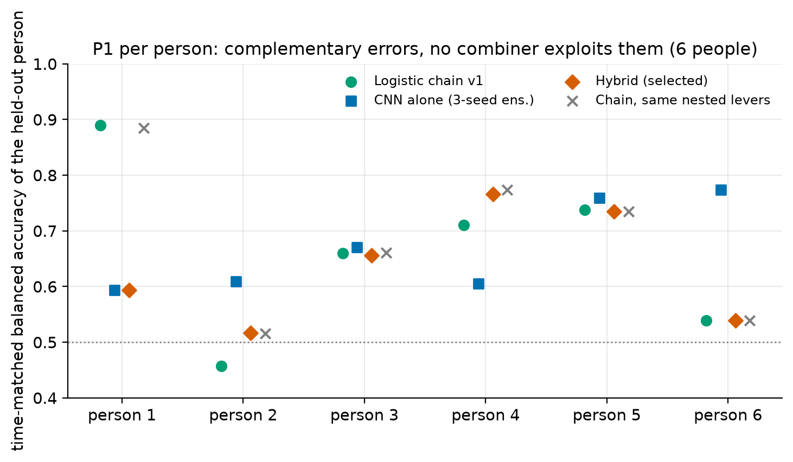
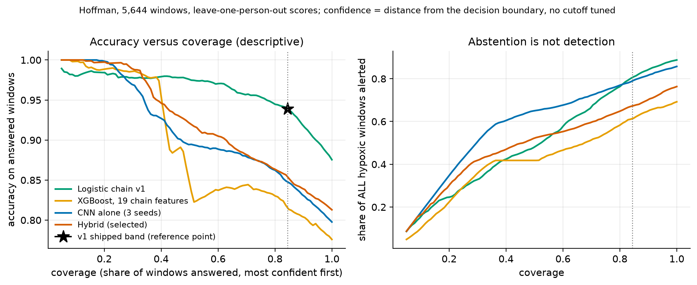
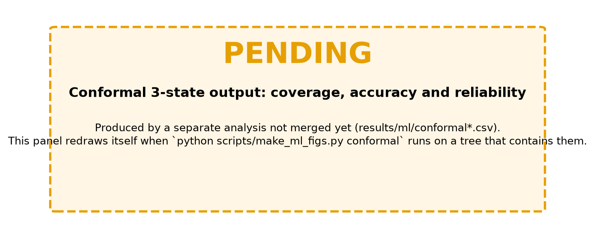
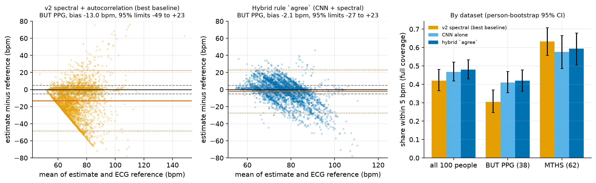
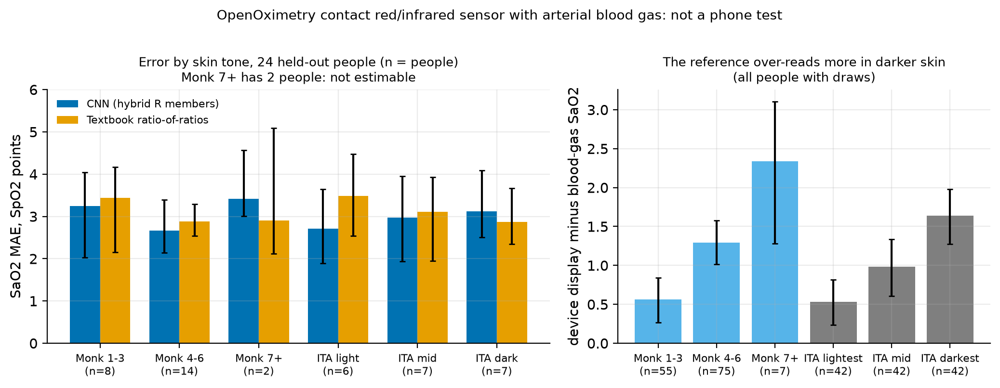
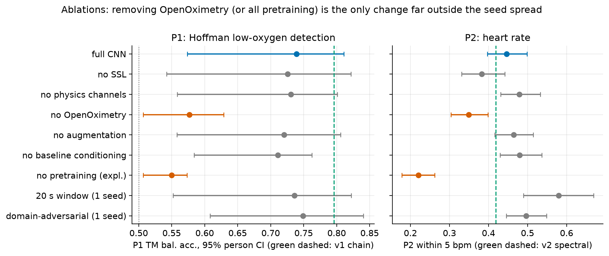
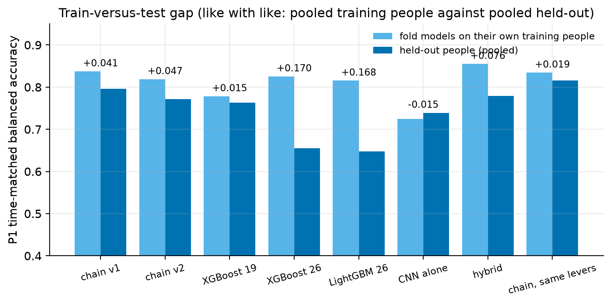

<!-- GENERATED from docs/templates/MODEL.md.in by scripts/render_docs.py. Edit the template, not this file. -->
# OxyDrop model card

> **Research prototype, not a medical device.** It does not measure SpO2, does not diagnose, and was validated on six hypoxic phone-camera people. The app is built to work on every phone and is not tuned to any specific phone; untested Android and other phones are a limitation (section 12).

This file documents the model that the app runs: architecture, data, training, the leave-one-person-out (LOSO) evaluation, every baseline, every lever (kept and dropped), and an honest comparison with prior work. Every number is generated from `results/ml/*.csv` (see `scripts/ml_numbers.py`, `scripts/render_docs.py`, checked by `scripts/check_claims.py`). The paper-style summary is `WHITEPAPER.md`.

## 1. What it is, in one paragraph

A **hybrid of a physiological logistic chain and a small 1D CNN**. The chain (the v1 model: heart-rate rise, pulse-shape and ratio-of-ratios features, each relative to the person's own first minute, two logistic regressions) gives a low-oxygen logit. A 167,588-parameter CNN (`OxyNet`, three seeds) learns a **residual correction** to that logit from the 10 s window of per-frame mean RGB. A small logistic meta-learner maps the sum to a decision. The same CNN also outputs heart rate, a quality score and an experimental SpO2 value that the app never shows. **The pre-registered primary metric was not beaten**: the deployed pipeline R scores 0.809 [0.644, 0.863] (optimistic: chosen after the outer scores were seen) and the nested per-person-selected hybrid 0.779 [0.638, 0.831], both ties with the shipped chain (0.796 [0.635, 0.856]). **A chain refit with the same levers and no CNN has the higher point estimate (0.816), and so does the chain-only conformal control (the conformal section)**; the intervals overlap, so this is a tie. ML is the app's core path by design (Amendment 2), not because it wins.





## 2. Who it is for and input to output

People with COVID-19, COPD, asthma or at altitude who own a phone but no pulse oximeter, and low-resource clinics. **Input:** 30 to 60 s of fingertip video (rear camera and flash), reduced on the phone to per-frame mean R, G, B and frame timestamps. **Output:** every 2 s after a 60 s label-free calibration, one of *Normal vs your baseline*, *Possible low oxygen: re-check with a pulse oximeter*, *Unsure, re-measure*; plus heart rate and a quality score. No pixel leaves the device.

## 3. Architecture and parameters

`python/oxydrop_ml/model.py` (specification: `python/oxydrop_ml/MODEL_SPEC.md`). **Parameters: 167,588** shipped (budget 300,000, asserted in a test); about 11.6 million multiply-adds per window; one member's JSON is 0.90 MB (three seed members 2.7 MB) and the ONNX interoperability file is 728 KB. A single forward pass takes 16.4 ms per 10 s window in Node on a development laptop (feature construction 0.2 to 1 ms) and a full hybrid window (v2 quality chain, v1 chain, features, three forward passes, combiner) 50 to 58 ms (`results/ml/DEPLOY.md`, laptop numbers). Phones are slower by an unmeasured factor; the app prints the real latency per window in its debug view, so every phone test gives one. The three seed files are 2.69 MB together.

| Stage | Detail |
|---|---|
| Input `x` | 10 channels by 300 samples (10 s at 30 Hz) and a 9-value side vector |
| Stem | one `Conv1d(1,8,k5)` shared by the R, G, B waveform slots (masked per domain) plus 7 auxiliary channels, `Conv1d(31,24,k5)`, plus a per-domain embedding (phone, contact oximeter) |
| Body | 4 stages of 2 residual blocks, widths 24, 40, 56, 80, kernel 3, dilations 1 and 2, stride 2 at stages 2 to 4 (T = 300, 150, 75, 38), BatchNorm folded at export |
| Pooling and embedding | global average and max (160 values), `Linear(160,64)` with ReLU |
| Heads | HR: 141 bins over 40 to 180 bpm; SpO2 and log-variance (experimental); low-oxygen logit on (embedding minus the person's baseline embedding) plus the side vector; signal-quality logit (will the HR be within 5 bpm?); a training-only auxiliary SaO2 head for the contact-oximeter domain, never exported |

**Input channels** (`python/oxydrop_ml/features.py`): 0 to 2 `ac_R/G/B` (100 times the causal 0.7 to 4 Hz band-pass of ln(rgb + 1)); 3 frame-time delta (0 when frames arrive on time); 4 and 5 per-beat ln ratio-of-ratios R/G and R/B minus the person's baseline value (the physics channels); 6 beat mask; 7 to 9 slow log DC minus the person's first-minute log DC. **Side vector:** baseline-relative ratio-of-ratios, DC and local amplitude changes and beat fraction. **Causality:** every filter is single-pass (no zero-phase filtering) and the baseline is the person's own first 60 s, label-free, so the JavaScript port in `app/js/` computes the same tensor on the fly (feature parity to 1e-6, network parity to 1e-4 on fixtures).

**Losses** (`python/oxydrop_ml/losses.py`, each head contributes only where its label exists): soft-label cross-entropy over the HR bins; Gaussian negative log-likelihood plus Huber for SpO2 (log-variance clamped); class-weighted BCE for SpO2 < 90 (weight 3 for the shipped recipe); BCE for quality; Huber for the contact-oximeter SaO2 head; an optional gradient-reversal domain head (ablation only).

## 4. Training data and licences

| Source | Use | Licence | Notes |
|---|---|---|---|
| UW Hoffman 2022 | P1 test (6 people, 5,644 windows), low-oxygen training in each fold | MIT | the only open phone-camera data with SpO2 below 90 |
| MTHS (Samavati et al.) | P2 and P3 test, normoxic phone video | CC BY-NC-ND 4.0 | non-commercial research; weights trained on it are flagged in `DATA_LICENSES.md`; no raw data or per-window predictions committed |
| BUT PPG v2.0 | P2 test, smartphone PPG with ECG heart rate | CC BY 4.0 | spot SpO2 per person used only as a low-weight label |
| OpenOximetry v1.1.1 | SSL, stage B warm-up, auxiliary head, skin-tone analysis | PhysioNet credentialed | contact red/infrared PPG, not a phone; derived aggregates only; Daytona only, never Kaggle; 34 people held out of everything |
| Pretraining corpus | SSL: 299,754 windows, 212 people (OpenOximetry, PTT-PPG, moshekam exercise, apnoea, BIDMC) | mixed | disjoint from every Hoffman, MTHS and BUT person |

## 5. Self-supervised pretraining

SimCLR-style contrastive learning (PPG-appropriate augmentations), 2,500 steps; checkpoint SHA-256 prefix `ccdb6a75eae9`.

| Run | Steps | First logged loss | Last loss | Top-1 positive retrieval |
| :--- | ---: | ---: | ---: | ---: |
| SSL, all corpora | 2,500 | 5.28 | 2.10 | 0.83 |
| SSL, no OpenOximetry | 2,500 | 5.48 | 2.16 | 0.84 |



A Kaggle pretraining on HealthRing PPG (different 5x450 network, predictions only) gave SpO2 MAE 4.25 pretrained, 4.33 from scratch, 5.42 frozen: pretrained against scratch is a tie, and it cannot initialise OxyNet, so it is not used.

## 6. Device augmentation

Per-channel gain and gamma, colour-matrix jitter, DC steps, baseline wander, frame-rate jitter and drops, resampling phase, saturation clipping, motion bursts, finger-pressure drift (`python/oxydrop_ml/augment.py`). **The device-agnostic augmentation novelty claim is not supported**: removing it changes P1 by 0.720 against 0.739 for the full model (inside the seed spread 0.019). No augmentation parameter or threshold is fit to any phone.

## 7. Evaluation protocol (pre-registered, nested)

`python/oxydrop_ml/PREREGISTRATION.md` was committed in `3e708fe` before any learned-model result and has five amendments (Amendment 1 in the pre-registration file, 2 to 5 in `python/oxydrop_ml/amendments/`, each stating what had been seen when it was written).

* **LOSO everywhere**; both hands of a person held out together; no window-level split. Rows that are not LOSO (ablation P2 and P3 use 10 grouped folds) are labelled in the protocol column.
* **Nested CV for every selection** (recipe, hyperparameters, thresholds, stacking, which lever to keep, conformal quantiles): an inner subject-grouped CV on the outer training people only. Disclosed deviation (Amendment 1): the single CNN recipe was taken over all outer folds and its validation people include P2 and P3 test people; the winner never changes when any one person is dropped.
* **Pretraining only on people who are never a test person.**
* **Seeds:** three for every final CNN row; seed SD reported.
* **Intervals:** 95% person-level bootstrap (2000 resamples of people); paired person bootstrap for differences. A *win* is claimed only against the **best** honest baseline.
* **Gap:** fold models scored on their own pooled training people against the pooled held-out score.
* **Primary metrics:** **P1** Hoffman time-matched balanced accuracy at full coverage; **P2** share of windows within 5 bpm of the reference at full coverage (BUT PPG plus MTHS, 100 people); **P3** SpO2 MAE on MTHS (61 people with a scored window).

## 8. Results

### 8.1 P1: low-oxygen detection (primary)

| Model (P1: Hoffman, 6 people, LOSO) | TM bal. acc. | 95% CI (person bootstrap) | Per person, mean ± SD | Plain AUROC | Train-vs-test gap | vs best baseline (pre-registered rule) |
| :--- | ---: | ---: | ---: | ---: | ---: | :--- |
| Majority class (always "hypoxic") | 0.500 | [0.500, 0.500] | 0.500 ± 0.000 | 0.500 | +0.000 | baseline |
| Clock only (elapsed seconds, not deployable) | 0.495 | [0.480, 0.514] | 0.509 ± 0.021 | 0.821 | +0.054 | baseline |
| Ratio-of-ratios, textbook 110-25R (red/blue) | 0.535 | [0.475, 0.594] | 0.528 ± 0.026 | 0.480 | +0.000 | baseline |
| Ratio-of-ratios, textbook 110-25R (red/green) | 0.498 | [0.436, 0.548] | 0.480 ± 0.036 | 0.587 | -0.001 | baseline |
| Ratio-of-ratios, personally calibrated (red/blue) | 0.503 | [0.398, 0.555] | 0.498 ± 0.003 | 0.421 | +0.020 | baseline |
| Ratio-of-ratios, personally calibrated (red/green) | 0.612 | [0.493, 0.693] | 0.539 ± 0.089 | 0.651 | +0.020 | baseline |
| XGBoost, 26 handcrafted features | 0.655 | [0.528, 0.778] | 0.642 ± 0.096 | 0.899 | +0.170 | baseline |
| LightGBM, 26 handcrafted features | 0.647 | [0.538, 0.775] | 0.634 ± 0.086 | 0.916 | +0.168 | baseline |
| XGBoost, 19 chain features (v1 HR) | 0.736 | [0.539, 0.851] | 0.622 ± 0.119 | 0.894 | +0.106 | baseline |
| XGBoost, 19 chain features (v2 HR) | 0.763 | [0.613, 0.840] | 0.582 ± 0.115 | 0.854 | +0.015 | baseline |
| LightGBM, 19 chain features (v1 HR) | 0.743 | [0.544, 0.849] | 0.612 ± 0.114 | 0.897 | +0.081 | baseline |
| LightGBM, 19 chain features (v2 HR) | 0.738 | [0.618, 0.818] | 0.604 ± 0.110 | 0.816 | +0.080 | baseline |
| Logistic chain v2 (pulse-lock gate, forced answer) | 0.772 | [0.645, 0.828] | 0.609 ± 0.124 | 0.869 | +0.047 | baseline |
| Logistic chain v2, C by nested CV | 0.759 | [0.625, 0.825] | 0.600 ± 0.113 | 0.844 | +0.056 | baseline |
| Logistic chain v1, C by nested CV | 0.786 | [0.596, 0.864] | 0.642 ± 0.131 | 0.930 | +0.052 | baseline |
| Logistic chain v1 (best baseline) | 0.796 | [0.635, 0.856] | 0.666 ± 0.153 | 0.947 | +0.041 | baseline |
| **CNN alone** (167k parameters; mean of 3 seeds, own probability at 0.5) | 0.739 | [0.574, 0.811] | 0.618 ± 0.094 | 0.843 | -0.015 | tie with the best baseline (3-seed ensemble 0.754, paired diff -0.042 [-0.131, 0.005]) |
| CNN alone, 3-seed ensemble through the per-fold recalibration (`default_P`) | 0.781 | [0.632, 0.827] | 0.669 ± 0.081 | 0.852 | n/a | exploratory |
| **Deployed pipeline R** (the app; chain + CNN residual). Optimistic: chosen after the outer scores were seen | 0.809 | [0.644, 0.863] | 0.671 ± 0.088 | 0.918 | n/a | exploratory; interval overlaps the best baseline, no paired test run |
| **Hybrid, per-person selected** (nested: unbiased estimate of the selection procedure) | 0.779 | [0.638, 0.831] | 0.635 ± 0.102 | 0.891 | +0.076 | **tie** with the best baseline (-0.017 [-0.103, 0.069]) |
| Control: chain refit with the same nested levers (no CNN) | 0.816 | [0.674, 0.869] | 0.685 ± 0.142 | 0.947 | +0.019 | tie with the best baseline (+0.019 [-0.000, 0.049]) |

Majority class is 57.48% of the windows. *Per person* = mean ± SD of the six held-out people. The pre-registered rule applies to the **best** baseline, the shipped v1 chain (0.796 [0.635, 0.856]; accuracy 0.875 [0.844, 0.905]).

**Reading.** The CNN ties the chain (3 seeds 0.752, 0.717, 0.748; seed 1 alone loses, -0.079 [-0.217, -0.021]; the ensemble 0.754 ties, -0.042 [-0.131, 0.005]). The nested hybrid ties it too (-0.017 [-0.103, 0.069]), and so does the deployed pipeline R (0.809 [0.644, 0.863], no paired test run; this is the model the app runs and its estimate is optimistic because R was chosen after the outer scores were seen). A chain refit with the same nested levers reaches 0.816 [0.674, 0.869], a higher point estimate than either hybrid, so any gain over the shipped chain is a recalibration, not a CNN effect. The only systematic wins are against weak baselines (ratio-of-ratios, clock), which are not pre-registered wins.

| Model | person 1 | person 2 | person 3 | person 4 | person 5 | person 6 | mean ± SD |
| :--- | ---: | ---: | ---: | ---: | ---: | ---: | ---: |
| Logistic chain v1 (shipped) | 0.889 | 0.458 | 0.660 | 0.711 | 0.737 | 0.539 | 0.666 ± 0.153 |
| Chain, same nested levers | 0.885 | 0.515 | 0.661 | 0.774 | 0.735 | 0.539 | 0.685 ± 0.142 |
| CNN alone, 3-seed ensemble (`default_P`) | 0.594 | 0.610 | 0.671 | 0.605 | 0.759 | 0.774 | 0.669 ± 0.081 |
| **Deployed pipeline R** (default levers, optimistic) | 0.636 | 0.517 | 0.671 | 0.766 | 0.737 | 0.697 | 0.671 ± 0.088 |
| Hybrid, per-person selected pipeline (nested) | 0.594 | 0.517 | 0.656 | 0.766 | 0.735 | 0.539 | 0.635 ± 0.102 |



CNN alone, per person and seed (AUROC / sensitivity / specificity at the fixed 0.5 threshold):

| CNN alone | person 1 | person 2 | person 3 | person 4 | person 5 | person 6 |
| :--- | ---: | ---: | ---: | ---: | ---: | ---: |
| seed 0 | 0.94 / 0.64 / 1.00 | 0.98 / 1.00 / 0.65 | 0.94 / 0.99 / 0.34 | 0.91 / 0.90 / 0.74 | 0.98 / 0.93 / 0.93 | 0.99 / 0.97 / 0.90 |
| seed 1 | 0.69 / 0.04 / 1.00 | 0.98 / 1.00 / 0.74 | 0.91 / 0.98 / 0.44 | 0.56 / 0.46 / 0.62 | 0.99 / 1.00 / 0.68 | 0.99 / 1.00 / 0.64 |
| seed 2 | 0.77 / 0.28 / 0.92 | 0.98 / 1.00 / 0.73 | 0.93 / 0.98 / 0.52 | 0.86 / 0.85 / 0.68 | 0.99 / 0.94 / 0.91 | 0.99 / 0.99 / 0.74 |

Inner-fold selection of the deployed pipeline per held-out person (Amendment 2; sources chosen: R in 3 folds, c+p in 2, P in 1):

| Held-out person | Chosen source | Per-user calibration | k windows | Inner-CV TM bal. acc. |
| :--- | :--- | :--- | ---: | ---: |
| person 1 | P | off | 1 | 0.769 |
| person 2 | R | off | 1 | 0.789 |
| person 3 | R | on | 6 | 0.865 |
| person 4 | R | off | 1 | 0.785 |
| person 5 | c+p | off | 1 | 0.722 |
| person 6 | c+p | off | 1 | 0.744 |

### 8.2 Accuracy versus coverage and abstention (descriptive, confidence ranking)

| Model (Hoffman, 5,644 windows) | Coverage | Accuracy on answered windows | Share of ALL hypoxic windows alerted | Accuracy at full coverage |
| :--- | ---: | ---: | ---: | ---: |
| Logistic chain v1 (shipped) | 84.4% | 93.9% | 80.5% | 87.5% |
| XGBoost, 19 chain features (v2) | 84.4% | 81.6% | 61.3% | 77.6% |
| CNN alone (3-seed mean probability) | 84.4% | 84.8% | 79.0% | 79.8% |
| Hybrid (selected pipeline) | 84.4% | 85.4% | 67.3% | 81.3% |



The v1 shipped band answers 84.4% of windows at 93.9% accuracy and alerts 80.5% of all hypoxic windows; the v2 chain with its pulse-lock gate answers 68.0% at 94.7% and alerts 71.8%. Abstention is not detection: unanswered hypoxic windows are missed.

### 8.3 Calibration and conformal 3-state output

The nested conformal result below supersedes the descriptive ranking above where the two differ: it fixes the cutoffs from other people only.

**Held-out conformal output at the declared level alpha = 0.10** (Mondrian, thresholds from the five other people only, 5,644 Hoffman windows after the first minute, 95% person-bootstrap CIs). The deployed pipeline R is the model the app runs; its row is exploratory and optimistic because R was chosen with all six people in view. The per-person selected row is the nested estimate of the selection procedure. The chain-only control has the higher point estimates:

| Pipeline | Coverage (answered) | Accuracy on answered | All hypoxic windows alerted | Hypoxic called Normal | Normal / Possible low / Unsure |
| :--- | ---: | ---: | ---: | ---: | ---: |
| **Deployed pipeline R** (the app; optimistic) | 74.5% [60.1%, 84.0%] | 89.5% [79.4%, 98.1%] | 70.0% [46.5%, 88.5%] | 8.7% | 31% / 43% / 26% |
| Hybrid, per-person selected (nested) | 79.1% [63.5%, 89.9%] | 87.0% [76.1%, 95.5%] | 70.1% [43.6%, 90.0%] | 11.4% | 35% / 44% / 21% |
| v1 chain alone (control) | 92.5% [86.9%, 98.2%] | 90.3% [86.1%, 94.4%] | 84.3% [78.9%, 88.2%] | 10.0% | 41% / 52% / 8% |

**At matched coverage** (each system is read at the coverage of the reference, by interpolation along alpha; the reference accuracy is the hand-set band of the shipped v1 or v2 chain):

| Reference at its own coverage | Pipeline (nested Mondrian conformal) | Matched coverage | Accuracy on answered | Reference accuracy | Difference, points | Verdict |
| :--- | :--- | ---: | ---: | ---: | ---: | :--- |
| v1 shipped band | **Deployed pipeline R** (the app; optimistic) | 84.4% | 88.0% [78.5%, 96.2%] | 93.9% | -5.9 [-17.1, +2.3] | tie |
| v1 shipped band | Hybrid, per-person selected (nested) | 84.4% | 85.9% [75.6%, 94.9%] | 93.9% | -8.0 [-20.8, +1.2] | tie |
| v1 shipped band | v1 chain alone (control) | 84.4% | 92.0% [88.2%, 95.9%] | 93.9% | -1.9 [-3.7, +0.3] | tie |
| v2 gated band | **Deployed pipeline R** (the app; optimistic) | 68.0% | 90.8% [82.2%, 98.7%] | 94.7% | -3.9 [-13.9, +3.8] | tie |
| v2 gated band | Hybrid, per-person selected (nested) | 68.0% | 89.5% [78.9%, 98.2%] | 94.7% | -5.2 [-18.5, +3.3] | tie |
| v2 gated band | v1 chain alone (control) | 68.0% | 95.0% [91.0%, 98.2%] | 94.7% | +0.3 [-3.5, +3.1] | tie |

**Empirical set coverage next to the target** (the guarantee is per class and assumes exchangeability; windows of one person overlap by 80% and people differ):

| alpha | Target | Pipeline | Coverage, hypoxic windows | Coverage, normal windows |
| ---: | ---: | :--- | ---: | ---: |
| 0.05 | 95% | **Deployed pipeline R** (the app; optimistic) | 97.1% [91.4%, 100.0%] | 96.3% [90.4%, 99.8%] |
| 0.05 | 95% | Hybrid, per-person selected (nested) | 93.7% [81.8%, 100.0%] | 95.8% [89.6%, 99.3%] |
| 0.05 | 95% | v1 chain alone (control) | 95.0% [90.5%, 98.4%] | 95.1% [91.0%, 98.1%] |
| 0.10 | 90% | **Deployed pipeline R** (the app; optimistic) | 91.3% [74.1%, 99.9%] | 93.2% [84.8%, 99.0%] |
| 0.10 | 90% | Hybrid, per-person selected (nested) | 88.6% [69.6%, 99.2%] | 91.2% [80.6%, 97.8%] |
| 0.10 | 90% | v1 chain alone (control) | 89.6% [82.1%, 95.4%] | 91.7% [87.6%, 95.7%] |
| 0.15 | 85% | **Deployed pipeline R** (the app; optimistic) | 89.0% [69.0%, 99.2%] | 88.8% [77.7%, 96.7%] |
| 0.15 | 85% | Hybrid, per-person selected (nested) | 84.2% [60.9%, 97.2%] | 87.8% [76.4%, 95.9%] |
| 0.15 | 85% | v1 chain alone (control) | 85.7% [76.3%, 92.2%] | 88.5% [85.0%, 91.7%] |

**Per person** (deployed pipeline R, alpha = 0.10): the pooled guarantee does not hold person by person.

| Held-out person | Windows | Coverage | Accuracy on answered | Hypoxic alerted | Hypoxic called Normal | Set coverage, hypoxic | Unsure |
| :--- | ---: | ---: | ---: | ---: | ---: | ---: | ---: |
| person 1 | 1,022 | 84.9% | 68.2% | 20.1% | 51.3% | 48.7% | 15.1% |
| person 2 | 1,053 | 85.4% | 96.0% | 87.2% | 0.4% | 99.6% | 14.6% |
| person 3 | 998 | 72.4% | 84.9% | 92.8% | 0.0% | 100.0% | 27.6% |
| person 4 | 947 | 41.8% | 97.7% | 44.2% | 0.0% | 100.0% | 58.2% |
| person 5 | 859 | 83.2% | 99.2% | 86.8% | 0.6% | 99.4% | 16.8% |
| person 6 | 765 | 78.7% | 98.8% | 84.0% | 0.0% | 100.0% | 21.3% |

AUROC over all windows: hybrid 0.891, deployed R 0.918, v1 chain 0.947. Expected calibration error of sigmoid(z): hybrid 0.076, deployed R 0.054, v1 chain 0.107 (the chain ranks well but is not calibrated).

Source: `results/ml/conformal_curve.csv`, `conformal_matched.csv`, `conformal_per_person.csv`, `conformal_calibration.csv`; protocol and reading in `results/ml/CONFORMAL.md`.



**Reading.** The numbers for the model the app runs are the **deployed pipeline R** rows. They are exploratory and optimistic (R was chosen with all six people in view); the per-person-selected rows are the nested estimate of the selection procedure. The deployed pipeline does not beat v1 at matched coverage (-5.9 [-17.1, +2.3] points at v1's coverage, -3.9 [-13.9, +3.8] at v2's; both intervals contain zero), and the per-person-selected hybrid is at -8.0 [-20.8, +1.2] and -5.2 [-18.5, +3.3]. The same conformal step on the v1 chain reads 92.0% at v1's coverage and 95.0% at v2's, and at alpha = 0.10 it answers 92.5% of windows at 90.3% and alerts 84.3% of hypoxic windows, against 74.5%, 89.5% and 70.0% for the deployed hybrid: **the chain-only control, which the app can run behind `?engine=logistic`, has the higher point estimates and answers more windows**; the intervals overlap. The loss therefore comes from the hybrid score, not from the conformal step. At alpha = 0.10 the deployed pipeline calls 8.7% of hypoxic windows Normal (target 10%). Set coverage holds approximately pooled and fails per person: person 1 has 51.3% of its hypoxic windows called Normal. The thresholds shipped in the app (`app/data/conformal.json`) are fit on the out-of-fold scores of all six people for this pipeline and are therefore in-sample on the replay demo.

### 8.4 P2: heart rate

| Model (P2: BUT PPG + MTHS, 100 people, LOSO, full coverage) | All: within 5 bpm [95% CI] | BUT PPG (38) | MTHS (62) | MAE (bpm) | Doubling | vs best baseline |
| :--- | ---: | ---: | ---: | ---: | ---: | :--- |
| FFT peak, plain | 0.382 [0.329, 0.441] | 0.271 | 0.590 | 17.22 | 1.03% | baseline |
| v1 peak-interval counter | 0.397 [0.345, 0.450] | 0.315 | 0.549 | 14.53 | 2.44% | baseline |
| **v2 spectral + autocorrelation (best baseline)** | 0.419 [0.366, 0.481] | 0.304 | 0.633 | 13.68 | 0.24% | baseline |
| v2 with its shipped quality gate (abstains) | 0.312 [0.255, 0.378] | 0.167 | 0.582 | 8.85 | 0.00% | baseline |
| CNN alone (3-seed median) | 0.468 [0.419, 0.522] | 0.410 | 0.576 | 8.63 | 0.02% | tie (3-seed ensemble) |
| **Hybrid HR rule `agree`** (CNN, averaged with v2 spectral when within 5 bpm) | 0.480 [0.429, 0.534] | 0.419 | 0.594 | 8.55 | 0.02% | win by the rule (+0.061 [0.013, 0.107]); **post hoc, exploratory, driven by BUT PPG** |



Rule selection on the Hoffman inner folds (6 people disjoint from every P2 test person): `spec` 0.883, `agree` 0.826, `guard` 0.811, `gate` 0.814, `cnn` 0.803. The pre-registered metric shows a "win" (+0.061 [0.013, 0.107]), but it rests on a rule chosen after the pooled table had been seen (Amendment 3) and is **exploratory, not a clean win**: the gain comes from BUT PPG (+0.115 [0.054, 0.177]); on MTHS the spectral estimator is nominally better (-0.039 [-0.102, 0.017]); on the Hoffman people the spectral estimator alone is best (0.883 against 0.826 for the rule that ships).

**Voting rule on clean clips** (pass the shipped v2 quality gate; MAE in bpm; target stated before any result: MAE under 3 bpm and doubling under 1%). Voting of autocorrelation, spectral harmonic sum and the CNN, with octave check and a causal median of 5:

| Dataset | Clean windows | Voting MAE [95% CI] | Within 5 bpm | Doubling | CNN alone MAE | Spectral alone MAE | Target met |
| :--- | ---: | ---: | ---: | ---: | ---: | ---: | :--- |
| BUT PPG (38 people) | 1,379 (36%) | 10.94 [8.63, 13.44] | 49.2% [38.8%, 59.4%] | 0.00% | 8.05 | 11.85 | no |
| MTHS (62 people) | 1,701 (82%) | 5.22 [3.51, 7.34] | 77.4% [69.0%, 84.8%] | 0.00% | 6.30 | 6.42 | no |
| BUT PPG + MTHS (100 people) | 3,080 (52%) | 7.78 [6.29, 9.45] | 64.7% [57.8%, 71.4%] | 0.00% | 7.08 | 8.85 | no |
| Hoffman (6 people, extra) | 4,671 (83%) | 0.98 [0.78, 1.21] | 98.2% [95.7%, 99.7%] | 0.00% | 2.11 | 1.77 | yes |

**Slow pulse (Hoffman person 4, mean reference 48 bpm).** With the shipped spectral floor of 51 bpm the spectral estimate has MAE 14.3 bpm; widening the band to 40 bpm gives 1.9; the CNN does not track this person (21.0 bpm).

Paired MAE difference, voting minus baseline in bpm (positive = voting better):

| Scope | Baseline | Difference [95% CI] | Verdict |
| :--- | :--- | ---: | :--- |
| BUT PPG, clean clips | CNN alone | -2.89 [-4.50, -1.43] | worse |
| BUT PPG, clean clips | P2 rule `agree` | -3.03 [-4.59, -1.60] | worse |
| MTHS, clean clips | CNN alone | +1.08 [+0.09, +2.18] | better |
| MTHS, clean clips | P2 rule `agree` | +0.96 [-0.02, +2.06] | tie |
| BUT PPG + MTHS, all clips | CNN alone | -1.09 [-1.76, -0.36] | worse |
| BUT PPG + MTHS, all clips | P2 rule `agree` | -1.17 [-1.84, -0.45] | worse |

On BUT PPG the voting rule (10.94 bpm against 8.05) is worse than the CNN alone, and the target is not met on either phone dataset, so **it does not replace the P2 rule** and the app keeps `agree`. Source: `results/ml/hr_vote_summary.csv`, `hr_vote_paired.csv`, `hr_vote_slow_band.csv`; protocol in `results/ml/HR_VOTE.md`.

### 8.5 P3: absolute SpO2 (not headlined)

| Model (P3: MTHS SpO2, 61 people, LOSO) | MAE, SpO2 points | 95% CI | Per person, mean ± SD | Train-vs-test gap |
| :--- | ---: | ---: | ---: | ---: |
| Train-mean predictor (best baseline) | 1.354 | [1.097, 1.650] | 1.392 ± 1.040 | +0.065 |
| Ridge on six ratio features | 1.354 | [1.097, 1.649] | 1.393 ± 1.039 | +0.067 |
| LightGBM, 52 handcrafted features | 1.351 | [1.101, 1.649] | 1.351 ± 0.964 | +0.495 |
| XGBoost, 52 handcrafted features | 1.370 | [1.118, 1.673] | 1.364 ± 0.988 | +0.459 |
| Ratio-of-ratios 110-25R (red/blue) | 3.332 | [2.890, 3.787] | 3.276 ± 1.858 | -0.056 |
| Ratio-of-ratios 110-25R (red/green) | 6.004 | [4.521, 8.010] | 6.902 ± 8.167 | +0.897 |
| **CNN alone** (mean of 3 seeds) | 1.457 | [1.196, 1.787] | 1.524 ± 1.124 | not reported |
| CNN alone, 3-seed ensemble (interval column: paired difference in MAE points, train-mean MAE minus CNN MAE; a negative value means the CNN is worse) | 1.371 | -0.017 [-0.181, 0.148] |  | tie (CNN worse by 0.017, interval contains zero) |

MTHS is normoxic, so nothing beats the train-mean predictor, including the CNN (-0.017 [-0.181, 0.148]). The OpenOximetry arterial-blood-gas analysis is the SpO2 test that matters:

**Contact-sensor test, not a phone test.** OpenOximetry is a red/infrared finger clip with arterial-blood-gas SaO2. 34 people are held out of every training stage (24 with SaO2 labels, 25 scored); the label lag (19 s, bootstrap [15, 27]) was learned on 63 training people only. Windows: 33,001. Error in SpO2 points, 95% person-bootstrap CI:

| Predictor | MAE | Bias (prediction minus SaO2) | ARMS, SaO2 70 to 100 |
| :--- | ---: | ---: | ---: |
| CNN, hybrid R members (3 seeds, shipped family) | 2.94 [2.45, 3.50] | 1.22 [0.45, 2.02] | 4.19 [3.65, 4.69] |
| CNN, plain family P (3 seeds) | 3.14 [2.63, 3.70] | 1.43 [0.62, 2.27] | 4.37 [3.83, 4.87] |
| CNN, stage-B warm-up checkpoint | 2.82 [2.37, 3.33] | 0.95 [0.26, 1.71] | 4.10 [3.64, 4.51] |
| Textbook ratio-of-ratios (110 - 25 R) | 3.07 [2.60, 3.54] | -0.18 [-0.90, 0.63] | 4.21 [3.77, 4.61] |
| Ratio-of-ratios, linear fit on training people | 4.75 [4.35, 5.17] | 0.41 [-0.11, 1.00] | 5.53 [5.19, 5.87] |
| Training-mean predictor | 7.38 [6.95, 7.82] | -0.01 [-0.56, 0.62] | 8.19 [7.83, 8.52] |

**Paired difference of the shipped CNN (R) minus each baseline** (MAE points, negative = CNN better):

| Baseline | Difference [95% CI] | Verdict |
| :--- | ---: | :--- |
| Textbook ratio-of-ratios (110 - 25 R) | -0.13 [-0.47, +0.26] | tie |
| Ratio-of-ratios, linear fit on training people | -1.81 [-2.24, -1.41] | model better |
| Training-mean predictor | -4.44 [-4.94, -3.97] | model better |
| CNN, plain family P (3 seeds) | -0.20 [-0.29, -0.11] | model better |
| CNN, stage-B warm-up checkpoint | +0.12 [-0.12, +0.32] | tie |

**By skin tone** (Monk scale from the dataset; ITA from the image-derived tertiles; MAE in SpO2 points):

| Group | People | CNN MAE | Textbook ratio-of-ratios MAE | Training-mean MAE |
| :--- | ---: | ---: | ---: | ---: |
| Monk 1-3 | 8 | 3.25 [2.03, 4.04] | 3.44 [2.15, 4.16] | 7.11 [5.95, 7.85] |
| Monk 4-6 | 14 | 2.66 [2.14, 3.40] | 2.88 [2.54, 3.29] | 7.60 [7.17, 8.16] |
| Monk 7+ | 2 | 3.42 [3.01, 4.57] | 2.90 [2.12, 5.09] | 7.13 [6.38, 9.22] |
| ITA lightest tertile | 6 | 2.71 [1.89, 3.64] | 3.49 [2.54, 4.47] | 7.70 [6.99, 8.77] |
| ITA mid tertile | 7 | 2.97 [1.94, 3.96] | 3.11 [1.95, 3.93] | 7.27 [6.05, 7.91] |
| ITA darkest tertile | 7 | 3.12 [2.50, 4.09] | 2.87 [2.35, 3.66] | 7.26 [6.57, 8.40] |

CNN MAE dark minus light, ITA tertiles (7 versus 6 people): +0.41 [-0.75, +1.63], and the interval contains 0. Monk 7 and above has only 2 held-out people, so the gap by Monk group is **not estimable**.

**The reference itself is biased.** Contact-oximeter display minus blood-gas SaO2 (all 137 people with draws), dark minus light: Monk 7+ versus 1-3 +1.77 [+0.64, +2.61] points (7 versus 55 people), ITA darkest versus lightest tertile +1.10 [+0.65, +1.55] points. The device over-reads more in darker skin, so any label from a pulse oximeter inherits this; the analysis above is anchored to blood gas.

Source: `results/ml/openox_spo2_overall.csv`, `openox_spo2_skin.csv`, `openox_spo2_gaps.csv`, `openox_spo2_paired.csv`, `openox_spo2_contact_bias_gaps.csv`; protocol in `results/ml/OPENOX_SPO2.md` (Daytona only, aggregates only).



The CNN ties the textbook ratio-of-ratios on the contact sensor (-0.13 [-0.47, +0.26] MAE points) and beats the training mean (-4.44 [-4.94, -3.97]); the dark-minus-light MAE gap by ITA tertile is +0.41 [-0.75, +1.63] (7 versus 6 people), a tie, and not estimable by Monk group with 2 dark-skinned held-out people. No claim about phone SpO2 follows, and no SpO2 number is shown to users.

### 8.6 Ablations and levers

| Variant | Seeds (P1 / P2,P3) | P1 TM bal. acc. [95% CI] (seed SD) | P1 gap | P2 within 5 bpm [95% CI] | P3 MAE [95% CI] | P2/P3 protocol |
| :--- | ---: | ---: | ---: | ---: | ---: | :--- |
| full CNN (all levers) | 3 / 3 | 0.739 [0.574, 0.811] (0.019) | -0.015 | 0.447 [0.397, 0.499] | 1.457 [1.196, 1.787] | LOSO |
| full CNN, seed 0 only | 1 / 1 | 0.752 [0.612, 0.853] (n/a) | -0.043 | 0.414 [0.365, 0.464] | 1.426 [1.167, 1.779] | LOSO |
| full CNN, seed 0 only (reference for single-seed rows) | 1 / 1 | 0.752 [0.612, 0.853] (n/a) | -0.042 | 0.491 [0.438, 0.544] | 1.486 [1.227, 1.792] | grouped10 (not LOSO) |
| no SSL (stage B only) | 3 / 1 | 0.726 [0.542, 0.821] (0.010) | -0.009 | 0.383 [0.331, 0.442] | 1.387 [1.129, 1.696] | grouped10 (not LOSO) |
| no physics channels | 3 / 1 | 0.731 [0.559, 0.801] (0.012) | -0.042 | 0.479 [0.431, 0.533] | 1.449 [1.200, 1.730] | grouped10 (not LOSO) |
| no OpenOximetry (no stage B, no SSL on OpenOx) | 3 / 1 | 0.577 [0.507, 0.629] (0.023) | +0.033 | 0.349 [0.304, 0.399] | 1.351 [1.108, 1.634] | grouped10 (not LOSO) |
| no device augmentation | 3 / 1 | 0.720 [0.558, 0.806] (0.013) | -0.005 | 0.465 [0.416, 0.514] | 1.419 [1.148, 1.748] | grouped10 (not LOSO) |
| no baseline conditioning | 3 / 1 | 0.711 [0.584, 0.763] (0.005) | +0.105 | 0.480 [0.430, 0.537] | 1.594 [1.284, 1.972] | grouped10 (not LOSO) |
| HR and quality heads only | 0 / 1 | n/a | n/a | 0.501 [0.449, 0.554] | n/a | grouped10 (not LOSO) |
| 20 s window (two 10 s feature windows) | 1 / 1 | 0.736 [0.552, 0.822] (n/a) | -0.032 | 0.580 [0.489, 0.669] | 1.505 [1.210, 1.832] | grouped10 (not LOSO) |
| no pretraining at all (exploratory) | 3 / 1 | 0.550 [0.507, 0.573] (0.028) | +0.048 | 0.220 [0.178, 0.262] | 1.327 [1.094, 1.588] | grouped10 (not LOSO) |
| gradient-reversal domain head (exploratory) | 1 / 1 | 0.749 [0.608, 0.841] (n/a) | -0.032 | 0.496 [0.446, 0.549] | 1.500 [1.234, 1.809] | grouped10 (not LOSO) |

Variants: `no_ssl` = stage B from scratch, no SSL; `no_pretrain` = neither (exploratory); `no_physics` = ratio-of-ratios channels, beat mask and their side features zeroed (baseline-relative DC stays); `no_openox` = SSL without OpenOximetry, no stage B; `no_aug`; `no_basecond` = baseline-relative inputs and embedding subtraction removed; `hr_only` = HR and quality heads only; `win20` = two consecutive 10 s feature windows; `adv` = gradient-reversal domain head. Single-seed rows compare with the full seed-0 row of the same protocol.



Lever ledger (kept and dropped, with the evidence):

| Lever | Measured effect on held-out people (descriptive) | Decision | Evidence and caveat |
| :--- | :--- | :--- | :--- |
| OpenOximetry supervised warm-up (stage B) and OpenOx data | P1 -0.162 when removed; P2 -0.142 (grouped, vs seed 0) | KEEP | Largest effect in the study, far outside the seed SD; with six people the person-level intervals of the two rows still overlap |
| Self-supervised pretraining (SimCLR on 299,754 windows) | P1 -0.013; P2 -0.108 (seed 0) | KEEP (small) | P1 change is inside the seed SD 0.019; the HR gain is a single seed |
| Baseline conditioning (person-relative inputs and embedding subtraction) | P1 -0.028; gap +0.105 vs -0.015 | KEEP | Removing it widens the train-vs-test gap; the design is the personalised comparison itself |
| Physics channels (ratio-of-ratios, beat mask, side features) | P1 -0.008; P2 -0.012 | NO MEASURED GAIN (still in the network, not claimed) | Inside the seed SD; it was fixed before the ablation and removing it needs a full refit, so no accuracy claim is made for it |
| Device-agnostic augmentation | P1 -0.019; P2 -0.026 | NO MEASURED GAIN (still in the network, not claimed) | Inside the seed SD; the device-agnostic novelty claim is withdrawn |
| HR-only training (HR and quality heads) | P2 +0.010 vs full seed 0 | DROP | Within noise of the multi-task network on HR; P1 and P3 are not defined for it |
| 20 s window | P1 -0.003; P2 on MTHS only 0.580 vs 0.588 for full seed 0 | DROP | No gain on the matching MTHS subset; the 10 s window is the shipped one |
| Gradient-reversal domain head (exploratory) | P1 +0.010 | DROP | Within noise, single seed |
| Residual on the chain logit (family R) | TM 0.809 vs plain CNN 0.781 (default levers, 3 seeds) | KEEP (selected in 3 of 6 folds) | Does not beat the chain alone (0.816 after the same recalibration) |
| Chain distillation (family D) | TM 0.744 | DROP | Selected in 0 of 6 folds; below R and P at default levers |
| Frozen-backbone residual (family L, exploratory) | TM 0.754 | DROP | Added after the first results (Amendment 4); not better |
| Per-user baseline calibration of the scores | TM 0.807 on vs 0.809 off (R, k = 1) | DROP (chosen in 1 of 6 folds) | Inner folds rarely prefer it |
| Multi-window aggregation (k = 6 windows) | TM 0.810 vs 0.809 for k = 1 (R) | DROP (chosen in 1 of 6 folds) | Inner folds rarely prefer it; adds latency |
| Test-time BatchNorm adaptation on the first minute | TM 0.638 vs 0.752 without (seed 0) | DROP | Hurts the CNN on its own |
| Seed ensembling (3 seeds) | TM 0.754 vs 0.739 mean of single seeds | KEEP (R members shipped as 3 seeds) | Gain over the mean of single seeds is inside the seed SD 0.019; the shipped members are an ensemble |
| Fold ensembling (extra members from the inner fits) | TM 0.769 vs 0.781 for the seed ensemble | DROP | No gain |
| Stacking: meta-learner on [chain logit, CNN logit] | TM 0.786 | KEEP (selected in 2 of 6 folds) | Ties the chain |
| HR: average CNN and v2 spectral when they agree within 5 bpm | within 5 bpm 0.480 vs CNN alone 0.468 | KEEP | Declared design choice made after seeing the pooled table (Amendment 3) |
| HealthRing PPG pretraining (Kaggle kernel, different CNN; predictions only) | SpO2 MAE 4.25 pretrained vs 4.33 scratch (6 Hoffman people) | DROP | Tie with training from scratch; no weights, cannot initialise OxyNet |
| Conformal 3-state abstention (Mondrian, alpha 0.10) | hybrid 85.9% at v1 coverage 84.4% against 93.9% for the hand-set v1 band (-8.0 points [-20.8, +1.2]); the same step on the chain: 92.0% | KEEP (output rule, not a win) | Calibrated rule instead of a hand-set band; the loss against v1 comes from the hybrid score, not from the conformal step; the per-person guarantee fails |
| OpenOximetry lag-corrected SaO2 head (contact sensor) | MAE 2.94 [2.45, 3.50] against 3.07 for the textbook ratio-of-ratios (tie) | DROP as a claim (never shown) | Ties the textbook rule on a contact sensor; says nothing about phone SpO2 |
| HR voting with harmonic and octave correction | clean BUT PPG MAE 10.94 bpm against 8.05 for the CNN alone; target under 3 bpm not met | DROP | Does not replace the P2 rule `agree` |

### 8.7 Per-fold spread and the train-versus-test gap

| Model | Train, pooled people | Held-out, pooled | Gap (train minus held-out) | Reading |
| :--- | ---: | ---: | ---: | :--- |
| Logistic chain v1 | 0.837 | 0.796 | +0.041 | baseline |
| Logistic chain v2 | 0.819 | 0.772 | +0.047 | baseline |
| XGBoost, 19 chain features | 0.778 | 0.763 | +0.015 | baseline |
| XGBoost, 26 handcrafted | 0.825 | 0.655 | +0.170 | baseline |
| LightGBM, 26 handcrafted | 0.815 | 0.647 | +0.168 | baseline |
| CNN alone (3 seeds) | 0.725 | 0.739 | -0.015 [-0.018, -0.011] | train score below held-out: no over-fitting signal at the fixed 0.5 threshold |
| Hybrid, selected pipeline | 0.855 | 0.779 | +0.076 | per person +0.093 (SD 0.121); selection optimism -0.000 |
| Chain, same nested levers | 0.834 | 0.816 | +0.019 | per person +0.004 (SD 0.172); selection optimism -0.038 |



## 9. Deployed pipeline and the app

Source R: logit = 0.940 + 3.236 x (r - 1.486) / 4.275, r = v1 chain logit plus the mean residual of three CNN seeds; decision logit > 0 is *possible low oxygen*, otherwise *normal*, with the quality gates and the conformal rule deciding *Unsure*. Inner-CV score of the deployed choice 0.818, which was selected with all six people in view, and its outer-fold score 0.809 [0.644, 0.863] is therefore optimistic; the unbiased estimate of the *procedure* is the nested 0.779 [0.638, 0.831]. Format and reference combiner: `results/ml/HYBRID.md`, `app/data/hybrid_weights.json`.

**What the app runs.** The hybrid is the on-device default path: the v1 physiological chain logit plus the residual of three CNN seeds, then the logistic meta-learner and the conformal three-state rule (`app/js/hybrid_engine.js`, `docs/APP_INTEGRATION.md`). The CNN runs in a Web Worker so a forward pass never delays camera frames, with an in-page fallback when module workers are unavailable; the v2 logistic chain stays behind `?engine=logistic`. A generic low-amplitude guard (AC/DC below the 0.1th percentile of the Hoffman training windows, 0.24%) answers *Unsure* and shows the spectral heart rate only. With the shipped cut (`scripts/ood_range.py`) it would refuse 0.1% of Hoffman windows, 6.7% of MTHS windows and 8.8% of BUT PPG windows (other studies' phones), so a weak-flash phone will see more *Unsure*; the rate on any untested phone is unknown. Latency measured on a development laptop (`results/ml/DEPLOY.md`): 16.4 ms for one forward pass, 50 to 58 ms per 2 s window including all three seeds; phones are slower and unmeasured. The three seed files are 2.69 MB together. The replay demo is in-sample for the hybrid (the weights saw those two people) and is labelled demo only in the app.

## 10. Comparison with prior work

| Work | Setting | Reported | Relation to this project |
|---|---|---|---|
| Hoffman et al. 2022 (npj Digital Medicine) | induced hypoxemia, smartphone, deep model; the released data are the six-person dataset used here | 81% sensitivity, 79% specificity for SpO2 < 90, 5.00 SpO2 MAE | the data source; protocol and labels differ, so **not a head-to-head comparison**; we do not report an absolute-SpO2 MAE on Hoffman |
| MTHS, Samavati et al. 2022 | 62 normoxic smartphone videos, end-to-end network | vital-sign errors on a normoxic cohort | our P2/P3 test data; normoxic, so it cannot test hypoxemia |
| Ratio-of-ratios (classical optics), Sun et al. 2021, Tian et al. 2022 | camera oximetry with calibration and heart-rate-adaptive filtering | see papers | our textbook ratio baselines on P1 (0.535 and 0.498) and P3 (3.332 MAE) are weak; the hybrid and CNN beat them, which is not a pre-registered win |
| Bickler 2005, Sjoding 2020 | pulse oximetry bias with skin pigmentation | over-reading at low saturation in darker skin | motivates the skin-tone analysis and ABG-anchored labels |

**Novelty, stated carefully.** This is **not** the first camera hypoxemia detector and not a new sensing principle. The claims are limited to: a personalised chain-plus-residual-CNN hybrid on the device with calibrated abstention; an open, pre-registered, nested LOSO audit that reports ties and losses; and OpenOximetry-based pretraining and fairness analysis. Device-agnostic augmentation is **not** claimed (not supported by the ablation).

## 11. Reproduction

```bash
source scripts/ml_env.sh                         # venv, TMPDIR, no credentials printed
python -m pytest python/oxydrop_ml/tests -q      # leakage, selection and consistency tests
bash scripts/reproduce_ml.sh baselines           # baselines (about 8 min)
bash scripts/reproduce_ml.sh core-report         # core CNN tables from the run files
bash scripts/reproduce_ml.sh hybrid-report       # hybrid tables (needs the hybrid run directory)
bash scripts/reproduce_ml.sh docs                # figures + README, MODEL.md, WHITEPAPER.md (+ PDF) from results/ml/*.csv, then check_claims
```

Heavy stages (SSL, stage B, per-fold fits) ran on a Daytona sandbox because OpenOximetry arrays may only live there (`scripts/ml_daytona.py`); checkpoints and run directories stay outside git, with SHA-256 in `results/ml/ssl_manifest.json`.

## 12. Limitations

* **Six hypoxic phone-camera people**, one phone model (Nexus 6P), induced desaturation at rest. P1 intervals are wide; "tie" mostly means "cannot distinguish". Nothing about untested low SpO2 in the wild is known.
* **The app is built to work on every phone and is not tuned to any specific phone.** No threshold, gain or model behaviour is fit to a device; the lens probe, adaptive gain, quality gating and augmentation are device-agnostic. The iPhone 13, 17 and 18 Pro are only a held-out sanity check, never a tuning set. **Untested Android phones and other phones are a limitation**; far-flash phones are out of distribution.
* MTHS is normoxic, so SpO2 is not headlined and is not shown to users. OpenOximetry is contact red/infrared PPG and cannot validate phone SpO2.
* Already-low-at-start is invisible; dark-skin performance is unmeasured on phones (one dark-skinned Hoffman participant); exercise, arrhythmia and beta-blockers break the heart-rate signal.
* The chain with the same levers has the higher point estimate on P1 (0.816 against 0.809 for the deployed pipeline R) and the chain-only conformal control answers more windows at higher accuracy: the CNN is kept in the inference path by design (Amendment 2), not because it wins. The intervals overlap.
* **Weak-pulse guard refusal rate.** The low-amplitude guard (cut = 0.1th percentile of the Hoffman training windows, `OOD_LAC_MIN` in `app/js/hybrid_engine.js`) would refuse 0.1% of the Hoffman windows, **6.7% of MTHS windows and 8.8% of BUT PPG windows** (`results/ml/ood_ac_range.csv`, column `share_below_cut`, from `scripts/ood_range.py`). A phone with a weak flash or a far-flash layout will therefore see more *Unsure* answers; a refused window shows the spectral heart rate only, a path no P2 table evaluated. The rate on any untested phone is unmeasured.
* **Not a medical device.** "Normal" is never reassurance.
