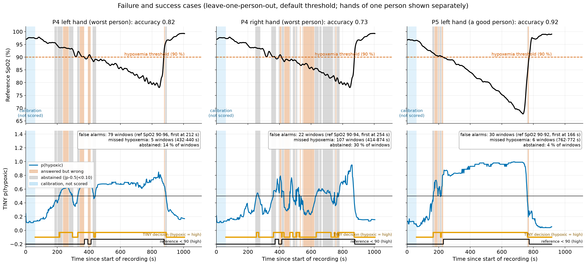
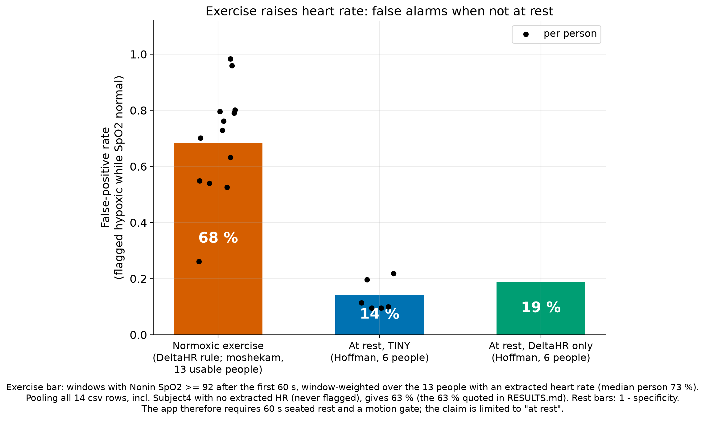
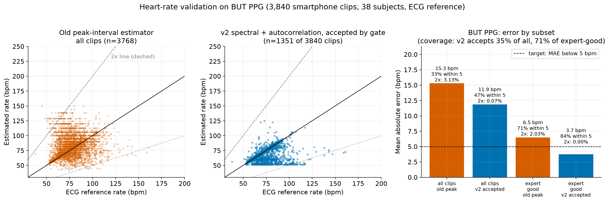

# OxyDrop

**Phone-camera check for a drop in blood oxygen from your own baseline. No extra hardware, no install, no data leaves the phone.**

**Live app:** https://aravhawk.github.io/oxydrop/ (open on a phone; "Watch a recorded demo" works with no camera)

> **This project is a prototype and is not medical advice.** It does not measure SpO₂, is not a medical device, and was validated on only 6 people. Never use it instead of a pulse oximeter or a clinician. It has **not been tested on a real phone camera yet** (see the [phone retest](docs/PHONE_RETEST.md), whose duration has not been measured).

Built for the Veritas AI International High School Hackathon 2026, Health track.

## The idea

Hold a fingertip over the rear camera and flash, rest for 60 seconds so the app learns **your** normal, then keep measuring. The first answer arrives at **70 seconds** (the 60 second calibration plus the first 10 second window), counted from the moment you tap start and not including the lens probe and setup before it. After that it shows one of three results every 2 seconds, with exactly these words:

| State | Text on screen | Meaning |
|---|---|---|
| Normal | **Normal vs your baseline** | Heart-rate, pulse-shape and light-absorption changes from your own first minute look like the normal group. It cannot tell whether you were already low during that first minute (**oxygen status at start unknown**) |
| Possible low oxygen | **Possible low oxygen: re-check with a pulse oximeter** | Looks like the low-oxygen group (SpO₂ < 90% in the study). Not a diagnosis |
| Unsure | **Unsure, re-measure** | Bad placement, motion, no stable pulse, a poor calibration, or the model is near 50/50. No number is shown |

The app never shows an SpO₂ value and never gives a confident answer from a signal it rejects.

**The design scenario (not evidence of efficacy, and not tested at altitude):** a hiker or skier resting in a lodge with no pulse oximeter, who wants to know "should I re-check with a real oximeter or go down?" Heart rate tends to rise in hypoxia, and the phone can see both heart rate and the colour of light through the fingertip. An earlier note here said we reproduced that heart-rate link on a 20-person altitude-chamber dataset (zero-shot AUROC 0.88). That run has no self-contained script in this repository, so it is not relied on; a better-documented zero-shot check on a larger dataset (OpenOximetry, below) is reported separately.

**Why a chain, not one big network (v1 and v2).** UW Hoffman 2022 is the only open phone-camera dataset with real SpO₂ below 90% that we found (6 people). We looked at a number of other candidate datasets and found them normoxic, gated, or without an optical signal, but this was not an exhaustive or dated search and there is no inventory in this repository, so "only 6 people anywhere" is not claimed. So the shipped model is a chain of small stages. The stages that carry the signal (heart rate extraction, heart-rate rise from baseline, light absorption) are built from physiology and validated on data-rich tasks. Only the last step, two logistic regressions with 62 numbers (the count includes the scaling statistics), is fit on the scarce hypoxemia data. That last step is not heart-rate only: the fusion regression takes 19 features, including four ratio-of-ratios features with nonzero coefficients (`ror_RG`, `ror_RB`, `ror_GB`, `ror30_RG`), slopes and DC absorption.


## Prior work: what is and is not new

**Phone-camera low-oxygen detection is not new.** [Hoffman et al., 2022](https://www.nature.com/articles/s41746-022-00665-y) already showed fingertip camera and flash screening for hypoxemia with induced desaturation and held-out testing (81% sensitivity and 79% specificity below 90% SpO₂, 5.00-point SpO₂ MAE; their protocol differs from ours, so these are not a head-to-head comparison). [MTHS (Samavati et al., 2022)](https://arxiv.org/abs/2204.08989) studied smartphone vital-sign estimation with 62 recordings. [Sun et al., 2021](https://pmc.ncbi.nlm.nih.gov/articles/PMC7984770/) and [Tian et al., 2022](https://doi.org/10.1109/JSTSP.2022.3152352) used red/green ratios, calibration and heart-rate-adaptive filtering for camera oximetry. Ratios, personal calibration and physiological filtering all predate this app.

**What this project adds:** a small personalised classifier with a causal JavaScript implementation that runs offline in the phone browser, browser capture and replay, a three-state output with abstention, and a confound audit (time-matched control). That is engineering and reproducibility work. It is not a new sensing principle, a first hypoxemia detector, or evidence of superiority over earlier work.

## What changed in v2 (versus the first model)

| Part | v1 (first version) | v2 (this version) |
|---|---|---|
| Heart rate | Peak-interval beat counter. A strong dicrotic notch (the second bump in each pulse) was counted as a second beat, so a person at about 75 bpm could read about 150 | Spectral harmonic-sum plus autocorrelation fundamental, accepted only if the two agree and the signal-quality gate passes. Otherwise no number is shown |
| Frame timing | Assumed 30 fps | True frame timestamps (`requestVideoFrameCallback`) and a resampler to a uniform 30 Hz. The resampler records how long each gap lasted: a single gap over 1 s inside the 10 s window, more than 3 s missing in the last 30 s, or 3 or more gap events in 10 s make the result "Unsure". A calibration minute containing a stall over 1.5 s is rejected. If no frame arrives for 1.5 s (screen lock, app switch, camera interruption, track ended) the screen switches to "Unsure, re-measure" with the heart-rate tile cleared, without waiting for the next window |
| Camera | Browser defaults | Rear camera, torch where supported, exposure, white-balance and focus lock where the browser allows it (taken after the fingertip placement has read "good" for 3 s, released if the placement is lost in setup, and retaken when Flash/Ambient is switched); lens selection (auto-switch away from ultra-wide and tele lenses) |
| Quality gate | Weak | Strict: finger-placement check, saturation (clipped red) check, frame rate and gap check, motion, calibration plausibility (51 to 110 bpm resting), and a lock requirement on every window |
| Output | Normal / hypoxic / unsure | Three states with fixed wording (above), plus reasons for "Unsure" |
| Optical SpO₂ (ratio-of-ratios) | Ratio features inside the fusion regression | A separate optical SpO₂ estimator was tried on MTHS and Hoffman and **did not help, so it is not shipped**. The ratio features are still **inputs to the fusion regression** (19 features, four ratio features with nonzero coefficients), in v1 and v2 alike (see below) |

`app/js/engine_v1.js` and `python/oxydrop/chain.py` keep the original chain so the comparison below can be rerun. The model (two logistic regressions, 62 numbers including the scaling statistics) has the same form; v2 refits it on windows where the pulse is locked.

### v1 vs v2 on Hoffman (leave-one-person-out, same windows, `scripts/eval_v2.py`)

Fixed-hyperparameter protocol (C = 0.01 and 0.1 as shipped; v2 hardcodes these values, `chain.py` describes them as the modal choice of an earlier nested search over the same six people, and the abstain band 0.10 has no independent provenance, so these rows are **not** free of tuning on the six test people), 5,644 windows from t = 60 s (`results/loPO_v*_windows.csv`; the parity test below covers 5,646 windows, 1 more each in 100002R and 100006R that has no row in the evaluation files). v1 here scores 87.5% instead of the 87.0% in the research table further down because that table uses nested hyperparameter selection. Source: `results/eval_v1_vs_v2.csv`.

| Model | Coverage | Accuracy on answered | Balanced acc. | Missed hypoxemia | False alarms | AUROC | Worst person |
|---|---|---|---|---|---|---|---|
| v1 (peak-interval HR), every window | 100% | 87.5% [CI 84.4, 90.5] | 87.3% | 11.3% | 14.1% | 0.948 | 0.812 |
| v2, every window forced to answer (a window without a pulse lock reuses the last valid features, forward-filled; only a recording with no baseline at all gets zero baseline-relative features) | 100% | 80.5% [CI 66.2, 89.9] | 80.6% | 19.9% | 18.9% | 0.869 | 0.489 |
| v2, lock-gated (no lock = no answer) | 82.4% | 87.0% | 85.4% | 5.8% | 23.3% | 0.956 | 0.798 |
| v1 + abstain band 0.10 | 84.4% | 93.9% | 93.7% | 4.8% | 7.8% | 0.964 | 0.894 |
| **v2, lock-gated + abstain band 0.10 (what the app does)** | **68.0%** | **94.7%** | **93.8%** | **2.4%** | **10.1%** | **0.971** | **0.892** |

Baselines for reference: the time-only clock scores 83.5% raw but 51.9% time-matched in the research table below, so a model that only knows elapsed time is not a free 87%. Always answering "low oxygen" (the majority class) scores **57.48%** on these 5,644 windows. Time-matched accuracy for these two protocol rows: v1 0.796, v2 forced 0.771 (not computed for abstaining rows). These rows are **engine-only** results: they leave out the camera, placement, motion and calibration-plausibility gates the live app also applies. The numbers come from `scripts/review_checks.py` and `scripts/eval_v2.py` (`results/review_checks.csv`, `results/eval_v1_vs_v2.csv`).

Read this table carefully:
- **v2 does not improve accuracy on Hoffman.** On these clean, resting, locked-camera recordings v1's heart rate was already good (1.2 bpm error). v2 matches v1 on the windows it answers (87.0% vs 87.5%) and answers fewer of them (68% with the abstain band, against 84% for v1).
- **The "worst person 0.892" is among people who get answers.** Person 4 (resting heart rate 43 bpm) is below the 51 bpm floor of the heart-rate estimator, so v2 never locks and he gets "Unsure, re-measure" on every window: **0 answers in 947 windows**, and the worst-person figure excludes him. That is the honest failure for an unsupported pulse, not an accuracy. Forced to answer, v2 is worse than v1 (80.5%, worst person 0.489).
- The gain of v2 is not Hoffman accuracy. It is that doubled or invented heart rates are withheld (BUT PPG and field-case results below). Like for like, the v1 + abstain row (93.9% on 84.4% of windows) sits beside the shipped row (94.7% on 68.0%): the extra 0.8 points cost 16 points of coverage. On the **same 3,836 windows v2 answers**, v1 scores **94.60%** against v2's **94.68%**, so the selective gain is mostly selection (which windows get answered), not better classification.
- **Abstention is not detection.** Of 3,244 hypoxic windows, 857 are unanswered, so only **71.79%** of all hypoxic windows receive a "possible low oxygen" alert. The 2.4% missed-hypoxemia figure is conditional on answering. Abstaining is not a false "normal", but it is not a successful detection either.
- The labels average working oximeters and include **240 evaluation windows with a reference below 70%**, unlike the original paper, which excluded the lower range.
- Without a pulse lock the shipped model answers nothing, so its "possible low oxygen" output rests on heart-rate rise, which has a 63.4% exercise false-alarm rate (rest required).
- The abstain band 0.10 was meant to be fixed in advance, as in the research table, but its advance selection has no independent provenance. The nested-cutoff version of that protocol has not been rerun for v2. Matched-coverage curves, an HR-only rule at matched coverage and a reproduced Hoffman-paper baseline under identical labels, calibration and abstention are still missing; the ML evaluation (`python/oxydrop_ml/PREREGISTRATION.md`) is meant to supply them.

## Results (honest version)

The numbers in this section are for the **original (v1) chain** under the full research protocol (nested hyperparameter selection, time-matched control, bootstrap intervals). The v2 comparison is in the previous section. **They were re-derived from the saved out-of-fold score arrays (`scripts/make_eval.py`), which checks the arithmetic but not the nested training procedure itself.** About 10 chain variants were compared on the same 6 people, so there is some test-set reuse even though every split is by person.

UW Hoffman 2022, 6 people, 12 hands, **leave-one-person-out** (both hands of a person held out together; scaling fitted on the training people; hyperparameters chosen in an inner leave-one-person-out loop, with the caveats below). 5,644 evaluation windows (10 s windows, 2 s step, first 60 s used only as the person's own calibration). Label = window-mean reference SpO₂ < 90 (base rate 57.5%).

| Model | Accuracy [95% CI, person bootstrap] | Missed hypoxemia (FN rate) | False alarms (FP rate) | AUROC | Time-matched acc. | Worst person |
|---|---|---|---|---|---|---|
| Time-only baseline (elapsed seconds; not deployable) | 0.835 [0.70, 0.93] | 13.6% | 20.3% | 0.819 | **0.519** | 0.54 |
| Heart-rate rise only (1 feature) | 0.751 [0.60, 0.88] | 29.4% | 18.8% | 0.855 | 0.792 | 0.51 |
| **TINY chain, answers every window** | **0.870 [0.83, 0.91]** | **12.1%** | **14.2%** | 0.942 | **0.795** | 0.78 |
| **TINY chain, allowed to say "unsure"** (band \|p−0.5\| < 0.10) | **0.925** at **85.1%** coverage | **6.6%** | **8.7%** | 0.959 | 0.852 | 0.83 |
| ~~TINY, abstain cutoff chosen by nested CV (target 0.90)~~ **UNSUPPORTED here**: the constants are copied from an external experiment by `make_eval.py`, which does not rerun the nested cutoff selection | 0.903 at 86.7% coverage | 9.2% | 10.4% | 0.956 | 0.816 | 0.80 |

*Time-matched (TM) accuracy:* a random subset in which every 100 s of elapsed time has equal numbers of hypoxic and normal windows, so a clock scores about 50%. This matters because the Hoffman protocol lowers oxygen steadily, so time alone predicts the label. TINY keeps ~0.80 under this control; the clock drops to 0.52.

**Read these caveats next to the table:**
- The **+3.5-point** gain over the clock on raw accuracy (+3.47 on the saved scores) has a **paired** person-bootstrap CI of **[−6.8, +16.7]** points (500 draws, seed 1, `scripts/review_checks.py`). Six people cannot resolve it. The solid claims are the clock-free numbers (TM ≈ 0.80) and the abstention result.
- **The clock beats TINY on 3 of 6 individual people** (persons 1, 2 and 4; see `results/TABLES.md`). TINY wins pooled and on persons 3, 5 and 6.
- 90% at full coverage is **not** reached. 90% on answered windows is reached only by allowing "unsure". The band 0.10 row has no independent provenance for its advance selection, and the nested row could not be reproduced here. Comparing many variants on the same 6 people is test-set reuse even with correct person splits, so treat small differences between variants as ties.
- Missed hypoxemia is still 7–12%. A "normal" answer must never be taken as reassurance.

| ROC | Coverage vs accuracy | Per person |
|---|---|---|
|  |  |  |

### Failure case (v1 chain)
Person 4 (a 20-year-old man with a resting heart rate of 43 bpm, the worst person at 77.5% accuracy). On his right hand the chain misses hypoxemia for 107 windows (414–874 s) and abstains on 30% of windows; on his left hand it raises 79 false alarms spanning 212 to 888 s (13 of them after 400 s) while the reference is 90–96%. We have not established why. Possible factors (hypotheses, not tested): his very low resting heart rate (43 bpm) makes the heart-rate-rise feature unstable, and one person's physiology can differ from the other five.



In v2 this person is handled differently: his 43 bpm resting rate is below the 51 bpm floor, the pulse never locks, and the app answers "Unsure, re-measure" for every window instead of a wrong answer. That is a withheld answer, not a fix.

### Subgroups (age, sex, skin tone)
The 6 participants are adults aged 20 to 34, 3 women and 3 men, 1 Black participant (person 2: accuracy 0.886, sensitivity 0.874, specificity 0.900) and 5 White participants. Per-person accuracy ranges from 0.78 to 0.92. With one participant per skin tone group, **no subgroup or fairness claim can be made**, and the model has never been tested on children, older adults or dark-skinned people beyond that single person. Details: `results/SUBGROUPS.md`.

### The biggest known failure: exercise
Heart-rate rise is not oxygen-specific. On normoxic people exercising (moshekam dataset, 14 subjects) the same rule flags **63.4% of exercise windows as hypoxic** (68.4% over the 13 people with an extractable heart rate; the 63.4% pools all 14 subjects and counts the one with no usable heart rate as never flagged, which lowers the headline). The raw exercise extraction and this rule's equivalence to the shipped classifier are not reproducible from this repository; the figures are saved-summary arithmetic (`results/scores/exercise_fp.csv`, `scripts/review_checks.py`). This is why the app demands seated rest, uses the phone's motion sensor to pause readings, and rejects a calibration with an unrealistic resting heart rate.



## Leakage and confound audit
1. **Own bug found and fixed:** leading NaN heart-rate windows had been filled with the whole-recording median, leaking future hypoxic heart rate into the baseline. Fixed to causal forward fill then calibration median. The current causal filling is inspectable in the code; the old-to-new accuracy change is not reproduced by any script in this repository, so no before/after number is quoted. All numbers here are post-fix.
2. No elapsed-time feature. Everything in the scored feature path is causal (trailing windows, single-pass `sosfilt`, never `filtfilt`). Calibration = label-free median over the person's first 60 s (personalisation, not person leakage). The scaler is fitted on the training people only; the regularisation strength of the v1 research chain was chosen in an inner leave-one-person-out loop, while v2 hardcodes it (see above). Both hands of a person are held out together.
3. **Time-matched control** (above). An earlier **label-swap control** (training on another person's label trajectory at the same elapsed time) is not reproduced by the shipped audit scripts, so its numbers are not quoted.
4. **Positive controls** (adding elapsed time, whole-recording z-scoring, a window-level random split, `filtfilt`) were run in earlier experiments to check that the evaluation catches leaks. Those runs are prose in earlier notes, not reproduced by the shipped audit scripts, so their numbers are not quoted and they are not evidence for this repository.
5. An earlier perfect-heart-rate oracle experiment (no number quoted: not reproduced here) suggested the heart-rate stage is not the ceiling; this is unverified.
6. Not headlined: an earlier pooled many-person accuracy, because most of those people are normoxic and trivially correct (not reproduced here, no number quoted).
7. The shipped weights are fit on all 6 people, so **in-sample numbers are never reported**. The in-app replay uses weights fit **without** the replayed person. Production weights and both person-excluded replay weight sets match independent refits.
8. **v2 additions.** The heart-rate gate (`F_LO`, `SQI_MIN`, `ACF_MIN`, `AGREE`) was chosen by **subject-level cross-fit** on BUT PPG: select on even-numbered subjects, score odd, then swap. An earlier sweep that picked the gate on all clips and reported the same clips was deleted. The expert quality label only sets a coverage floor and splits the report; the app never sees it. BUT PPG and MTHS are **never used to fit the shipped weights**. The optics decision rule was written before the MTHS run. MTHS AUROC values are not quoted: leave-one-person-out has a mechanical anti-correlation that the fold-mean correction does not remove (the MAE comparison is unaffected). In the v1 vs v2 table the abstain band was fixed in advance. Of the lock gate, `F_LO`, `SQI_MIN`, `ACF_MIN` and `AGREE` come from the BUT PPG cross-fit; the two further constants in the engine's validity rule, `BEAT_AGREE` = 0.12 and `SAT_MAX` = 0.10, are fixed heuristics that no result file selects or evaluates.
9. **Still weak.** Several chain variants (roughly 10) and optics variants (16) were compared on the same 6 Hoffman people (no dated inventory exists, so the counts are approximate), `F_LO` was chosen with BUT's rate distribution (which has few slow pulses), and the BUT folds split by subject number parity, not at random. The cross-fit is a held-out check of the gate, but the final fixed gate uses the acceptance of both halves, so the pooled cross-fit score is not an untouched test of that final gate. `BEAT_AGREE` and `SAT_MAX` stay heuristics. Treat small differences as ties.
Full audit: `results/RESULTS_full_audit.md`.

## What was validated on abundant data (and what was not)

| Stage | Evidence (details in `docs/HR_VALIDATION.md` and `docs/SPO2_OPTICS.md`) |
|---|---|
| Heart-rate extraction (v2) | **BUT PPG** (CC BY 4.0, 3,840 smartphone clips, 38 subjects, ECG reference), gate chosen by subject-level cross-fit. Gate-accepted clips (the fixed gate accepts 1,351 clips, 35% of all): **MAE 11.86 bpm, 47.15% within 5 bpm, doubling 0.074%, halving 4.5%**. Expert-good clips accepted (71% of the good clips): **MAE 3.7 bpm, 84.5% within 5 bpm**. The old peak counter on all clips: MAE 15.3 bpm, 33% within 5 bpm, **doubling 3.1%, halving 1.1%**. Like for like (all clips), v2 without the gate doubles 0.4% and halves 6.0%: doubling is traded for halving. **The target (MAE below 5 bpm) is met only on clean, accepted clips, not overall.** |
| Heart rate on Hoffman and MTHS (oximeter pulse as reference) | Hoffman: old peak 1.2 bpm, v2 accepted 1.8 bpm (83% coverage). MTHS (62 people): old peak 11.2 bpm, v2 accepted 6.2 bpm, 72% within 5 bpm. These use the **10-second** validation configuration (`scripts/validate_hr.py`); the engine estimates heart rate over **30 seconds**, so they are not exact shipped-engine errors |
| Doubling in the field case | Simulated fingertip pulses with a strong dicrotic notch (52 to 75 bpm): old counter doubled 90% of cases (28.8% for ordinary resting 55 to 100 bpm); v2 0%. At 110 to 160 bpm the old counter was not doubled either. An earlier explanation (the second harmonic lies above the 4 Hz band-pass) is imprecise: at 110 bpm the second harmonic is 3.67 Hz, still inside the filter, so the cause is not established. These are code-path checks on generated signals, not physiology |
| Optical ratio-of-ratios (red/green/blue) | **Negative.** MTHS (62 people, phone video, oximeter SpO₂, person-level leave-one-person-out): no model beats the training-mean baseline (MAE 2.22 for ridge on optics + HR against 2.21 for the mean; textbook 110 - 25R gives 3.49). On Hoffman, no optics variant beats TINY v2 in nested leave-one-person-out (computed from `results/optics_experiment/decision_rule.csv`; the raw-data rerun needs external code, `pivot/kit.py`, that is not in this repository). **So a separate optical SpO₂ estimator is not shipped. The ratio features are nevertheless inputs of the fusion regression** (19 features, four ratio features with nonzero coefficients). MTHS is normoxic (47 of 4,646 labelled seconds, 1.0%, below 90), so it cannot test hypoxemia. OpenOximetry (PhysioNet credentialed desaturation and skin-tone dataset) is now **used** for validation, fairness and later pretraining, as derived aggregates only, never redistributed (see `DATA_LICENSES.md`; aggregates are on the `openox-results` branch and are not merged into this table yet) |
| Heart-rate rise → hypoxia | An earlier 20-person altitude-chamber check (zero-shot AUROC 0.88) has **no self-contained script in this repository and is UNSUPPORTED here**. The OpenOximetry zero-shot check on the `openox-results` branch is the better-documented replacement |
| Red-channel absorbance | Beer-Lambert reasoning only. The earlier per-person absorbance correlations (ρ +0.62 to +0.96) are **UNSUPPORTED** (no rerun supplied) and would not show oxygen-specific sensing anyway, since they are partly drift and time confounded |
| Tried and dropped (no gain) | Quality-gated abstention, synthetic desaturation, pooling BUT/MTHS people, deep nets, red/IR ring transfer, smoothing, optical ratio features |

BUT PPG and MTHS **validated and informed the design; they never train the shipped 62 weights.** The only data that fit them is Hoffman.

### Heart rate on BUT PPG (v2 gate, `results/hr_validation/HR_SUMMARY.csv`)

| Subset | Estimator | Clips | Coverage | MAE (bpm) | Within 5 bpm | Doubling | Halving |
|---|---|---|---|---|---|---|---|
| All clips | old peak interval | 3,840 | 98.1% | 15.30 | 33.1% | 3.1% | 1.1% |
| All clips | v2, no gate | 3,840 | 100% | 16.56 | 30.6% | 0.4% | 6.0% |
| All clips | v2, accepted by gate | 3,840 | 35.2% | 11.86 | 47.15% | 0.074% | 4.5% |
| Expert-good | old peak interval | 795 | 99.0% | 6.49 | 71.2% | 2.0% | 0.1% |
| Expert-good | v2, accepted by gate | 795 | 70.6% | 3.74 | 84.5% | 0.0% | 0.9% |
| Finger at rest, good | v2, accepted by gate | 443 | 76.7% | 3.27 | 85.6% | 0.0% | 0.0% |
| Ear, good | v2, accepted by gate | 207 | 64.3% | 6.00 | 78.9% | 0.0% | 3.8% |

Held-out gate result (each clip scored with a gate chosen on the other half of the subjects; this describes the cross-fit estimators, a different set from the final fixed gate above, so do not mix their denominators): 1,359 of 3,840 clips accepted, MAE 11.89 bpm, 47.0% within 5 bpm, doubling 0.07%, halving 4.5%; expert-good 70.6% coverage, MAE 3.74 bpm, 84.5% within 5 bpm. Without the gate v2 is **not** better than the old counter on all clips (16.6 vs 15.3 bpm). The gain is that wrong answers are withheld, at the cost of coverage (35%). Quote the 0.07% doubling only together with that 35%. 40% of accepted clips are still more than 10 bpm off (mostly expert-bad clips that pass the gate), so a better signal-quality index is an open problem.



### Optical SpO₂ attempt (MTHS, `results/mths_spo2/`)

Per-frame red/green/blue AC/DC ratio-of-ratios, quality gate, per-person calibration from the first 30 s, ridge and small gradient-boosted corrections, person-level leave-one-person-out, intervals by person bootstrap. On the strict gate only 22 of 62 people could be calibrated (the red channel was clipped in 65.6% of windows with the phone's automatic exposure), 220 windows from 20 people. Results: training-mean 2.21 [1.66, 2.68], ridge optics + HR 2.22, gradient boosting 2.27, textbook 3.49 [2.51, 4.63], time-only 2.36 (MAE in SpO₂ points). The textbook formula 110 − 25R and these results are implementation checks, not a universal camera calibration. Predicting the change from the person's own start was worse than saying "no change" (0.87 vs 0.77). Decision rule (fixed before the run, applied to Hoffman, `results/optics_experiment/decision_rule.csv`): none of 16 optics variants beat TINY v2 on accuracy and time-matched accuracy with a bootstrap lower bound above 0, so a separate optical estimator is not shipped. This is arithmetic on the CSV; it is not an independent raw-data rerun.

## Model-agnostic camera flow

The app never assumes a phone layout. Flash position, lens count and lens size differ a lot between models (on iPhone 17 Pro and 18 Pro class phones the flash sits about 2-3 cm from the main lens, some phones put the flash between large lenses, some lenses are too big for one fingertip to seal). So the app decides from the signal:

1. **Lens probe.** After camera permission it lists every back camera and tests each one for about 3 seconds with the torch on (up to 4 lenses, about 15 s). Each lens gets a score from 0 to 100 from the pulsatile AC/DC amplitude, the spectral peak SNR and the periodicity of the band-passed signal, with a penalty for saturation (`app/js/lensprobe.js`). The best lens is selected and shown by name. The lens menu stays available as an override.
2. **Generic placement guide.** Lay the fingertip flat across the whole camera plateau so it covers the picked lens and, if possible, the flash, with light pressure. A live ring shows the picked camera's brightness and redness (green border when it looks covered).
3. **Adaptive exposure.** After a steady placement the app steps exposure compensation, brightness, ISO or exposure time (whatever the browser exposes) toward a mid-range image with little saturation, then locks. Needed because a far-away flash gives a weaker, more diffuse signal.
4. **Live signal-quality meter.** AC/DC, spectral SNR and periodicity over the last 8 s. If it stays poor for 4 s while the pulse lock also fails, the app shows "Weak signal: slide your finger so it covers the lens and the flash, press lightly" and answers "Unsure, re-measure" with no heart rate, instead of a reading. The Chain and the three-state thresholds are unchanged.
5. **Fallback modes.** If the torch cannot be used, the ladder tries ambient light, then the front camera. If the torch works but every back lens scores below 35, it picks the **front camera with a full-white screen** first (front camera geometry is the same on all phones; the screen is the light source). Turn the screen brightness up; the app requests a screen wake lock. Modes can also be chosen by hand.
6. **Debug view.** Per-lens probe scores, the mode chosen and why, exposure adaptation and live quality are listed in the debug view and the copied debug summary, so each phone's pick can be reviewed. If a requested camera id is rejected (`NotFoundError` or `OverconstrainedError`, "Requested device not found"), the camera is reopened by facing mode and the reason is shown in the debug view and the probe table.
7. **Calibration gates (live).** The 60 second baseline is only taken after exposure, white balance and focus have been settled (the app waits for the lock before the minute starts). If the fingertip comes off the lens or flash for more than 2 seconds during the minute, or the camera settings change, the minute is voided and restarted once the finger is back. A calibration in which the fingertip covered the lens and flash for less than 90% of the minute is rejected. The engine itself still builds its baseline from every window with a valid pulse (it cannot see placement), so these gates live in the app, and the offline results above do not include them.

The probe logic is tested in Node (`npm run test:lens`) with a mocked `MediaDevices` and synthetic frames. That is a simulation of the selection logic only.

The probe score thresholds (pulse score 35 to use a lens, 55 for a "good" live reading, and the autocorrelation and spectral-quality floors in `lensprobe.js`) were tuned on synthetic traces only. They have not been validated on recorded or live fingertip data and may need retuning on real phones. Saturation is measured on the frames after the 0.5 s settle window, so the first frames while auto-exposure converges do not count. Leaving the setup page or tapping Stop cancels the probe, releases the torch and removes the white screen.

## Untested phones and browsers

**This has not been tested on any real phone.** The lens probe, adaptive exposure, quality meter and fallback modes are only exercised by `tests/lensprobe.mjs` (mocked `navigator.mediaDevices`, synthetic frame data, including a simulated weak diffuse signal for a far flash) and the fake-video browser test in `tests/e2e`. A single headless Chromium smoke run of the new setup flow against its fake device also ran without script errors. The following are untested:

| Device or browser | Status |
|---|---|
| iPhone 17 Pro / 18 Pro (flash 2-3 cm from the main lens) | Untested. The far-flash diffuse-signal case is simulated only |
| Other iPhones (Safari cannot control the torch, so ambient or front-camera mode is expected) | Untested |
| Google Pixel | Untested |
| Samsung Galaxy | Untested |
| Other Android phones (Chrome) | Untested |
| Firefox, Edge, desktop webcams | Untested |

Real-phone results are collected with `docs/PHONE_RETEST.md`. The live flow (lens probe, camera start, setup screen) is covered by an integration test, `tests/flow.mjs`, that drives the real `app/js/app.js` against a fake camera; it exists because an earlier build never showed the setup screen after the probe (a camera-generation guard bug, fixed) and the unit tests did not see it.

## Limitations
- 6 test people, one phone (Nexus 6P), fingertip only, one-way desaturation protocol, controlled FiO₂. Wide confidence intervals.
- **Not tested on a real phone.** v2's capture path (frame timestamps, exposure and white-balance lock, torch, placement check, motion sensor) was checked only against a synthetic fake camera in headless Chromium and a simulator. The decision thresholds for frame gaps, stalls and finger placement are untuned heuristics. The finger check is a colour test (red at least 50 and at least 1.4 times green and blue, little saturation, even image), so a warm lit surface can read "Fingertip detected"; the pulse lock is what then refuses it. A pulsatile-amplitude test would be a better finger check, but its threshold needs real-phone data and was not guessed. The exposure lock timing and the stall watchdog have only been exercised in headless Chromium with a fake camera (stalls are injected by withholding frames). Run the [phone retest](docs/PHONE_RETEST.md) and send back the trace.
- **Heart-rate floor of 51 bpm.** A resting rate below that cannot lock, so the app says "Unsure, re-measure" and gives no answer. Hoffman person 4 (43 bpm) is always "Unsure".
- **The HR target (MAE below 5 bpm) is met only on clean accepted clips** (3.7 bpm on expert-good BUT clips). Over all accepted clips it is 11.9 bpm, and the gate accepts only 35% of BUT clips.
- **A separate optical SpO₂ estimator is not implemented.** The fusion regression is not heart-rate only (19 features, including four ratio features with nonzero coefficients, slopes and DC absorption), but a ratio-of-ratios test on MTHS (normoxic) and Hoffman gave no gain over it. Skin-tone evidence comes only from the OpenOximetry aggregates (contact oximeters, not phone video) and the single dark-skinned Hoffman participant.
- Works at rest only. Detects a **drop from your own first minute**; it cannot detect low oxygen already present during that minute (**oxygen status at start unknown**), for example after starting at altitude, during an illness, or after restarting the app. The app says so on screen. An independently established baseline would be needed for an oxygen interpretation.
- Exercise, anxiety, caffeine, beta-blockers and arrhythmia break heart-rate rise.
- **Browser phones differ from the study phone.** Hoffman used locked camera settings. The app asks the browser to lock exposure and white balance, but support varies (best on Android Chrome). **iPhone Safari does not expose flash control**, so the live path there is best-effort and unvalidated; the recorded demo works everywhere. We have not validated any phone other than the Nexus 6P.
- Face video is not supported (no open face dataset with real desaturation exists).
- Reference oximeters in the study disagree by up to ~6 points at the low end.

## Repository layout
```
app/        the web app (static PWA, no build step): index.html, js/engine.js (v2 model), js/hr.js (robust HR), js/resample.js,
            js/camera.js, js/decision.js (3-state output), js/app.js, js/engine_v1.js (original chain, kept for comparison)
python/     reference implementation (oxydrop/ package: hr.py, features_v2.py, chain_v2.py, chain.py = v1), refit + export scripts
tests/      parity (JS vs Python), hr_parity, capture_sim, decision, stall, lensprobe, flow (probe -> start -> setup integration), e2e fake-camera test
results/    tables, eval_v1_vs_v2.csv, hr_validation/, mths_spo2/, optics_experiment/, out-of-fold scores, full audit
docs/       figures, HR_VALIDATION.md, SPO2_OPTICS.md, PHONE_RETEST.md, WRITEUP.md, REVIEW_RESPONSE.md (how each item of the independent review was handled)
scripts/    reproduce.sh, eval_v2.py, validate_hr.py, hr_crossfit.py, mths_spo2.py, optics_*.py, make_eval.py, make_v2_figs.py, review_checks.py
```

## Run it
```bash
npm run serve            # http://localhost:8080 (camera needs HTTPS or localhost)
npm test                 # decision logic, JS-vs-Python parity (v2 and v1, 2 bundled recordings), HR parity, capture simulation, stall, lens probe, live-flow integration
npm run test:e2e         # fake-camera browser test (needs Chromium and playwright-core, see tests/e2e/README.md)
scripts/reproduce.sh /path/to/oximetry-phone-cam-data   # figures + tables + refit + parity on all 12 recordings
```
Datasets are not in the repo. `scripts/reproduce.sh` with no argument runs the figure and bundled-fixture checks. With the optional dataset environment variables (`OXY_BUT`, `OXY_MTHS`, see the script header) it also reruns the v2 evaluation, the BUT PPG heart-rate validation and cross-fit, and the MTHS optics experiment. `scripts/optics_experiment.py`, `optics_feats.py` and `optics_decision.py` still contain host-specific scratch paths that need editing on another machine.

**Parity result:** the JavaScript v2 engine reproduces the Python reference on all 12 Hoffman recordings, 5,646 windows: max |Δp| = 2.09×10⁻¹³, 0 decision mismatches (v1: 3.18×10⁻¹³). This is implementation agreement, not held-out accuracy. The JavaScript heart-rate estimator matches the Python one to a maximum relative difference of 6.94×10⁻¹⁵ over 417 calls (240 BUT windows plus edge cases). `npm test` also runs a capture-path simulation of 138 trials (jittered timestamps, 24/30/60 fps, dropped frames, exposure step; this includes a 48-trial resting subset) and `tests/stall.mjs` (16 checks: resampler gap-duration accounting, a 0 / 0.5 / 3 / 6 s stall through the shipped engine and decision rule, staleness and gating boundaries). An end-to-end browser test with a synthetic 72 bpm fingertip video (`tests/e2e/`) passes: calibration completes, the app reads 72 bpm and "Normal vs your baseline", a grey frame is refused by the placement check, and the replay of person 4 shows only "Unsure". Two further e2e cases (`CASES=stall,calstall`) freeze the camera frames: a 4 s stall after calibration must show "Unsure, re-measure" with the heart-rate tile cleared within 2.6 s and recover to "Normal" afterwards, and a 3 s stall inside calibration must reject the calibration. None of this validates real fingertips or real phones.

## Deploy
The site is the `app/` folder served from the `gh-pages` branch (`scripts/deploy_pages.sh`). Any static host works (Cloudflare Pages / Netlify / Vercel: set the output directory to `app`). HTTPS is required for the camera.

## Credits
Data: UW Ubicomp Lab (Hoffman et al., 2022), BUT PPG, OpenOximetry (PhysioNet, credentialed; aggregates only), altitude-chamber pilot, moshekam, MTHS, HealthRing (see `DATA_LICENSES.md`). Code: numpy, scipy, scikit-learn, matplotlib; Node for the parity test. AI tools: Claude (Anthropic) assisted with code, analysis and writing; the team reviewed and can explain every component. Code is MIT.
