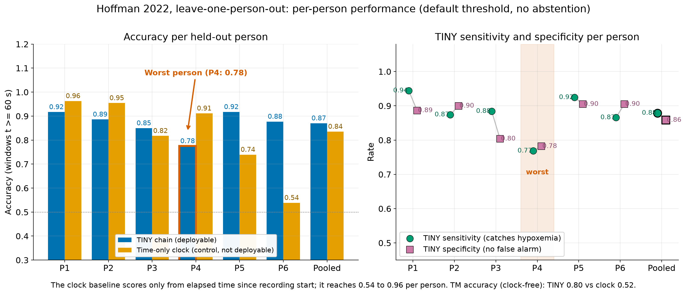

# OxyDrop

**Phone-camera check for a drop in blood oxygen from your own baseline. No extra hardware, no install, no data leaves the phone.**

**Live app:** https://aravhawk.github.io/oxydrop/ (open on a phone; "Watch a recorded demo" works with no camera)

> **This project is a prototype and is not medical advice.** It does not measure SpO₂, is not a medical device, and was validated on only 6 people. Never use it instead of a pulse oximeter or a clinician.

Built for the Veritas AI International High School Hackathon 2026, Health track.

## The idea

Hold a fingertip over the rear camera and flash, rest for 60 seconds so the app learns **your** normal, then keep measuring. Every 2 seconds it answers **normal**, **possible low-oxygen episode (SpO₂ < 90%)**, or **unsure, re-measure**.

**Who it is for (a design persona, not a claim of clinical use):** a hiker or skier resting in a lodge at 3,000 m with no pulse oximeter, who wants to know "should I re-check with a real oximeter or go down?" Heart rate rises in hypoxia (we reproduce that link on a separate 20-person altitude-chamber dataset), and the phone can see both heart rate and the colour of light through the fingertip.

**Why a chain, not one big network.** Only 6 people with phone-camera video and real SpO₂ below 90% exist in open data (UW Hoffman 2022). We checked 32 candidate datasets; the rest are normoxic, gated, or have no optical signal. So the model is a chain of small stages. The stages that carry the signal (heart rate extraction, heart-rate rise from baseline, light absorption) are built from physiology and validated on data-rich tasks. Only the last step, two logistic regressions with 62 numbers, is fit on the scarce hypoxemia data.


## Results (honest version)

UW Hoffman 2022, 6 people, 12 hands, **leave-one-person-out** (both hands of a person held out together; every hyperparameter chosen on the other 5 people). 5,644 evaluation windows (10 s windows, 2 s step, first 60 s used only as the person's own calibration). Label = window-mean reference SpO₂ < 90 (base rate 57.5%).

| Model | Accuracy [95% CI, person bootstrap] | Missed hypoxemia (FN rate) | False alarms (FP rate) | AUROC | Time-matched acc. | Worst person |
|---|---|---|---|---|---|---|
| Time-only baseline (elapsed seconds; not deployable) | 0.835 [0.70, 0.93] | 13.6% | 20.3% | 0.819 | **0.519** | 0.54 |
| Heart-rate rise only (1 feature) | 0.751 [0.60, 0.88] | 29.4% | 18.8% | 0.855 | 0.792 | 0.51 |
| **TINY chain, answers every window** | **0.870 [0.83, 0.91]** | **12.1%** | **14.2%** | 0.942 | **0.795** | 0.78 |
| **TINY chain, allowed to say "unsure"** (band \|p−0.5\| < 0.10) | **0.925** at **85.1%** coverage | **6.6%** | **8.7%** | 0.959 | 0.852 | 0.83 |
| TINY, abstain cutoff chosen by nested CV (target 0.90) | 0.903 at 86.7% coverage | 9.2% | 10.4% | 0.956 | 0.816 | 0.80 |

*Time-matched (TM) accuracy:* a random subset in which every 100 s of elapsed time has equal numbers of hypoxic and normal windows, so a clock scores about 50%. This matters because the Hoffman protocol lowers oxygen steadily, so time alone predicts the label. TINY keeps ~0.80 under this control; the clock drops to 0.52.

**Read these caveats next to the table:**
- The 3.7-point gain over the clock on raw accuracy has a person-bootstrap CI of [−7, +16] points. Six people cannot resolve it. The solid claims are the clock-free numbers (TM ≈ 0.80) and the abstention result.
- **The clock beats TINY on 3 of 6 individual people** (persons 1, 2 and 4; see `results/TABLES.md`). TINY wins pooled and on persons 3, 5 and 6.
- 90% at full coverage is **not** reached. 90% on answered windows is reached only by allowing "unsure". The band 0.10 row is a fixed a-priori choice; the nested row is the protocol-clean version. About 10 model variants were compared on the same 6 people, so treat small differences (such as TINY vs a CNN ensemble, +1.4 points) as ties.
- Missed hypoxemia is still 7–12%. A "normal" answer must never be taken as reassurance.

| ROC | Coverage vs accuracy | Per person |
|---|---|---|
|  |  |  |

### Failure case
Person 4 (a 20-year-old man with a resting heart rate of 43 bpm, the worst person at 77.5% accuracy). On his right hand the chain misses hypoxemia for 107 windows (414–874 s) and abstains on 30% of windows; on his left hand it raises 79 false alarms between 212 s and 400 s while the reference is 90–96%. We have not established why. Possible factors (hypotheses, not tested): his very low resting heart rate (43 bpm) makes the heart-rate-rise feature unstable, and one person's physiology can differ from the other five.


### Subgroups (age, sex, skin tone)
The 6 participants are adults aged 20 to 34, 3 women and 3 men, 1 Black participant (person 2: accuracy 0.886, sensitivity 0.874, specificity 0.900) and 5 White participants. Per-person accuracy ranges from 0.78 to 0.92. With one participant per skin tone group, **no subgroup or fairness claim can be made**, and the model has never been tested on children, older adults or dark-skinned people beyond that single person. Details: `results/SUBGROUPS.md`.

### The biggest known failure: exercise
Heart-rate rise is not oxygen-specific. On normoxic people exercising (moshekam dataset, 13 usable people) the same rule flags **63% of exercise windows as hypoxic** (68% over the 13 people with an extractable heart rate; 63% pools all 14 subjects, one of whom had no usable heart rate). This is why the app demands seated rest, uses the phone's motion sensor to pause readings, and rejects a calibration with an unrealistic resting heart rate.


## Leakage and confound audit
1. **Own bug found and fixed:** leading NaN heart-rate windows had been filled with the whole-recording median, leaking future hypoxic heart rate into the baseline. Fixed to causal forward fill then calibration median (ΔHR-only: 0.772 → 0.751). All numbers are post-fix.
2. No elapsed-time feature. Everything is causal (trailing windows, single-pass `sosfilt`, never `filtfilt`). Calibration = label-free median over the person's first 60 s. Scaler and regularisation chosen in an inner leave-one-person-out loop. Both hands of a person are held out together.
3. **Time-matched control** (above) and a **label-swap control** (train on another person's label trajectory at the same elapsed time: still 0.74–0.83 accuracy, which mostly shows robustness to noisy labels for low-capacity models, not that the signal is the clock).
4. **Positive controls proving the evaluation catches leaks** (none in the reported rows): adding elapsed time → 0.854, whole-recording z-score → 0.890, window-level random split → 0.972 (TM 0.939), `filtfilt` → +2 points.
5. A perfect-heart-rate oracle only lifts TINY to 0.879, so the heart-rate stage is not the ceiling; the data is.
6. Not headlined: a pooled 105-person 0.911 accuracy, because 99 of those people are normoxic and trivially correct.
7. The shipped weights are fit on all 6 people, so **in-sample numbers are never reported**. The in-app replay uses weights fit **without** the replayed person.
Full audit: `results/RESULTS_full_audit.md`.

## What was validated on abundant data (and what was not)
| Stage | Evidence |
|---|---|
| Heart-rate extraction | BUT PPG (CC BY 4.0), ECG reference: finger at rest MAE 11.1 bpm (median 6.7), expert-good clips 4.5 bpm; on Hoffman (locked camera settings) 1.2 bpm vs the reference oximeter, 99% within 5 bpm |
| Heart-rate rise → hypoxia | Reproduced on a separate 20-person altitude-chamber set (no optical signal): zero-shot AUROC 0.88 on Hoffman windows (threshold does not transfer) |
| Red-channel absorbance | Beer-Lambert reasoning; consistent sign in all 6 people (ρ +0.62 to +0.96), but partly drift/time confounded |
| Tried and dropped (no gain) | Quality-gated abstention, synthetic desaturation, pooling BUT/MTHS people, deep nets, red/IR ring transfer, smoothing |

These abundant datasets **validated and informed the design; they do not train the shipped 62 weights.**

## Limitations
- 6 test people, one phone (Nexus 6P), fingertip only, one-way desaturation protocol, controlled FiO₂. Wide confidence intervals.
- Works at rest only. Detects a **drop from your own first minute**; it cannot detect chronic low oxygen already present at calibration.
- Exercise, anxiety, caffeine, beta-blockers and arrhythmia break heart-rate rise.
- **Browser phones differ from the study phone.** Hoffman used locked camera settings. The app asks the browser to lock exposure and white balance, but support varies (best on Android Chrome). **iPhone Safari does not expose flash control**, so the live path there is best-effort and unvalidated; the recorded demo works everywhere. We have not validated any phone other than the Nexus 6P.
- Face video is not supported (no open face dataset with real desaturation exists).
- Reference oximeters in the study disagree by up to ~6 points at the low end.

## Repository layout
```
app/        the web app (static PWA, no build step): index.html, js/engine.js (the model), js/camera.js, js/app.js
python/     reference implementation (oxydrop/ package), weights, refit + export scripts
tests/      parity test: JS engine vs Python on Hoffman windows (+ 2 bundled recordings)
results/    tables, subgroup notes, per-window out-of-fold scores, full audit
docs/       figures, write-up
scripts/    reproduce.sh, make_eval.py (figures and tables)
```

## Run it
```bash
npm run serve            # http://localhost:8080 (camera needs HTTPS or localhost)
npm test                 # JS-vs-Python parity on the 2 bundled recordings
scripts/reproduce.sh /path/to/oximetry-phone-cam-data   # figures + tables + refit + parity on all 12 recordings
```
**Parity result:** the JavaScript engine reproduces the Python reference on all 12 Hoffman recordings, 5,646 windows: max |Δp| = 3.2×10⁻¹³, 0 decision mismatches. An end-to-end browser test of the live camera path with a synthetic 72 bpm fingertip video (`tests/e2e/`) passes: calibration completes and the app reads 72 bpm. This does not validate real fingertips or real phones. The clean Python package reproduces the original research outputs exactly, and refitting reproduces the shipped weights exactly.

## Deploy
The site is the `app/` folder served from the `gh-pages` branch (`scripts/deploy_pages.sh`). Any static host works (Cloudflare Pages / Netlify / Vercel: set the output directory to `app`). HTTPS is required for the camera.

## Credits
Data: UW Ubicomp Lab (Hoffman et al., 2022), BUT PPG, altitude-chamber pilot, moshekam, MTHS, HealthRing (see `DATA_LICENSES.md`). Code: numpy, scipy, scikit-learn, matplotlib; Node for the parity test. AI tools: Claude (Anthropic) assisted with code, analysis and writing; the team reviewed and can explain every component. Code is MIT.
