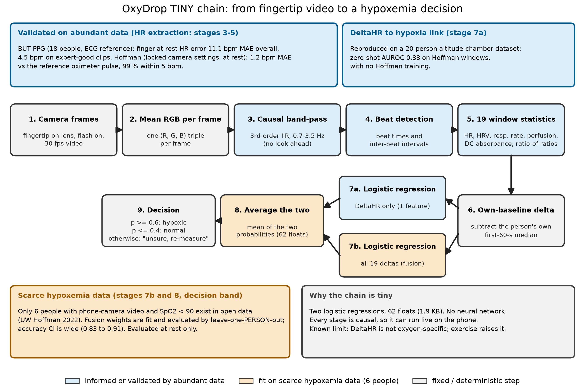
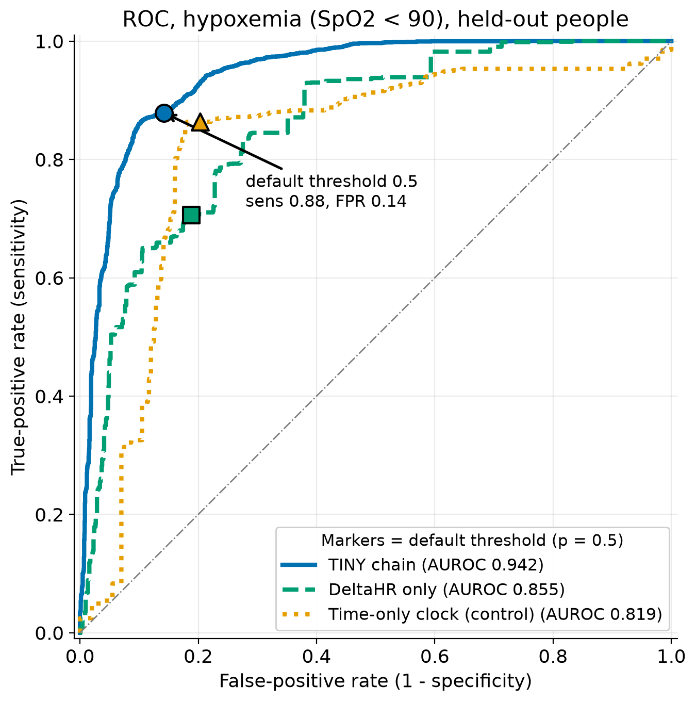
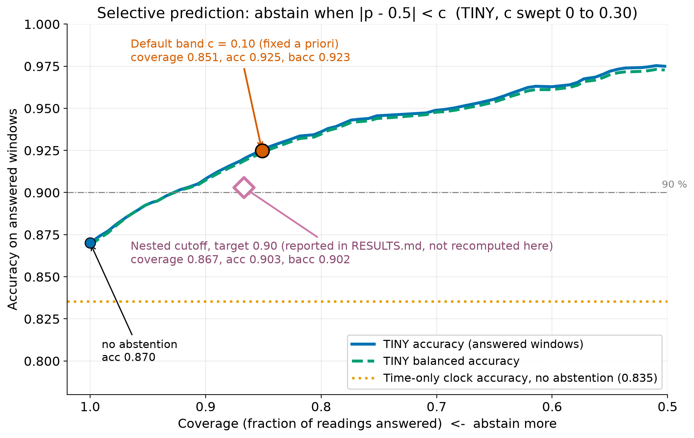

# OxyDrop

**Phone-camera check for a drop in blood oxygen from your own baseline. No extra hardware, no install, no data leaves the phone.**

**Live app:** https://aravhawk.github.io/oxydrop/ (open on a phone; "Watch a recorded demo" works with no camera)

> **This project is a prototype and is not medical advice.** It does not measure SpO₂, is not a medical device, and was validated on only 6 people. Never use it instead of a pulse oximeter or a clinician. It has **not been tested on a real phone camera yet** (see the [2-minute phone retest](docs/PHONE_RETEST.md)).

Built for the Veritas AI International High School Hackathon 2026, Health track.

## The idea

Hold a fingertip over the rear camera and flash, rest for 60 seconds so the app learns **your** normal, then keep measuring. Every 2 seconds it shows one of three results, with exactly these words:

| State | Text on screen | Meaning |
|---|---|---|
| Normal | **Normal vs your baseline** | Heart-rate change from your own first minute looks like the normal group |
| Possible low oxygen | **Possible low oxygen: re-check with a pulse oximeter** | Looks like the low-oxygen group (SpO₂ < 90% in the study). Not a diagnosis |
| Unsure | **Unsure, re-measure** | Bad placement, motion, no stable pulse, a poor calibration, or the model is near 50/50. No number is shown |

The app never shows an SpO₂ value and never gives a confident answer from a signal it rejects.

**Who it is for (a design persona, not a claim of clinical use):** a hiker or skier resting in a lodge at 3,000 m with no pulse oximeter, who wants to know "should I re-check with a real oximeter or go down?" Heart rate rises in hypoxia (we reproduce that link on a separate 20-person altitude-chamber dataset), and the phone can see both heart rate and the colour of light through the fingertip.

**Why a chain, not one big network.** Only 6 people with phone-camera video and real SpO₂ below 90% exist in open data (UW Hoffman 2022). We checked 32 candidate datasets; the rest are normoxic, gated, or have no optical signal. So the model is a chain of small stages. The stages that carry the signal (heart rate extraction, heart-rate rise from baseline, light absorption) are built from physiology and validated on data-rich tasks. Only the last step, two logistic regressions with 62 numbers, is fit on the scarce hypoxemia data.



## What changed in v2 (versus the first model)

| Part | v1 (first version) | v2 (this version) |
|---|---|---|
| Heart rate | Peak-interval beat counter. A strong dicrotic notch (the second bump in each pulse) was counted as a second beat, so a person at about 75 bpm could read about 150 | Spectral harmonic-sum plus autocorrelation fundamental, accepted only if the two agree and the signal-quality gate passes. Otherwise no number is shown |
| Frame timing | Assumed 30 fps | True frame timestamps (`requestVideoFrameCallback`) and a resampler to a uniform 30 Hz; frame gaps and a low frame rate make the result "Unsure" |
| Camera | Browser defaults | Rear camera, torch where supported, exposure, white-balance and focus lock where the browser allows it; lens selection (auto-switch away from ultra-wide and tele lenses) |
| Quality gate | Weak | Strict: finger-placement check, saturation (clipped red) check, frame rate and gap check, motion, calibration plausibility (51 to 110 bpm resting), and a lock requirement on every window |
| Output | Normal / hypoxic / unsure | Three states with fixed wording (above), plus reasons for "Unsure" |
| Optical SpO₂ (ratio-of-ratios) | Not tried | Tried on MTHS and Hoffman, **did not help, not used by the model** (see below) |

`app/js/engine_v1.js` and `python/oxydrop/chain.py` keep the original chain so the comparison below can be rerun. The model (two logistic regressions, 62 numbers) has the same form; v2 refits it on windows where the pulse is locked.

### v1 vs v2 on Hoffman (leave-one-person-out, same windows, `scripts/eval_v2.py`)

Fixed-hyperparameter protocol (C = 0.01 and 0.1 as shipped), 5,646 windows from t = 60 s. v1 here scores 87.5% instead of the 87.0% in the research table further down because that table uses nested hyperparameter selection. Source: `results/eval_v1_vs_v2.csv`.

| Model | Coverage | Accuracy on answered | Balanced acc. | Missed hypoxemia | False alarms | AUROC | Worst person |
|---|---|---|---|---|---|---|---|
| v1 (peak-interval HR), every window | 100% | 87.5% [CI 84.4, 90.5] | 87.3% | 11.3% | 14.1% | 0.948 | 0.812 |
| v2, every window forced to answer (windows without a pulse lock scored as "no change") | 100% | 80.5% [CI 66.2, 89.9] | 80.6% | 19.9% | 18.9% | 0.869 | 0.489 |
| v2, lock-gated (no lock = no answer) | 82.4% | 87.0% | 85.4% | 5.8% | 23.3% | 0.956 | 0.798 |
| v1 + abstain band 0.10 | 84.4% | 93.9% | 93.7% | 4.8% | 7.8% | 0.964 | 0.894 |
| **v2, lock-gated + abstain band 0.10 (what the app does)** | **68.0%** | **94.7%** | **93.8%** | **2.4%** | **10.1%** | **0.971** | **0.892** |

Baseline for reference: the time-only clock scores 83.5% raw but 51.9% time-matched in the research table below, so a model that only knows elapsed time is not a free 87%. Time-matched accuracy for these two protocol rows: v1 0.796, v2 forced 0.771 (not computed for abstaining rows).

Read this table carefully:
- **v2 does not improve accuracy on Hoffman.** On these clean, resting, locked-camera recordings v1's heart rate was already good (1.2 bpm error). v2 matches v1 on the windows it answers (87.0% vs 87.5%) and answers fewer of them (68% with the abstain band, against 84% for v1).
- **The "worst person 0.892" is among people who get answers.** Person 4 (resting heart rate 43 bpm) is below the 51 bpm floor of the heart-rate estimator, so v2 never locks and he gets "Unsure, re-measure" on every window. That is the honest failure for an unsupported pulse, not an accuracy. Forced to answer, v2 is worse than v1 (80.5%, worst person 0.489).
- The gain of v2 is not Hoffman accuracy. It is that doubled or invented heart rates are withheld (BUT PPG and field-case results below).
- The abstain band 0.10 was fixed in advance, as in the research table. The nested-cutoff version of that protocol has not been rerun for v2.

## Results (honest version)

The numbers in this section are for the **original (v1) chain** under the full research protocol (nested hyperparameter selection, time-matched control, bootstrap intervals). The v2 comparison is in the previous section.

UW Hoffman 2022, 6 people, 12 hands, **leave-one-person-out** (both hands of a person held out together; every hyperparameter chosen on the other 5 people). 5,644 evaluation windows (10 s windows, 2 s step, first 60 s used only as the person's own calibration). Label = window-mean reference SpO₂ < 90 (base rate 57.5%).

| Model | Accuracy [95% CI, person bootstrap] | Missed hypoxemia (FN rate) | False alarms (FP rate) | AUROC | Time-matched acc. | Worst person |
|---|---|---|---|---|---|---|
| Time-only baseline (elapsed seconds; not deployable) | 0.835 [0.70, 0.93] | 13.6% | 20.3% | 0.819 | **0.519** | 0.54 |
| Heart-rate rise only (1 feature) | 0.751 [0.60, 0.88] | 29.4% | 18.8% | 0.855 | 0.792 | 0.51 |
| **TINY chain, answers every window** | **0.870 [0.83, 0.91]** | **12.1%** | **14.2%** | 0.942 | **0.795** | 0.78 |
| **TINY chain, allowed to say "unsure"** (band \|p−0.5\| < 0.10) | **0.925** at **85.1%** coverage | **6.6%** | **8.7%** | 0.959 | 0.852 | 0.83 |
| TINY, abstain cutoff chosen by nested CV (target 0.90) | 0.903 at 86.7% coverage | 9.2% | 10.4% | 0.956 | 0.816 | 0.80 |

*Time-matched (TM) accuracy:* a random subset in which every 100 s of elapsed time has equal numbers of hypoxic and normal windows, so a clock scores about 50%. This matters because the Hoffman protocol lowers oxygen steadily, so time alone predicts the label. TINY keeps ~0.80 under this control; the clock drops to 0.52.

**Read these caveats next to the table:**
- The 3.7-point gain over the clock on raw accuracy has a person-bootstrap CI of [−7, +16] points. Six people cannot resolve it. The solid claims are the clock-free numbers (TM ≈ 0.80) and the abstention result.
- **The clock beats TINY on 3 of 6 individual people** (persons 1, 2 and 4; see `results/TABLES.md`). TINY wins pooled and on persons 3, 5 and 6.
- 90% at full coverage is **not** reached. 90% on answered windows is reached only by allowing "unsure". The band 0.10 row is a fixed a-priori choice; the nested row is the protocol-clean version. About 10 model variants were compared on the same 6 people, so treat small differences (such as TINY vs a CNN ensemble, +1.4 points) as ties.
- Missed hypoxemia is still 7–12%. A "normal" answer must never be taken as reassurance.

| ROC | Coverage vs accuracy | Per person |
|---|---|---|
|  |  |  |

### Failure case (v1 chain)
Person 4 (a 20-year-old man with a resting heart rate of 43 bpm, the worst person at 77.5% accuracy). On his right hand the chain misses hypoxemia for 107 windows (414–874 s) and abstains on 30% of windows; on his left hand it raises 79 false alarms between 212 s and 400 s while the reference is 90–96%. We have not established why. Possible factors (hypotheses, not tested): his very low resting heart rate (43 bpm) makes the heart-rate-rise feature unstable, and one person's physiology can differ from the other five.


In v2 this person is handled differently: his 43 bpm resting rate is below the 51 bpm floor, the pulse never locks, and the app answers "Unsure, re-measure" for every window instead of a wrong answer. That is a withheld answer, not a fix.

### Subgroups (age, sex, skin tone)
The 6 participants are adults aged 20 to 34, 3 women and 3 men, 1 Black participant (person 2: accuracy 0.886, sensitivity 0.874, specificity 0.900) and 5 White participants. Per-person accuracy ranges from 0.78 to 0.92. With one participant per skin tone group, **no subgroup or fairness claim can be made**, and the model has never been tested on children, older adults or dark-skinned people beyond that single person. Details: `results/SUBGROUPS.md`.

### The biggest known failure: exercise
Heart-rate rise is not oxygen-specific. On normoxic people exercising (moshekam dataset, 13 usable people) the same rule flags **63% of exercise windows as hypoxic** (68% over the 13 people with an extractable heart rate; 63% pools all 14 subjects, one of whom had no usable heart rate). This is why the app demands seated rest, uses the phone's motion sensor to pause readings, and rejects a calibration with an unrealistic resting heart rate.


## Leakage and confound audit
1. **Own bug found and fixed:** leading NaN heart-rate windows had been filled with the whole-recording median, leaking future hypoxic heart rate into the baseline. Fixed to causal forward fill then calibration median (ΔHR-only: 0.772 → 0.751). All numbers are post-fix.
2. No elapsed-time feature. Everything is causal (trailing windows, single-pass `sosfilt`, never `filtfilt`). Calibration = label-free median over the person's first 60 s. Scaler and regularisation chosen in an inner leave-one-person-out loop. Both hands of a person are held out together.
3. **Time-matched control** (above) and a **label-swap control** (train on another person's label trajectory at the same elapsed time: still 0.74–0.83 accuracy, which mostly shows robustness to noisy labels for low-capacity models, not that the signal is the clock).
4. **Positive controls proving the evaluation catches leaks** (none in the reported rows): adding elapsed time → 0.854, whole-recording z-score → 0.890, window-level random split → 0.972 (TM 0.939), `filtfilt` → +2 points.
5. A perfect-heart-rate oracle only lifts TINY to 0.879, so the heart-rate stage is not the ceiling; the data is.
6. Not headlined: a pooled 105-person 0.911 accuracy, because 99 of those people are normoxic and trivially correct.
7. The shipped weights are fit on all 6 people, so **in-sample numbers are never reported**. The in-app replay uses weights fit **without** the replayed person.
8. **v2 additions.** The heart-rate gate (`F_LO`, `SQI_MIN`, `ACF_MIN`, `AGREE`) was chosen by **subject-level cross-fit** on BUT PPG: select on even-numbered subjects, score odd, then swap. An earlier sweep that picked the gate on all clips and reported the same clips was deleted. The expert quality label only sets a coverage floor and splits the report; the app never sees it. BUT PPG and MTHS are **never used to fit the shipped weights**. The optics decision rule was written before the MTHS run. MTHS ranking metrics use deviations from each fold's training mean (a plain mean baseline otherwise scores an AUROC near 0 for a mechanical reason). In the v1 vs v2 table the abstain band was fixed in advance, and the lock gate comes from BUT PPG, not Hoffman.
9. **Still weak.** About 10 chain variants and 16 optics variants were compared on the same 6 Hoffman people, `F_LO` was chosen with BUT's rate distribution (which has few slow pulses), and the BUT folds split by subject number parity, not at random. Treat small differences as ties.
Full audit: `results/RESULTS_full_audit.md`.

## What was validated on abundant data (and what was not)

| Stage | Evidence (details in `docs/HR_VALIDATION.md` and `docs/SPO2_OPTICS.md`) |
|---|---|
| Heart-rate extraction (v2) | **BUT PPG** (CC BY 4.0, 3,840 smartphone clips, 38 subjects, ECG reference), gate chosen by subject-level cross-fit. Gate-accepted clips (35% of all clips): **MAE 11.9 bpm, 47% within 5 bpm, doubling 0.07%**. Expert-good clips accepted (71% of the good clips): **MAE 3.7 bpm, 84.5% within 5 bpm**. The old peak counter: MAE 15.3 bpm, 33% within 5 bpm, **doubling 3.1%** of all clips. **The target (MAE below 5 bpm) is met only on clean, accepted clips, not overall.** |
| Heart rate on Hoffman and MTHS (oximeter pulse as reference) | Hoffman: old peak 1.2 bpm, v2 accepted 1.8 bpm (83% coverage). MTHS (62 people): old peak 11.2 bpm, v2 accepted 6.2 bpm, 72% within 5 bpm |
| Doubling in the field case | Simulated fingertip pulses with a strong dicrotic notch (52 to 75 bpm): old counter doubled 90% of cases (28.8% for ordinary resting 55 to 100 bpm); v2 0%. At 110 to 160 bpm the old counter was not doubled either (the second harmonic is above the 4 Hz band-pass). These are code-path checks on a simulator, not physiology |
| Optical ratio-of-ratios (red/green/blue) | **Negative.** MTHS (62 people, phone video, oximeter SpO₂, person-level leave-one-person-out): no model beats the training-mean baseline (MAE 2.22 for ridge on optics + HR against 2.21 for the mean; textbook 110 - 25R gives 3.49). On Hoffman, no optics variant beats TINY v2 in nested leave-one-person-out. **So the ratio is not a model input.** MTHS is normoxic (1% of seconds below 90), so it cannot test hypoxemia. OpenOximetry (the desaturation and skin-tone dataset) was **not available** (credentialed access never activated) |
| Heart-rate rise → hypoxia | Reproduced on a separate 20-person altitude-chamber set (no optical signal): zero-shot AUROC 0.88 on Hoffman windows (threshold does not transfer) |
| Red-channel absorbance | Beer-Lambert reasoning; consistent sign in all 6 people (ρ +0.62 to +0.96), but partly drift/time confounded |
| Tried and dropped (no gain) | Quality-gated abstention, synthetic desaturation, pooling BUT/MTHS people, deep nets, red/IR ring transfer, smoothing, optical ratio features |

BUT PPG and MTHS **validated and informed the design; they never train the shipped 62 weights.** The only data that fit them is Hoffman.

### Heart rate on BUT PPG (v2 gate, `results/hr_validation/HR_SUMMARY.csv`)

| Subset | Estimator | Clips | Coverage | MAE (bpm) | Within 5 bpm | Doubling |
|---|---|---|---|---|---|---|
| All clips | old peak interval | 3,840 | 98.1% | 15.30 | 33.1% | 3.1% |
| All clips | v2, no gate | 3,840 | 100% | 16.56 | 30.6% | 0.4% |
| All clips | v2, accepted by gate | 3,840 | 35.2% | 11.87 | 47.2% | 0.07% |
| Expert-good | old peak interval | 795 | 99.0% | 6.49 | 71.2% | 2.0% |
| Expert-good | v2, accepted by gate | 795 | 70.6% | 3.74 | 84.5% | 0.0% |
| Finger at rest, good | v2, accepted by gate | 443 | 76.7% | 3.27 | 85.6% | 0.0% |
| Ear, good | v2, accepted by gate | 207 | 64.3% | 6.00 | 78.9% | 0.0% |

Held-out gate result (each clip scored with a gate chosen on the other half of the subjects): 1,359 of 3,840 clips accepted, MAE 11.89 bpm, 47.0% within 5 bpm, doubling 0.07%; expert-good 70.6% coverage, MAE 3.74 bpm, 84.5% within 5 bpm. Without the gate v2 is **not** better than the old counter on all clips (16.6 vs 15.3 bpm). The gain is that wrong answers are withheld. 40% of accepted clips are still more than 10 bpm off (mostly expert-bad clips that pass the gate), so a better signal-quality index is an open problem.


### Optical SpO₂ attempt (MTHS, `results/mths_spo2/`)

Per-frame red/green/blue AC/DC ratio-of-ratios, quality gate, per-person calibration from the first 30 s, ridge and small gradient-boosted corrections, person-level leave-one-person-out, intervals by person bootstrap. On the strict gate only 22 of 62 people could be calibrated (the red channel was clipped in 66% of windows with the phone's automatic exposure), 220 windows from 20 people. Results: training-mean 2.21 [1.66, 2.68], ridge optics + HR 2.22, gradient boosting 2.28, textbook 3.49 [2.51, 4.63], time-only 2.37 (MAE in SpO₂ points). Predicting the change from the person's own start was worse than saying "no change" (0.87 vs 0.77). Decision rule (fixed before the run, applied to Hoffman, `results/optics_experiment/decision_rule.csv`): none of 16 optics variants beat TINY v2 on accuracy and time-matched accuracy with a bootstrap lower bound above 0, so it is not shipped.

## Limitations
- 6 test people, one phone (Nexus 6P), fingertip only, one-way desaturation protocol, controlled FiO₂. Wide confidence intervals.
- **Not tested on a real phone.** v2's capture path (frame timestamps, exposure and white-balance lock, torch, placement check, motion sensor) was checked only against a synthetic fake camera in headless Chromium and a simulator. The decision thresholds for frame gaps and finger placement are untuned heuristics. Run the [2-minute phone retest](docs/PHONE_RETEST.md) and send back the trace.
- **Heart-rate floor of 51 bpm.** A resting rate below that cannot lock, so the app says "Unsure, re-measure" and gives no answer. Hoffman person 4 (43 bpm) is always "Unsure".
- **The HR target (MAE below 5 bpm) is met only on clean accepted clips** (3.7 bpm on expert-good BUT clips). Over all accepted clips it is 11.9 bpm, and the gate accepts only 35% of BUT clips.
- **Optical oxygen sensing is not implemented.** The model reads the heart-rate response to low oxygen, not the colour ratio. A ratio-of-ratios test on MTHS (normoxic) and Hoffman gave no gain, and OpenOximetry was not available, so there is also no skin-tone result.
- Works at rest only. Detects a **drop from your own first minute**; it cannot detect chronic low oxygen already present at calibration.
- Exercise, anxiety, caffeine, beta-blockers and arrhythmia break heart-rate rise.
- **Browser phones differ from the study phone.** Hoffman used locked camera settings. The app asks the browser to lock exposure and white balance, but support varies (best on Android Chrome). **iPhone Safari does not expose flash control**, so the live path there is best-effort and unvalidated; the recorded demo works everywhere. We have not validated any phone other than the Nexus 6P.
- Face video is not supported (no open face dataset with real desaturation exists).
- Reference oximeters in the study disagree by up to ~6 points at the low end.

## Repository layout
```
app/        the web app (static PWA, no build step): index.html, js/engine.js (v2 model), js/hr.js (robust HR), js/resample.js,
            js/camera.js, js/decision.js (3-state output), js/app.js, js/engine_v1.js (original chain, kept for comparison)
python/     reference implementation (oxydrop/ package: hr.py, features_v2.py, chain_v2.py, chain.py = v1), refit + export scripts
tests/      parity (JS vs Python), hr_parity, capture_sim, decision, e2e fake-camera test
results/    tables, eval_v1_vs_v2.csv, hr_validation/, mths_spo2/, optics_experiment/, out-of-fold scores, full audit
docs/       figures, HR_VALIDATION.md, SPO2_OPTICS.md, PHONE_RETEST.md, WRITEUP.md
scripts/    reproduce.sh, eval_v2.py, validate_hr.py, hr_crossfit.py, mths_spo2.py, optics_*.py, make_eval.py, make_v2_figs.py
```

## Run it
```bash
npm run serve            # http://localhost:8080 (camera needs HTTPS or localhost)
npm test                 # decision logic, JS-vs-Python parity (v2 and v1, 2 bundled recordings), HR parity, capture simulation
npm run test:e2e         # fake-camera browser test (needs Chromium and playwright-core, see tests/e2e/README.md)
scripts/reproduce.sh /path/to/oximetry-phone-cam-data   # figures + tables + refit + parity on all 12 recordings
```
Datasets are not in the repo. `scripts/reproduce.sh` with no argument runs the figure and bundled-fixture checks. With the optional dataset environment variables (`OXY_BUT`, `OXY_MTHS`, see the script header) it also reruns the v2 evaluation, the BUT PPG heart-rate validation and cross-fit, and the MTHS optics experiment. `scripts/optics_experiment.py`, `optics_feats.py` and `optics_decision.py` still contain host-specific scratch paths that need editing on another machine.

**Parity result:** the JavaScript v2 engine reproduces the Python reference on all 12 Hoffman recordings, 5,646 windows: max |Δp| = 2.1×10⁻¹³, 0 decision mismatches (v1: 3.2×10⁻¹³). The JavaScript heart-rate estimator matches the Python one to a relative difference of 7×10⁻¹⁵ on 240 BUT windows plus edge cases. `npm test` also runs a 48-trial capture-path simulation (jittered timestamps, 24/30/60 fps, dropped frames, exposure step). An end-to-end browser test with a synthetic 72 bpm fingertip video (`tests/e2e/`) passes: calibration completes, the app reads 72 bpm and "Normal vs your baseline", a grey frame is refused by the placement check, and the replay of person 4 shows only "Unsure". None of this validates real fingertips or real phones.

## Deploy
The site is the `app/` folder served from the `gh-pages` branch (`scripts/deploy_pages.sh`). Any static host works (Cloudflare Pages / Netlify / Vercel: set the output directory to `app`). HTTPS is required for the camera.

## Credits
Data: UW Ubicomp Lab (Hoffman et al., 2022), BUT PPG, altitude-chamber pilot, moshekam, MTHS, HealthRing (see `DATA_LICENSES.md`). Code: numpy, scipy, scikit-learn, matplotlib; Node for the parity test. AI tools: Claude (Anthropic) assisted with code, analysis and writing; the team reviewed and can explain every component. Code is MIT.
