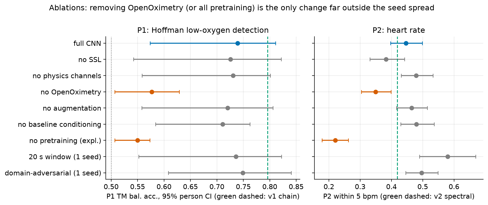
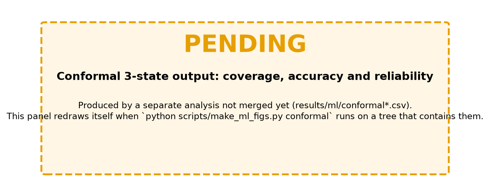
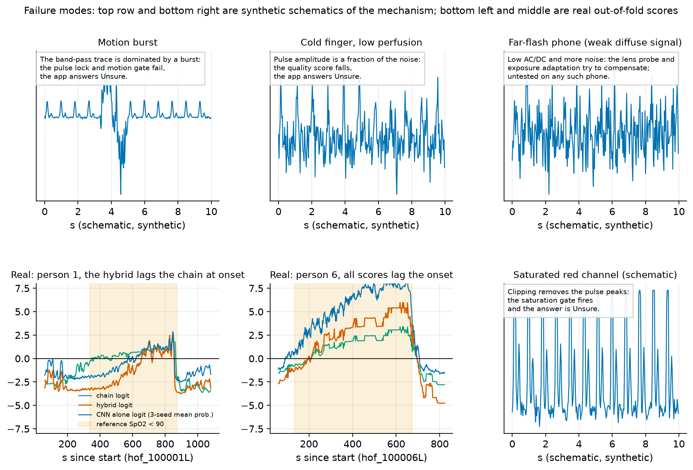

<!-- GENERATED from docs/templates/README.md.in by scripts/render_docs.py. Edit the template, not this file. -->
# OxyDrop

**Paper:** [paper/OxyDrop_paper.pdf](paper/OxyDrop_paper.pdf) (IEEE conference format, [view on GitHub](https://github.com/aravhawk/oxydrop/blob/main/paper/OxyDrop_paper.pdf))

OxyDrop checks, with a phone camera, whether your blood oxygen has dropped from your own baseline. It needs no extra hardware and no install, and no video leaves the phone. OxyDrop is a research prototype, not a medical device.

**Code:** [github.com/aravhawk/oxydrop](https://github.com/aravhawk/oxydrop) · **Video figures:** [docs/video/](docs/video/) · **Paper:** [paper/OxyDrop_paper.pdf](paper/OxyDrop_paper.pdf) · **Model card:** [MODEL.md](MODEL.md)

## One-page write-up

**Problem.** Low blood oxygen often causes no symptoms, and many of the people at risk (COVID-19, COPD or asthma at home, people at altitude, low-resource clinics) have a phone but no pulse oximeter. Phone-camera oximetry already exists ([Hoffman et al., 2022](https://www.nature.com/articles/s41746-022-00665-y)). The open question we studied is whether a small model running in the browser can flag a drop below SpO2 90 on people it has never seen, and say "unsure" when it cannot tell.

**Approach.** The user covers the rear camera and flash with a fingertip. The phone reduces each frame of the colour video to mean R, G and B, computes features for each 2 s window relative to the person's first minute, and runs a small network that outputs one of three states: *Low* ("Possible low oxygen: re-check with a pulse oximeter"), *Normal* ("Normal vs your baseline") or *Unsure* ("Unsure, re-measure"). The shipped network is PhotonDistill v2 (3 seeds of widths 32 / 32 / 64, 2,435 / 2,435 / 6,915 parameters). In each leave-one-person-out fold it is distilled from two teachers fitted on the training people only: the logistic chain on clean windows and a DC-colour regression on physics-simulated distant-flash copies. Every score comes from a person the model never saw, with nested tuning inside the training people, 95% person-bootstrap intervals and null-label controls.

**Results** (six hypoxic people from the Hoffman data, time-matched balanced accuracy, 95% person-bootstrap CI):

| Model | Clean light | Paired difference to the chain |
|---|---|---|
| Logistic chain (chain_v1, baseline) | 0.796 [0.636, 0.857] | reference |
| PhotonDistill v2 (distill2, shipped) | 0.784 [0.596, 0.834] | -0.012 [-0.091, 0.012] |
| PhotonDistill v2, GPU rerun of the same code | 0.761 [0.561, 0.830] | -0.035 [-0.127, -0.006] |

On clean light PhotonDistill v2 is on par with the chain. It does not beat it: the paired interval includes zero and 4/6 people score better. A GPU rerun of the same code scored lower, and its paired interval excludes zero, so that run loses to the chain. We report the gap between the two runs as seed variance. Under a *simulated* distant flash, the gain of PhotonDistill v2 over the chain is +0.097 [0.011, 0.195] at stress level L4, +0.170 [0.027, 0.249] at L5 and +0.174 [0.044, 0.284] at the out-of-family level X1.

**Limits and disclosures.**

* The key result rests on 6 people, of whom 1 is dark-skinned, recorded on 1 phone model. Intervals are wide, and skin-tone fairness on phones cannot be assessed.
* The stress test is simulated: it models a flash-to-lens offset, and behaviour on real phones with a distant flash is untested.
* A three-number DC-colour control is nearly as robust under stress as PhotonDistill v2.
* The round-3 models were designed post hoc, after the earlier held-out results had been seen (Amendments 6 to 8 of the pre-registration). The last round-3 score files arrived one minute after the stated cutoff.
* The app never shows an SpO2 value, and it cannot tell whether you were already low during the first minute.
* [Experimental in-browser capture demo](https://aravhawk.github.io/oxydrop/). Real-phone capture is unreliable on current iPhones, where the flash sits far from the lenses, so results here come from recorded datasets, not live capture.

## How to run

* **Locally:** `npm run serve`, then open http://localhost:8080 (the camera needs HTTPS or localhost). The app is static files in `app/` with no build step.
* **Tests:** `npm test` runs the decision, parity, capture and docs checks. `npm run test:docs` checks every number in the generated docs against the results files.
* **Reproduce the results:** `bash scripts/reproduce_ml.sh <stage>` (see [Reproduce](#reproduce)); the photon harness is `python -m oxydrop_ml.photon.evalkit`.

## Credits

**Datasets** (licences and use in [DATA_LICENSES.md](DATA_LICENSES.md)):

* Hoffman et al., "Smartphone camera oximetry in an induced hypoxemia study", npj Digital Medicine 2022 ([paper](https://www.nature.com/articles/s41746-022-00665-y), [data](https://github.com/ubicomplab/oximetry-phone-cam-data), MIT). The only open phone-camera data with SpO2 below 90.
* MTHS, Samavati et al. ([arXiv:2204.08989](https://arxiv.org/abs/2204.08989), [code and data](https://github.com/MahdiFarvardin/MEDVSE), CC BY-NC-ND 4.0, non-commercial research).
* BUT PPG v2.0, Brno University of Technology ([PhysioNet](https://physionet.org/content/butppg/2.0.0/), CC BY 4.0).
* OpenOximetry ([PhysioNet](https://physionet.org/content/openox-repo/1.1.1/), credentialed access; derived aggregates only, never redistributed).
* PhysioNet PTT-PPG ([PhysioNet](https://physionet.org/content/pulse-transit-time-ppg/1.1.0/)), BIDMC ([PhysioNet](https://physionet.org/content/bidmc/1.0.0/)) and the apnoea neck-oximeter PPG data: unlabeled windows for self-supervised pretraining only.
* moshekam PPG-during-exercise data (MIT, evaluation only), HealthRing (Zenodo, CC BY, a dropped experiment) and an altitude-chamber pilot (figshare, not relied on); details in [DATA_LICENSES.md](DATA_LICENSES.md).

**Optical constants** (PhotonTwin forward model, [sources](python/oxydrop_ml/optics_data/SOURCES.md)): haemoglobin extinction from S. Prahl, Oregon Medical Laser Center ([OMLC](https://omlc.org/spectra/hemoglobin/summary.html)); melanin absorption and skin scattering from S. L. Jacques, "Skin Optics" ([OMLC](https://omlc.org/news/jan98/skinoptics.html)); camera sensitivity initialised from Jiang et al., WACV 2013.

**Pretrained models and tutorials:** none from third parties. The CNN of the previous engine was pretrained by us, self-supervised, on the datasets above.

**AI tools and compute:**

* [Kiro](https://kiro.dev) with [Claude](https://www.anthropic.com/claude) Opus 5.5 and Sonnet 5.5 (Anthropic): code, analysis and drafting.
* [T3 Code](https://github.com/pingdotgg/t3code) and Hark: agent tools used during development.
* [Kaggle](https://www.kaggle.com): GPU kernels.
* [Daytona](https://www.daytona.io): sandboxes for heavy training.
* Libraries: numpy, scipy, scikit-learn, PyTorch, XGBoost, LightGBM, matplotlib, Node.js.

The team reviewed the AI-assisted work and can explain every component.

## Full details

> **Earlier rounds. The pre-registered primary metric (P1, detecting SpO2 below 90 on six held-out people) was not beaten.** The previous engine (now behind `?engine=hybrid`), the fixed hybrid pipeline R, scores 0.809 [0.644, 0.863] against 0.796 [0.635, 0.856] for the best baseline, the shipped logistic chain (a tie). That 0.809 is **optimistic**: pipeline R was chosen after its outer-fold scores had been seen. The unbiased estimate for the whole selection procedure is the nested 0.779 [0.638, 0.831]. **The simpler chain has the higher point estimates**: a chain refit with the same levers and no CNN scores 0.816, and at the same conformal level the chain-only control answers 92.5% of windows at 90.3% accuracy against 74.5% at 89.5% for the deployed hybrid. All of these intervals overlap, so it is a tie, and the CNN alone ties as well. What held: the CNN beating the weaker baselines (clock, ratio-of-ratios), a calibrated three-state hybrid that runs on the device (ML is the app's core path by design, not because it wins), an open pre-registered leave-one-person-out audit, and an exploratory heart-rate gain (P2, within 5 bpm 0.480 against 0.419) that is **post hoc and comes from BUT PPG**, not a clean win (see below).

> **Round 3, the model the app runs now: PhotonDistill v2, one small trained network. It is on par with the logistic chain on clean light and does not beat it** (0.784 [0.596, 0.834] against 0.796 [0.636, 0.857] on the photon harness, paired -0.012 [-0.091, 0.012], an interval that includes zero, 4/6 people better) and is more robust under a *simulated* distant flash (out-of-family stress X1: 0.682 against 0.508, paired +0.174 [0.044, 0.284]). It replaced round 2's PhotonDistill (0.758, which lost to the chain) under a rule fixed before any round-3 score; round-3 models were designed after the earlier results were seen, its last files arrived one minute after the stated cutoff, and a three-number colour control is nearly as robust. A rerun of the same code on a GPU scored 0.761 [0.561, 0.830] on clean light (paired -0.035 [-0.127, -0.006]) against 0.784 on the locked run; we report that gap as seed variance. Details and every disclosure: [MODEL.md](MODEL.md) section 0.

> **This project is a prototype and is not medical advice.** It does not measure SpO2, is not a medical device, and the key low-oxygen result rests on only six people. Never use it instead of a pulse oximeter or a clinician. Built for the Veritas AI International High School Hackathon 2026, Health track.

## Who it is for, and input to output

**For** people with COVID-19, COPD, asthma or at altitude who own a phone but no pulse oximeter, and for low-resource clinics. **Input:** a fingertip over the rear camera and flash for 30 to 60 s, reduced on the phone to per-frame mean R, G, B and frame timestamps. **Output:** after a 60 s calibration of *your own* normal (first answer at 70 s), every 2 s one of three results, with exactly these words:

| State | Text on screen | Meaning |
|---|---|---|
| Normal | **Normal vs your baseline** | Heart-rate, pulse-shape and light-absorption changes from your own first minute look like the normal group. It cannot tell whether you were already low during that first minute (**oxygen status at start unknown**) |
| Possible low oxygen | **Possible low oxygen: re-check with a pulse oximeter** | Looks like the low-oxygen group (SpO2 < 90% in the study). Not a diagnosis |
| Unsure | **Unsure, re-measure** | Bad placement, motion, no stable pulse, a poor calibration, or a score near the boundary. No number is shown |

The app never shows an SpO2 value. It also shows heart rate and a quality score.


## The model in one paragraph

**Default engine (round 3): PhotonDistill v2.** A multilayer perceptron (3 seeds of widths 32 / 32 / 64, 2,435 / 2,435 / 6,915 parameters) on 39 causal window features relative to the person's own first minute, with heads for P(SpO2 < 90), SpO2 (not shown) and its own abstain output. It was trained in each fold from two teachers fitted on the training people only (the logistic chain on clean windows, a DC-colour regression on physics-simulated distant-flash copies). Only the student runs in the app. See [MODEL.md](MODEL.md) section 0 and `docs/figures/photon_architecture.png`.

**Previous engine (`?engine=hybrid`).** A **hybrid**: a physiological logistic chain (heart-rate rise, pulse shape and ratio-of-ratios features, each relative to the person's own first minute) gives a low-oxygen logit, and a **167,588-parameter 1D CNN** (`OxyNet`, three seeds, dependency-free JavaScript) learns a residual correction to it, with heart-rate, quality and experimental SpO2 heads. The network was pretrained self-supervised and warmed up on contact-oximeter data (OpenOximetry) before fine-tuning on phone video. Details: [MODEL.md](MODEL.md).


## Results (leave-one-person-out, nested selection, 95% person-bootstrap intervals)

The evaluation protocol was **pre-registered** (commit `3e708fe`, [PREREGISTRATION.md](python/oxydrop_ml/PREREGISTRATION.md)) before any CNN result existed. A win needs the paired interval of the difference to the **best** honest baseline to exclude zero.

**P1 (primary, pre-registered): detect SpO2 < 90 on the six people of the UW Hoffman data, time-matched balanced accuracy.**

| Model (P1: Hoffman, 6 people, LOSO) | TM bal. acc. | 95% CI (person bootstrap) | Per person, mean ± SD | Plain AUROC | Train-vs-test gap | vs best baseline (pre-registered rule) |
| :--- | ---: | ---: | ---: | ---: | ---: | :--- |
| Majority class (always "hypoxic") | 0.500 | [0.500, 0.500] | 0.500 ± 0.000 | 0.500 | +0.000 | baseline |
| Clock only (elapsed seconds, not deployable) | 0.495 | [0.480, 0.514] | 0.509 ± 0.021 | 0.821 | +0.054 | baseline |
| Ratio-of-ratios, textbook 110-25R (red/blue) | 0.535 | [0.475, 0.594] | 0.528 ± 0.026 | 0.480 | +0.000 | baseline |
| Ratio-of-ratios, personally calibrated (red/green) | 0.612 | [0.493, 0.693] | 0.539 ± 0.089 | 0.651 | +0.020 | baseline |
| XGBoost, 26 handcrafted features | 0.655 | [0.528, 0.778] | 0.642 ± 0.096 | 0.899 | +0.170 | baseline |
| XGBoost, 19 chain features (v2 HR) | 0.763 | [0.613, 0.840] | 0.582 ± 0.115 | 0.854 | +0.015 | baseline |
| Logistic chain v2 (pulse-lock gate, forced answer) | 0.772 | [0.645, 0.828] | 0.609 ± 0.124 | 0.869 | +0.047 | baseline |
| Logistic chain v1 (best baseline) | 0.796 | [0.635, 0.856] | 0.666 ± 0.153 | 0.947 | +0.041 | baseline |
| **CNN alone** (167k parameters; mean of 3 seeds, own probability at 0.5) | 0.739 | [0.574, 0.811] | 0.618 ± 0.094 | 0.843 | -0.015 | tie with the best baseline (3-seed ensemble 0.754, paired diff -0.042 [-0.131, 0.005]) |
| CNN alone, 3-seed ensemble through the per-fold recalibration (`default_P`) | 0.781 | [0.632, 0.827] | 0.669 ± 0.081 | 0.852 | n/a | exploratory |
| **Deployed pipeline R** (the app; chain + CNN residual). Optimistic: chosen after the outer scores were seen | 0.809 | [0.644, 0.863] | 0.671 ± 0.088 | 0.918 | n/a | exploratory; interval overlaps the best baseline, no paired test run |
| **Hybrid, per-person selected** (nested: unbiased estimate of the selection procedure) | 0.779 | [0.638, 0.831] | 0.635 ± 0.102 | 0.891 | +0.076 | **tie** with the best baseline (-0.017 [-0.103, 0.069]) |
| Control: chain refit with the same nested levers (no CNN) | 0.816 | [0.674, 0.869] | 0.685 ± 0.142 | 0.947 | +0.019 | tie with the best baseline (+0.019 [-0.000, 0.049]) |

**The primary metric was not beaten.** The deployed pipeline R (0.809 [0.644, 0.863], optimistic because it was chosen after the outer scores were seen) and the nested per-person-selected hybrid (0.779 [0.638, 0.831], the unbiased estimate of the selection procedure) both tie the shipped chain (0.796 [0.635, 0.856]). The CNN alone ties it, and a chain refit with the same levers and no CNN has the higher point estimate, 0.816 [0.674, 0.869]. The CNN beats only weak baselines (ratio-of-ratios, clock), which is not a pre-registered win. One of three CNN seeds loses to the chain by itself.

**P2 (pre-registered metric, post hoc rule, exploratory): heart rate within 5 bpm, BUT PPG plus MTHS, 100 people.** Hybrid rule 0.480 [0.429, 0.534] against 0.419 [0.366, 0.481] for the v2 spectral estimator: paired difference +0.061 [0.013, 0.107]. This is **not a clean win**: the rule was chosen after the pooled table had been seen (Amendment 3), and the gain comes from BUT PPG (+0.115 [0.054, 0.177]). On MTHS the spectral estimator is nominally better (0.633 against 0.594 for the rule, difference -0.039 [-0.102, 0.017]), and on the Hoffman inner folds (the pooled out-of-fold windows of the six Hoffman people that were used to select the rule, not an outer-fold test result) the spectral estimator alone scores 0.883 against 0.826 for the rule that ships. Do not read this as a heart-rate improvement in general.

**P3 (pre-registered): absolute SpO2 on MTHS, MAE.** CNN 1.457 against 1.354 for predicting the training mean: no skill. MTHS is normoxic, so SpO2 is not headlined and not shown to users.

What the experiments say about the network: **the OpenOximetry warm-up is the main source of its skill** (P1 0.739 with it, 0.577 without); a device-agnostic-augmentation benefit is **not supported**; physics channels change nothing measurable; test-time BatchNorm adaptation hurts. Every lever, kept or dropped, is in the ledger in [MODEL.md](MODEL.md) and the [paper](paper/OxyDrop_paper.pdf).

**Conformal three-state output (secondary, exploratory).** For the **deployed pipeline R** (the model the app runs; nested over people, thresholds from the five other people only) the declared level alpha = 0.10 gives 74.5% answered windows at 89.5% accuracy, 70.0% of all hypoxic windows alerted and 8.7% called Normal (target 10%). These rows are optimistic, because R was chosen with all six people in view; the nested per-person-selected hybrid gives 79.1%, 87.0% and 70.1%. **The chain-only control has the higher point estimates**: 92.5% answered at 90.3% accuracy, 84.3% alerted. At the coverage of the v1 band (84.4%) the deployed pipeline scores 88.0% against 93.9% (-5.9 [-17.1, +2.3] points, a tie by interval, not a win) and the chain control 92.0%. The coverage guarantee holds roughly pooled and fails per person (person 1: 51.3% of hypoxic windows called Normal).

**SpO2 on a contact oximeter, by skin tone (secondary, not a phone test).** On 34 held-out OpenOximetry people (24 with blood-gas SaO2 labels) the CNN has MAE 2.94 [2.45, 3.50] against 3.07 [2.60, 3.54] for the textbook ratio-of-ratios (tie, difference -0.13 [-0.47, +0.26]) and 7.38 for the training mean; the learned label lag is 19 s [15, 27]. The dark-minus-light MAE gap by ITA tertile is +0.41 [-0.75, +1.63] (7 versus 6 people); the Monk 7+ group has too few held-out people to estimate. The contact oximeter itself reads higher in darker skin: dark minus light +1.77 [+0.64, +2.61] points by Monk group and +1.10 [+0.65, +1.55] by ITA tertile. No SpO2 number is shown to users.

**Heart-rate voting (negative result).** A voting rule over autocorrelation, spectral and CNN estimates gives a clean-clip MAE of 10.94 bpm on BUT PPG and 5.22 on MTHS (target under 3 bpm not met), is worse than the CNN alone on BUT PPG, and does not replace the P2 rule. For a resting pulse near 48 bpm the 51 bpm spectral floor gives MAE 14.3 bpm and a 40 bpm floor 1.9; the CNN does not track that person.

**What the app runs.** The hybrid is the on-device default path: the v1 physiological chain logit plus the residual of three CNN seeds, then the logistic meta-learner and the conformal three-state rule (`app/js/hybrid_engine.js`, `docs/APP_INTEGRATION.md`). The CNN runs in a Web Worker so a forward pass never delays camera frames, with logistic-chain fallback when module workers are unavailable or exceed the 2 s window deadline; the v2 logistic chain stays behind `?engine=logistic`. A generic low-amplitude guard (AC/DC below the 0.1th percentile of the Hoffman training windows, 0.24%) answers *Unsure* and shows the spectral heart rate only. With the shipped cut (`scripts/ood_range.py`) it would refuse 0.1% of Hoffman windows, 6.7% of MTHS windows and 8.8% of BUT PPG windows (other studies' phones), so a weak-flash phone will see more *Unsure*; the rate on any untested phone is unknown. Latency measured on a development laptop (`results/ml/DEPLOY.md`): 16.4 ms for one forward pass, 50 to 58 ms per 2 s window including all three seeds; phones are slower and unmeasured. The three seed files are 2.69 MB together. The replay demo is in-sample for the hybrid (the weights saw those two people) and is labelled demo only in the app.






## Where it fails

* **Only six hypoxic phone-camera people exist in open data**, one phone model, induced desaturation at rest: wide intervals, and "tie" mostly means "cannot distinguish". Nothing is known about low oxygen in the wild.
* **Person-level instability:** the chain is far better on person 1 and the CNN on person 6; no combiner learned from five people exploits it (per-person table in [MODEL.md](MODEL.md)).
* **Motion, cold fingers, saturated red channel, far-flash phones:** the app answers *Unsure* rather than guess ([figure](docs/figures/ml_failure_modes.png)). The generic low-amplitude guard (cut from the Hoffman training windows only) would have refused 6.7% of MTHS windows and 8.8% of BUT PPG windows, against 0.1% of the Hoffman windows it was derived from, so a phone with a weak flash will see more *Unsure* (refused windows still show a spectral heart rate). The rate on any untested phone is unmeasured.
* **Dark skin:** pulse-oximeter references are biased in darker skin at low saturation (Bickler 2005, Sjoding 2020). Phone-camera fairness cannot be assessed (one dark-skinned participant); the contact-oximeter analysis is in the whitepaper.
* **Already low at the start**, exercise, arrhythmia and a resting pulse under 51 bpm break the signal.
* **Every phone:** the app is built to work on every phone and is **not tuned to any specific phone**. The iPhone 13, 17 and 18 Pro the team owns are only a held-out sanity check, never a tuning set. **Untested Android phones and other phones are a limitation.** The per-phone test checklist for the pull request is [docs/PHONE_CHECKLIST.md](docs/PHONE_CHECKLIST.md).



## Prior work: what is and is not new

Phone-camera low-oxygen detection is **not new**: [Hoffman et al., 2022](https://www.nature.com/articles/s41746-022-00665-y) (81% sensitivity and 79% specificity below 90% SpO2, 5.00 SpO2 MAE; a different protocol, so not a head-to-head comparison), [MTHS (Samavati et al., 2022)](https://arxiv.org/abs/2204.08989), [Sun et al., 2021](https://pmc.ncbi.nlm.nih.gov/articles/PMC7984770/), [Tian et al., 2022](https://doi.org/10.1109/JSTSP.2022.3152352). **What this project adds is limited to** a personalised chain-plus-residual-CNN hybrid on the device with abstention, an open pre-registered leave-one-person-out audit that reports ties and losses, and OpenOximetry-based pretraining and fairness analysis. It is not a first detector, not a new sensing principle and not evidence of superiority.

## Quick start

```bash
npm run serve            # http://localhost:8080 (camera needs HTTPS or localhost)
npm test                 # decision logic, JS-vs-Python parity, HR parity, capture simulation, stall, lens probe, CNN parity
python scripts/check_claims.py   # every number in README, MODEL.md and WHITEPAPER.md against results/ml/*.csv
```

## Repository map

```
app/        static PWA, no build step: hybrid_engine.js + hybrid_worker.js (default path), engine.js (v2 quality chain), engine_v1.js (v1 chain), cnn.js + cnn_features.js (CNN), data/ (hybrid members, conformal.json, weights), sw.js
python/     oxydrop/ (chain, HR, evaluation kit) and oxydrop_ml/ (data, CNN, SSL, training, baselines, hybrid, tests, PREREGISTRATION.md and amendments)
results/    ml/ (all CSVs behind every number, scores/, CORE_RESULTS.md, BASELINES.md, HYBRID.md), older chain tables
scripts/    reproduce_ml.sh (stages), ml_numbers.py, render_docs.py, make_ml_figs.py, check_claims.py, build_whitepaper_pdf.sh
docs/       figures/, templates/ (sources of the generated docs), APP_INTEGRATION.md, PHONE_CHECKLIST.md, ENGINEERED_CHAIN.md (the v1/v2 chain, camera flow, older audit), WRITEUP.md, HR_VALIDATION.md, SPO2_OPTICS.md, PHONE_RETEST.md, REVIEW_RESPONSE.md
tests/      JS parity, flow and e2e tests; docs_claims.mjs guards wording
```

## Reproduce

`bash scripts/reproduce_ml.sh <stage>` (stages in the script header: `baselines`, `core-*`, `hybrid-*`, `docs`). The README, MODEL.md and WHITEPAPER.md are generated from `results/ml/*.csv` with one command: `bash scripts/reproduce_ml.sh docs` (figures, templates, PDF, then `check_claims.py`). Heavy training ran on a Daytona sandbox; checkpoints stay outside git (SHA-256 in `results/ml/ssl_manifest.json`).

## Data and licences

Hoffman (MIT), BUT PPG (CC BY 4.0), MTHS (CC BY-NC-ND 4.0, non-commercial research), OpenOximetry (PhysioNet credentialed, **aggregates only**, never redistributed), plus pretraining sources. **The shipped CNN weights (`app/data/hybrid_R_s*.json`, `oxynet.onnx`) are derived models trained on MTHS and OpenOximetry data. They are NOT under the MIT licence: they are shared for non-commercial, research and education use only, with attribution to MTHS (Samavati et al., CC BY-NC-ND 4.0) and OpenOximetry (PhysioNet)**, under the owner's decision of 2026-11-15, which is not a legal opinion and is not confirmed in writing by the data owners (see [DATA_LICENSES.md](DATA_LICENSES.md) and `app/data/WEIGHTS_LICENSE.md`). No data from users is stored. Code is MIT; the CNN weight files are not (see above). AI tools (Claude) assisted with code, analysis and writing; the team reviewed and can explain every component.

## Older documentation

The v1/v2 logistic chain, the heart-rate validation, the camera flow with its lens probe, the leakage audit and the untested-phone table are in [docs/ENGINEERED_CHAIN.md](docs/ENGINEERED_CHAIN.md). The independent reviews and how each item was handled: [docs/REVIEW_RESPONSE.md](docs/REVIEW_RESPONSE.md) (first review, PR #3) and [docs/REVIEW_RESPONSE_ML.md](docs/REVIEW_RESPONSE_ML.md) (semantic review of the ML branch).
