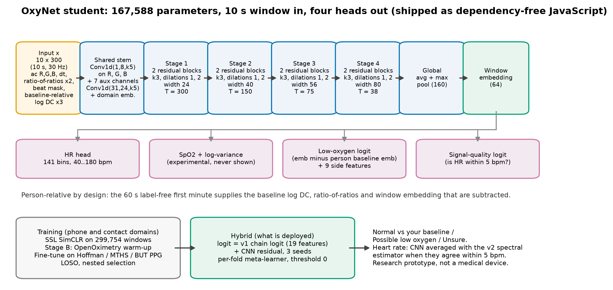
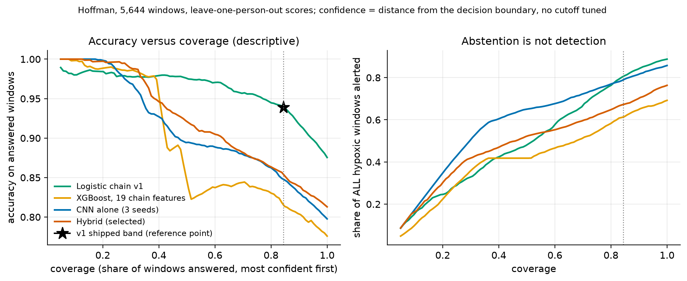
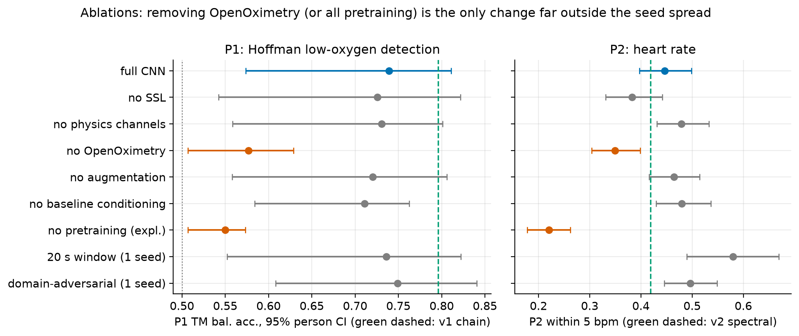
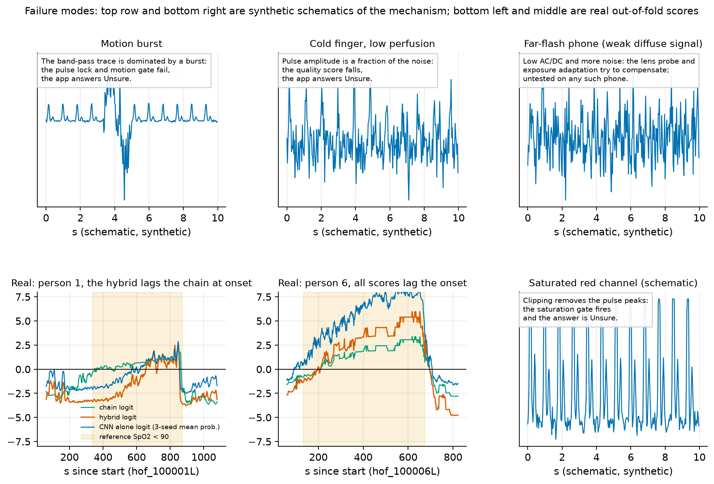

<!-- GENERATED from docs/templates/WHITEPAPER.md.in by scripts/render_docs.py. Edit the template, not this file. -->
# OxyDrop: a personalised physiology-plus-CNN check for a drop in blood oxygen from phone-camera video

*Evaluated with an open, pre-registered, leave-one-person-out audit. Arav Jain and team, Veritas AI Hackathon 2026, Health track. Research prototype, not a medical device.*

## Abstract

A person with COVID-19, COPD, asthma or at altitude who owns a phone but no pulse oximeter has no way to notice a fall in blood oxygen. OxyDrop covers the rear camera and flash with a fingertip, learns that person's own normal from the first 60 seconds, and then answers every 2 seconds with one of three states: *Normal vs your baseline*, *Possible low oxygen: re-check with a pulse oximeter*, or *Unsure, re-measure*. It shows heart rate and a quality score and never shows an SpO2 number. The deployed model is a hybrid: a physiological logistic chain (heart rate, ratio-of-ratios and pulse-shape features relative to the person's baseline) plus a residual learned by a 167,588-parameter 1D CNN that runs in dependency-free JavaScript. We evaluate with leave-one-person-out (LOSO) cross-validation, nested selection and person-level bootstrap intervals, under a protocol committed before any CNN result existed (commit `3e708fe`). **The pre-registered primary metric, P1 (time-matched balanced accuracy for SpO2 < 90 on the six people of the UW Hoffman data), was not beaten:** the hybrid scores 0.779 [0.638, 0.831] against 0.796 [0.635, 0.856] for the best baseline, the shipped logistic chain (a tie, difference -0.017 [-0.103, 0.069]), and a chain refit with the same nested levers and no CNN scores 0.816. The CNN alone also ties. The clear gains are in heart rate (P2: within 5 bpm 0.480 against 0.419, paired difference +0.061 [0.013, 0.107], a design choice made after seeing the pooled table) and in what the OpenOximetry warm-up buys the network. Absolute SpO2 on a normoxic phone dataset is not better than predicting the training mean (P3). We state where the model ties or loses, and what only six hypoxic phone-camera people can and cannot show.

## 1. Problem and user

Low blood oxygen often feels like nothing, and the people most exposed (home COVID-19 or COPD patients, asthmatics, hikers and skiers at altitude, low-resource clinics) are often far from an oximeter while a phone is in their pocket. The design scenario is a person resting who wants to decide "should I re-check with a real oximeter, or go down?". **Input:** 30 to 60 s of fingertip video, reduced on the phone to per-frame mean R, G, B and frame timestamps (no pixels leave the device). **Output:** a three-state result every 2 s after a 60 s personal calibration (first answer at 70 s), plus heart rate and signal quality. Because the comparison is with the person's own first minute, the app cannot know whether they were already low during that minute ("oxygen status at start unknown"). This is a scenario, not evidence of efficacy: nothing here was tested at altitude or with patients.

## 2. Related work and what is new

Camera-based low-oxygen detection is established. Hoffman et al. [1] ran an induced-hypoxemia study with a smartphone and flash, released the data we use (MIT), and reported 81% sensitivity and 79% specificity for SpO2 < 90 with 5.00 SpO2 MAE using a deep model under their own protocol (not a head-to-head comparison with ours). MTHS (Samavati et al. [2]) provides 62 normoxic smartphone videos with oximeter references and an end-to-end network for vital signs. Sun et al. [3] and Tian et al. [4] developed ratio-of-ratios methods with calibration and heart-rate-adaptive filtering for camera oximetry. The ratio-of-ratios rule itself is classical pulse-oximetry optics. Pulse oximeters over-read oxygen in darker skin at low saturation (Bickler et al. [5]; Sjoding et al. [6]), which is why we report skin-tone analysis on a contact dataset and state that no phone-camera fairness claim is possible with the data that exist.

**What we claim.** (i) A personalised chain-plus-residual-CNN hybrid that runs on the device with abstention; (ii) an open, pre-registered, nested leave-one-person-out audit that reports ties and losses next to wins; (iii) OpenOximetry-based pretraining and a fairness analysis. **What we do not claim:** to be the first camera hypoxemia detector, a new sensing principle, accuracy beyond the engineered chain, a device-agnostic-augmentation benefit (the ablation does not support it), or any phone SpO2 accuracy.

## 3. Method

**Data pipeline.** Per-frame mean RGB is resampled onto a causal 30 Hz grid (gaps are recorded, not hidden), band-passed causally (0.7 to 4 Hz, no zero-phase filtering), cut into 10 s windows with a 2 s hop, and compared with the person's own first minute (label-free). Training pools four sources: UW Hoffman (6 people, phone, SpO2 down to 70), MTHS (62, phone, normoxic), BUT PPG (38 smartphone PPG clips with ECG heart rate) and OpenOximetry (contact red/infrared PPG with arterial-blood-gas SaO2, Daytona only, aggregates only). Windows used: 5,644 (P1), 5,905 (P2), 1,141 (P3).

**Self-supervised pretraining and OpenOximetry warm-up.** SimCLR-style contrastive pretraining on 299,754 unlabeled windows from 212 people disjoint from every test person (loss 5.28 to 2.10, top-1 positive retrieval 0.83), followed by a supervised warm-up on OpenOximetry rows only (stage B). 34 OpenOximetry people are held out of everything for later tests. A Kaggle pretraining on HealthRing PPG tied training from scratch and could not initialise our network (SpO2 MAE 4.25 against 4.33).

**Physics-informed multi-task CNN (OxyNet).** Input: 10 channels by 300 samples (ac R, G, B, frame-time delta, per-beat ratio-of-ratios R/G and R/B relative to the person's baseline, beat mask, baseline-relative log DC), plus nine baseline-relative side features. A channel-shared stem feeds four stages of two residual blocks (widths 24, 40, 56, 80), global average and max pooling and a 64-d embedding. Heads: heart rate (141 bins, 40 to 180 bpm), SpO2 with log-variance (experimental, never shown), a low-oxygen logit on (embedding minus the person's baseline embedding), and a quality logit. Parameters: 167,588, under a 300,000 budget asserted in a test. JavaScript output matches PyTorch to better than 1e-4 on fixtures.

**Device augmentation.** Per-channel gain and gamma, colour-matrix jitter, DC steps, baseline wander, frame-rate jitter, dropped frames, saturation and motion bursts. No augmentation parameter and no threshold is fit to any particular phone. The ablation below shows the benefit is within noise, so we make no claim for it.

**Per-user calibration, distillation and the hybrid.** Per-person baselines (first minute) condition the network and are the comparison for the low-oxygen decision. Three ways of combining the chain and the CNN were pre-declared (Amendment 2): the plain CNN (P), a residual network that learns a correction to the chain logit (R), and a student distilled from the chain (D); stacking meta-learners combine their logits. All choices (source, per-user score calibration, number of windows averaged) are made by inner folds on the training people only. The deployed pipeline is chosen by the same rule on the six out-of-fold tables: source R, no score calibration, one window, with logit = 0.940 + 3.236 x (r - 1.486) / 4.275, where r is the chain logit plus the mean correction of three seeds (inner-CV score 0.818; this is selected with all six people in view, so the honest estimate of the procedure is the nested 0.779).

**Conformal 3-state output.**

> **PENDING: conformal 3-state output.** Split-conformal abstention on the final hybrid scores, with the coverage-versus-accuracy curve and the comparison with the v1 chain at matched coverage (v1 shipped band: coverage 84.4%, accuracy 93.9%). The numbers for this section come from a separate analysis that is not merged into this tree yet (`results/ml/CONFORMAL.md, results/ml/conformal*.csv`). This block is generated: run `bash scripts/reproduce_ml.sh docs` after the files exist and it renders in full. No number from this section is quoted anywhere else in this document.

**PENDING (app integration):** in this tree the app still runs the logistic chain v2. The hybrid weights are exported (`app/data/hybrid_weights.json`, three seed members) and checked for numerical parity, and wiring them into the app is the job of the app-integration branch (`docs/APP_INTEGRATION.md`). Until that is merged, nothing in this document claims that the live site runs the CNN.

## 4. Experiments

**Pre-registration and protocol.** `python/oxydrop_ml/PREREGISTRATION.md` was committed in `3e708fe` before any learned-model result. Primary metrics: **P1** Hoffman time-matched balanced accuracy at full coverage (6 people, 5,644 windows, majority class 57.48%); **P2** share of windows within 5 bpm of the reference on BUT PPG plus MTHS (100 people); **P3** SpO2 MAE on MTHS (61 people with a scored window). All numbers are LOSO with both hands and all recordings of a person held out together. Hyperparameters, thresholds, stacking and the choice of levers are selected by nested CV on training people only; pretraining uses only people who are never test people. We report mean, SD across folds, 95% person-bootstrap intervals (2000 resamples of people), seeds and a train-versus-test gap. A "win" requires the paired person-bootstrap interval of the difference to the *best* honest baseline to exclude zero. Four amendments are on file (`python/oxydrop_ml/amendments/` and the end of the pre-registration), each stating what had been seen when it was written: Amendment 1 discloses deviations in the core CNN run (recipe chosen over all outer folds, seed counts, grouped folds for ablations); Amendment 3 records that the P2 rule was chosen after the pooled table was seen.

**Baselines (same folds, windows and calibration).** Majority class, clock-only (elapsed time), textbook and personally calibrated ratio-of-ratios, XGBoost and LightGBM on handcrafted features, the v1 and v2 logistic chains. Time-matched accuracy is used because the Hoffman protocol lowers oxygen steadily, so elapsed time alone predicts the label: the clock scores 0.828 accuracy but 0.495 time-matched.

## 5. Results

### 5.1 P1: low-oxygen detection (primary, pre-registered)

| Model (P1: Hoffman, 6 people, LOSO) | TM bal. acc. | 95% CI (person bootstrap) | Per person, mean ± SD | AUROC | Train-vs-test gap | vs best baseline (pre-registered rule) |
| :--- | ---: | ---: | ---: | ---: | ---: | :--- |
| Majority class (always "hypoxic") | 0.500 | [0.500, 0.500] | 0.500 ± 0.000 | 0.500 | +0.000 | baseline |
| Clock only (elapsed seconds, not deployable) | 0.495 | [0.480, 0.514] | 0.509 ± 0.021 | 0.821 | +0.054 | baseline |
| Ratio-of-ratios, textbook 110-25R (red/blue) | 0.535 | [0.475, 0.594] | 0.528 ± 0.026 | 0.480 | +0.000 | baseline |
| Ratio-of-ratios, personally calibrated (red/green) | 0.612 | [0.493, 0.693] | 0.539 ± 0.089 | 0.651 | +0.020 | baseline |
| XGBoost, 26 handcrafted features | 0.655 | [0.528, 0.778] | 0.642 ± 0.096 | 0.899 | +0.170 | baseline |
| XGBoost, 19 chain features (v2 HR) | 0.763 | [0.613, 0.840] | 0.582 ± 0.115 | 0.854 | +0.015 | baseline |
| Logistic chain v2 (pulse-lock gate, forced answer) | 0.772 | [0.645, 0.828] | 0.609 ± 0.124 | 0.869 | +0.047 | baseline |
| Logistic chain v1 (best baseline) | 0.796 | [0.635, 0.856] | 0.666 ± 0.153 | 0.947 | +0.041 | baseline |
| **CNN alone** (167k parameters; mean of 3 seeds, own probability at 0.5) | 0.739 | [0.574, 0.811] | 0.618 ± 0.094 | 0.843 | -0.015 | tie with the best baseline (3-seed ensemble 0.754, paired diff -0.042 [-0.131, 0.005]) |
| CNN alone, 3-seed ensemble through the per-fold recalibration (`default_P`) | 0.781 | [0.632, 0.827] | 0.669 ± 0.081 | 0.852 | n/a | exploratory |
| **Hybrid, selected pipeline** (chain logit + CNN residual, nested selection) | 0.779 | [0.638, 0.831] | 0.635 ± 0.102 | 0.891 | +0.076 | **tie** with the best baseline (-0.017 [-0.103, 0.069]) |
| Control: chain refit with the same nested levers (no CNN) | 0.816 | [0.674, 0.869] | 0.685 ± 0.142 | 0.947 | +0.019 | tie with the best baseline (+0.019 [-0.000, 0.049]) |

*TM = time-matched. Gap = mean over folds of the fold model's score on its own pooled training people minus the pooled held-out score (positive = optimistic). Per-person values are the mean and SD of the six held-out people.* **The CNN does not beat the chain.** The three CNN seeds score 0.752, 0.717 and 0.748 (seed SD 0.019); seed 1 alone loses to the chain (-0.079 [-0.217, -0.021]), the 3-seed ensemble ties (-0.042 [-0.131, 0.005]). The hybrid ties the chain (-0.017 [-0.103, 0.069]). A chain refit with the same nested levers and threshold calibration reaches 0.816, at least as good as every CNN candidate, and the hybrid minus this control is -0.037 [-0.119, 0.028]. Against the weak baselines (ratio-of-ratios, clock) the CNN and hybrid are clearly better; these are not pre-registered wins. The people are complementary (the CNN is better on person 6, clearly worse on person 1) but no combiner learned from five people exploits it:

| Model | person 1 | person 2 | person 3 | person 4 | person 5 | person 6 | mean ± SD |
| :--- | ---: | ---: | ---: | ---: | ---: | ---: | ---: |
| Logistic chain v1 (shipped) | 0.889 | 0.458 | 0.660 | 0.711 | 0.737 | 0.539 | 0.666 ± 0.153 |
| Chain, same nested levers | 0.885 | 0.515 | 0.661 | 0.774 | 0.735 | 0.539 | 0.685 ± 0.142 |
| CNN alone, 3-seed ensemble (`default_P`) | 0.594 | 0.610 | 0.671 | 0.605 | 0.759 | 0.774 | 0.669 ± 0.081 |
| Residual hybrid R at default levers | 0.636 | 0.517 | 0.671 | 0.766 | 0.737 | 0.697 | 0.671 ± 0.088 |
| **Hybrid, selected pipeline** | 0.594 | 0.517 | 0.656 | 0.766 | 0.735 | 0.539 | 0.635 ± 0.102 |

At the coverage of the v1 shipped band (coverage 84.4%, accuracy 93.9%) the other models answer less accurately than the chain (descriptive, confidence ranking, no cutoff tuned):

| Model (Hoffman, 5,644 windows) | Coverage | Accuracy on answered windows | Share of ALL hypoxic windows alerted | Accuracy at full coverage |
| :--- | ---: | ---: | ---: | ---: |
| Logistic chain v1 (shipped) | 84.4% | 93.9% | 80.5% | 87.5% |
| XGBoost, 19 chain features (v2) | 84.4% | 81.6% | 61.3% | 77.6% |
| CNN alone (3-seed mean probability) | 84.4% | 84.8% | 79.0% | 79.8% |
| Hybrid (selected pipeline) | 84.4% | 85.4% | 67.3% | 81.3% |

### 5.2 P2: heart rate and P3: absolute SpO2

| Model (P2: BUT PPG + MTHS, 100 people, LOSO, full coverage) | All: within 5 bpm [95% CI] | BUT PPG (38) | MTHS (62) | MAE (bpm) | Doubling | vs best baseline |
| :--- | ---: | ---: | ---: | ---: | ---: | :--- |
| FFT peak, plain | 0.382 [0.329, 0.441] | 0.271 | 0.590 | 17.22 | 1.03% | baseline |
| v1 peak-interval counter | 0.397 [0.345, 0.450] | 0.315 | 0.549 | 14.53 | 2.44% | baseline |
| **v2 spectral + autocorrelation (best baseline)** | 0.419 [0.366, 0.481] | 0.304 | 0.633 | 13.68 | 0.24% | baseline |
| v2 with its shipped quality gate (abstains) | 0.312 [0.255, 0.378] | 0.167 | 0.582 | 8.85 | 0.00% | baseline |
| CNN alone (3-seed median) | 0.468 [0.419, 0.522] | 0.410 | 0.576 | 8.63 | 0.02% | tie (3-seed ensemble) |
| **Hybrid HR rule `agree`** (CNN, averaged with v2 spectral when within 5 bpm) | 0.480 [0.429, 0.534] | 0.419 | 0.594 | 8.55 | 0.02% | **win** (+0.061 [0.013, 0.107]) |

The hybrid rule `agree` (mean of CNN and v2 spectral estimate if within 5 bpm, else CNN) beats the best baseline on the pre-registered rule (+0.061 [0.013, 0.107]). It was chosen among CNN-containing rules on Hoffman inner folds after the pooled table had been seen (Amendment 3); the Hoffman people alone would choose the spectral estimator (0.883 against 0.826 for `agree`). The gain comes from BUT PPG (noisy ear and motion clips); on MTHS the spectral estimator is as good or better (-0.039 [-0.102, 0.017]). The CNN alone ties.

| Model (P3: MTHS SpO2, 61 people, LOSO) | MAE, SpO2 points | 95% CI | Per person, mean ± SD | Train-vs-test gap |
| :--- | ---: | ---: | ---: | ---: |
| Train-mean predictor (best baseline) | 1.354 | [1.097, 1.650] | 1.392 ± 1.040 | +0.065 |
| Ridge on six ratio features | 1.354 | [1.097, 1.649] | 1.393 ± 1.039 | +0.067 |
| LightGBM, 52 handcrafted features | 1.351 | [1.101, 1.649] | 1.351 ± 0.964 | +0.495 |
| XGBoost, 52 handcrafted features | 1.370 | [1.118, 1.673] | 1.364 ± 0.988 | +0.459 |
| Ratio-of-ratios 110-25R (red/blue) | 3.332 | [2.890, 3.787] | 3.276 ± 1.858 | -0.056 |
| Ratio-of-ratios 110-25R (red/green) | 6.004 | [4.521, 8.010] | 6.902 ± 8.167 | +0.897 |
| **CNN alone** (mean of 3 seeds) | 1.457 | [1.196, 1.787] | 1.524 ± 1.124 | not reported |
| CNN alone, 3-seed ensemble (the interval column is the paired difference to the train-mean predictor, positive = CNN better) | 1.371 | -0.017 [-0.181, 0.148] |  | tie |

MTHS is normoxic (median reference 97.0, minimum 88.1, 14.2% of windows below 95, 2 windows from 1 person below 90), so the train-mean predictor is near optimal and **no model beats it** (-0.017 [-0.181, 0.148] for the CNN). MTHS is not evidence about hypoxemia, so SpO2 is not headlined and is not shown to users.

### 5.3 Ablations and the lever ledger

Each lever is reported with its measured effect on held-out people and the decision. Ablation rows with several variants on six people carry selection optimism; single-seed rows compare with the matching seed-0 row (full table in `MODEL.md`).

| Lever | Measured effect on held-out people (descriptive) | Decision | Evidence and caveat |
| :--- | :--- | :--- | :--- |
| OpenOximetry supervised warm-up (stage B) and OpenOx data | P1 -0.162 when removed; P2 -0.142 (grouped, vs seed 0) | KEEP | Largest effect in the study, far outside the seed SD; with six people the person-level intervals of the two rows still overlap |
| Self-supervised pretraining (SimCLR on 299,754 windows) | P1 -0.013; P2 -0.108 (seed 0) | KEEP (small) | P1 change is inside the seed SD 0.019; the HR gain is a single seed |
| Baseline conditioning (person-relative inputs and embedding subtraction) | P1 -0.028; gap +0.105 vs -0.015 | KEEP | Removing it widens the train-vs-test gap; the design is the personalised comparison itself |
| Physics channels (ratio-of-ratios, beat mask, side features) | P1 -0.008; P2 -0.012 | NO MEASURED GAIN (still in the network, not claimed) | Inside the seed SD; it was fixed before the ablation and removing it needs a full refit, so no accuracy claim is made for it |
| Device-agnostic augmentation | P1 -0.019; P2 -0.026 | NO MEASURED GAIN (still in the network, not claimed) | Inside the seed SD; the device-agnostic novelty claim is withdrawn |
| HR-only training (HR and quality heads) | P2 +0.010 vs full seed 0 | DROP | Within noise of the multi-task network on HR; P1 and P3 are not defined for it |
| 20 s window | P1 -0.003; P2 on MTHS only 0.580 vs 0.588 for full seed 0 | DROP | No gain on the matching MTHS subset; the 10 s window is the shipped one |
| Gradient-reversal domain head (exploratory) | P1 +0.010 | DROP | Within noise, single seed |
| Residual on the chain logit (family R) | TM 0.809 vs plain CNN 0.781 (default levers, 3 seeds) | KEEP (selected in 3 of 6 folds) | Does not beat the chain alone (0.816 after the same recalibration) |
| Chain distillation (family D) | TM 0.744 | DROP | Selected in 0 of 6 folds; below R and P at default levers |
| Frozen-backbone residual (family L, exploratory) | TM 0.754 | DROP | Added after the first results (Amendment 4); not better |
| Per-user baseline calibration of the scores | TM 0.807 on vs 0.809 off (R, k = 1) | DROP (chosen in 1 of 6 folds) | Inner folds rarely prefer it |
| Multi-window aggregation (k = 6 windows) | TM 0.810 vs 0.809 for k = 1 (R) | DROP (chosen in 1 of 6 folds) | Inner folds rarely prefer it; adds latency |
| Test-time BatchNorm adaptation on the first minute | TM 0.638 vs 0.752 without (seed 0) | DROP | Hurts the CNN on its own |
| Seed ensembling (3 seeds) | TM 0.754 vs 0.739 mean of single seeds | KEEP (R members shipped as 3 seeds) | Gain over the mean of single seeds is inside the seed SD 0.019; the shipped members are an ensemble |
| Fold ensembling (extra members from the inner fits) | TM 0.769 vs 0.781 for the seed ensemble | DROP | No gain |
| Stacking: meta-learner on [chain logit, CNN logit] | TM 0.786 | KEEP (selected in 2 of 6 folds) | Ties the chain |
| HR: average CNN and v2 spectral when they agree within 5 bpm | within 5 bpm 0.480 vs CNN alone 0.468 | KEEP | Declared design choice made after seeing the pooled table (Amendment 3) |
| HealthRing PPG pretraining (Kaggle kernel, different CNN; predictions only) | SpO2 MAE 4.25 pretrained vs 4.33 scratch (6 Hoffman people) | DROP | Tie with training from scratch; no weights, cannot initialise OxyNet |
| Conformal 3-state abstention | PENDING (results/ml files not yet produced) | PENDING |  |
| OpenOximetry lag-corrected SaO2 head | PENDING (results/ml files not yet produced) | PENDING |  |
| HR voting and harmonic correction | PENDING (results/ml files not yet produced) | PENDING |  |

**The OpenOximetry warm-up is the main source of skill in the CNN:** without it P1 falls from 0.739 to 0.577, and with no pretraining at all to 0.550. SSL on top of it is a small, uncertain gain.

### 5.4 Spread and train-versus-test gap

| Model | Train, pooled people | Held-out, pooled | Gap (train minus held-out) | Reading |
| :--- | ---: | ---: | ---: | :--- |
| Logistic chain v1 | 0.837 | 0.796 | +0.041 | baseline |
| Logistic chain v2 | 0.819 | 0.772 | +0.047 | baseline |
| XGBoost, 19 chain features | 0.778 | 0.763 | +0.015 | baseline |
| XGBoost, 26 handcrafted | 0.825 | 0.655 | +0.170 | baseline |
| LightGBM, 26 handcrafted | 0.815 | 0.647 | +0.168 | baseline |
| CNN alone (3 seeds) | 0.725 | 0.739 | -0.015 [-0.018, -0.011] | train score below held-out: no over-fitting signal at the fixed 0.5 threshold |
| Hybrid, selected pipeline | 0.855 | 0.779 | +0.076 | per person +0.093 (SD 0.121); selection optimism -0.000 |
| Chain, same nested levers | 0.834 | 0.816 | +0.019 | per person +0.004 (SD 0.172); selection optimism -0.038 |

Per-fold spread (mean ± SD over the six held-out people) is in the P1 table; the CNN's seed SD is 0.019. The plain CNN shows no over-fitting at its fixed 0.5 threshold, while the selected hybrid has a pooled gap of +0.076 (per person +0.093 ± 0.121 [0.009, 0.180]) against +0.019 for the chain: a likely reason (Amendment 4, not tested) is that fine-tuning a whole network on at most five hypoxic people costs generalisation, which favours the simple chain when the two tie.

## 6. Fairness

> **PENDING: OpenOximetry SpO2 by skin tone.** ABG-anchored SaO2 (lag-corrected, learned on training people only) on OpenOximetry people held out of every training stage (Daytona only), MAE and ARMS against the ratio-of-ratios and the train-mean predictor, split by Monk skin-tone group, with dark-minus-light gaps and person-bootstrap intervals. The numbers for this section come from a separate analysis that is not merged into this tree yet (`results/ml/OPENOX_SPO2.md, results/ml/openox_spo2*.csv`). This block is generated: run `bash scripts/reproduce_ml.sh docs` after the files exist and it renders in full. No number from this section is quoted anywhere else in this document.

On Hoffman there is one dark-skinned participant (logistic chain v1 accuracy 88.6% for that person against 87.4% for the 5 others, gap -0.012; anecdote only, n = 1), which supports no fairness conclusion. BUT PPG and MTHS publish no skin tone. The reference oximeters themselves are biased in darker skin at low saturation [5, 6], so any label derived from a pulse oximeter inherits that bias: we therefore anchor the OpenOximetry analysis to arterial blood gas SaO2, and we do not claim the phone result is fair or unfair.

## 7. Failure modes

* **Motion, cold fingers and poor perfusion, saturated red channel:** the pulse lock, quality score or saturation gate fails and the app answers *Unsure*. The gates are heuristics checked only on a synthetic camera and on recorded data, not on live phones.
* **Far-flash phones** (flash several centimetres from the lens): weaker, diffuse signal. A runtime lens probe and adaptive exposure try to compensate. Such phones are absent from every training and evaluation set.
* **Dark skin:** pulse-oximeter references over-read at low saturation [5, 6]; our evidence is the contact dataset only (section 6).
* **Already low at the start:** the output is relative to the first minute, so low oxygen present during calibration is invisible.
* **Untested low SpO2 in the wild:** only **six hypoxic phone-camera people** exist in open data, all one phone (Nexus 6P), induced desaturation at rest. The model has never been evaluated on a person who is hypoxic outside that protocol.
* **Slow pulse and exercise:** person 4 (43 bpm) is below the heart-rate floor of the v2 estimator. Exercise raises heart rate without low oxygen and the heart-rate-rise signal then false-alarms (see `docs/ENGINEERED_CHAIN.md`).
* **Seed instability:** one of three CNN seeds loses to the chain on P1, and that seed almost never alerts for person 1.

## 8. Limitations and not a medical device

OxyDrop is a research prototype and **not a medical device**. It does not diagnose, must not replace a pulse oximeter or a clinician, and "Normal" is never reassurance. P1 has six people, so intervals are wide and a "tie" mostly means "cannot distinguish". The weights shipped in the app are fit on all people, so every reported number comes from held-out folds and no in-sample number is quoted. **The app is built to work on every phone and is not tuned to any specific phone**: no threshold, gain or model behaviour is fit to any device, and the lens probe, adaptive gain, quality gating and augmentation are device-agnostic. The team's iPhone 13, iPhone 17 and iPhone 18 Pro serve only as a held-out sanity check, never as a tuning set. **Untested Android phones and other phones are a limitation**: no phone other than the Hoffman devices contributes to P1, and no live-phone accuracy is claimed. Further limits: MTHS licence (CC BY-NC-ND, non-commercial research; weights trained on it are flagged in `DATA_LICENSES.md`), OpenOximetry is contact red/infrared PPG and cannot validate phone SpO2, the three-seed members are about three times the cost of one (a single member runs in 17 to 18 ms per window on a development laptop; the phone cost is PENDING in `docs/APP_INTEGRATION.md`), and several pre-declared levers were exploratory.

## 9. Ethics

No video, pixel or identifier leaves the device. The datasets are public (MIT, CC BY 4.0), non-commercial (MTHS) or credentialed (OpenOximetry, derived aggregates only, never redistributed, never uploaded to Kaggle). The costs of a false "Normal" (delayed care) are higher than those of a false alarm, so the interface abstains rather than guessing and states what it cannot know. Skin-tone gaps are reported where data allow and withheld where they do not. AI tools (Claude) assisted with code, analysis and drafting; the team reviewed the work.

## 10. Reproducibility

Every number in this paper is generated from `results/ml/*.csv` by `python scripts/render_docs.py` and checked by `python scripts/check_claims.py`; figures by `python scripts/make_ml_figs.py`. Pipeline stages: `bash scripts/reproduce_ml.sh <stage>` (`baselines`, `core-*`, `hybrid-*`, `docs`). Tests: `python -m pytest python/oxydrop_ml/tests`, `npm test`.

## References

1. Hoffman JS, Viswanath VK, Tian C, et al. Smartphone camera oximetry in an induced hypoxemia study. *npj Digital Medicine* 5:146 (2022). doi:10.1038/s41746-022-00665-y
2. Samavati et al. Efficient deep learning-based estimation of the vital signs on smartphones (MTHS dataset). arXiv:2204.08989 (2022).
3. Sun Z, He Q, Li Y, Wang W, Wang RK. Robust non-contact peripheral oxygenation saturation measurement using smartphone-enabled imaging photoplethysmography. *Biomedical Optics Express* 12:1746 (2021). PMC7984770.
4. Tian X, Wong C-W, Ranadive SM, Wu M. A multi-channel ratio-of-ratios method for noncontact hand video based SpO2 monitoring using smartphone cameras. *IEEE J. Sel. Topics Signal Process.* 16(2):197-207 (2022). doi:10.1109/JSTSP.2022.3152352
5. Bickler PE, Feiner JR, Severinghaus JW. Effects of skin pigmentation on pulse oximeter accuracy at low saturation. *Anesthesiology* 102:715-719 (2005).
6. Sjoding MW, Dickson RP, Iwashyna TJ, Gay SE, Valley TS. Racial bias in pulse oximetry measurement. *N Engl J Med* 383:2477-2478 (2020).
7. Chen T, Kornblith S, Norouzi M, Hinton G. A simple framework for contrastive learning of visual representations (SimCLR). *ICML* (2020).
8. Wolpert DH. Stacked generalization. *Neural Networks* 5(2) (1992). Varma S, Simon R. Bias in error estimation when using cross-validation for model selection. *BMC Bioinformatics* 7:91 (2006).
