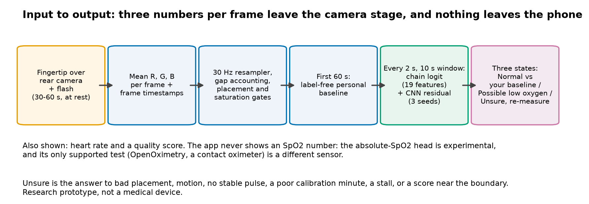
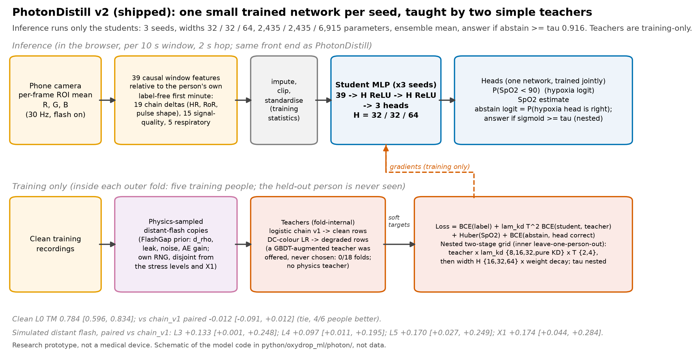
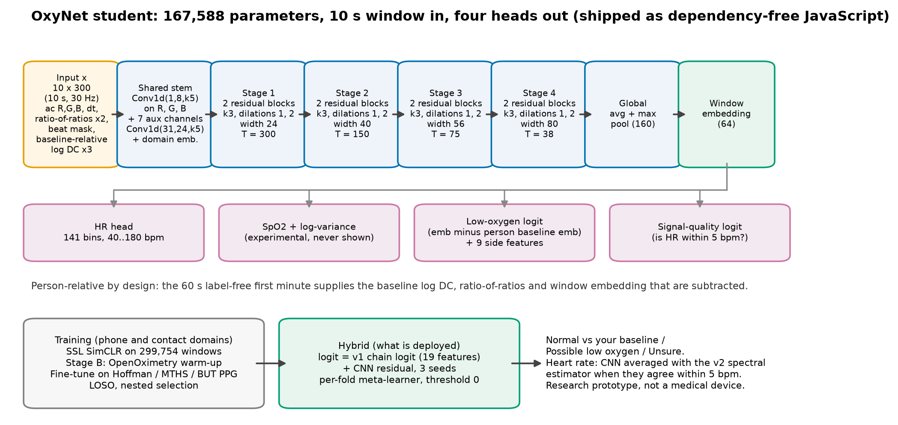

<!-- GENERATED from docs/templates/WRITEUP.md.in by scripts/render_docs.py. Edit the template, not this file. -->
# OxyDrop: a phone-camera check for a drop in blood oxygen

**Track:** Health
**Team:** Arav Jain, [TEAMMATE 2 NAME], [TEAMMATE 3 NAME]  *(Arav: fill in or delete before submitting; see CHECKLIST.md)*
**Paper:** [paper/OxyDrop_paper.pdf](https://github.com/aravhawk/oxydrop/blob/main/paper/OxyDrop_paper.pdf) · **Live app:** https://aravhawk.github.io/oxydrop/ · **Code:** https://github.com/aravhawk/oxydrop · **Video figures:** [docs/video/](video/) · **Long write-up:** [WHITEPAPER.md](../WHITEPAPER.md) · **Model card:** [MODEL.md](../MODEL.md)

> **OxyDrop is a research prototype, not a medical device. This project is a prototype and is not medical advice.**

## The problem
Low blood oxygen (SpO2 below 90%) often causes no symptoms, so it is easy to miss. The people most exposed to it (people with COVID-19, COPD or asthma at home, hikers and skiers at altitude, low-resource clinics) often have no pulse oximeter nearby, but they do have a phone. Our design scenario is **a person resting, without a pulse oximeter, who wants to know "should I re-check with a real oximeter, or go down?"** This scenario is a design goal and carries no evidence: the app has not been tested at altitude, on patients, or on a live phone by anyone outside the team.

## What we built
We built a web app that runs in a phone browser. Nothing is installed and the video never leaves the phone. The user sits at rest and covers the rear camera and flash with a fingertip. After a 60-second calibration of *their own* normal (the first answer arrives at 70 seconds), every 2 seconds it says **Normal vs your baseline**, **Possible low oxygen: re-check with a pulse oximeter**, or **Unsure, re-measure**, and shows heart rate and a quality score. It does not output an SpO2 number, and because it compares you with your own first minute it cannot know whether you were already low at the start (oxygen status at start unknown). A "recorded demo" mode replays real study recordings so anyone can try it without a camera.

## How it works
**Model (round 3, what the app runs now): PhotonDistill v2**, one small trained network per seed (3 seeds of widths 32 / 32 / 64, 2,435 / 2,435 / 6,915 parameters) on 39 window features relative to your first minute, taught in each fold by two simple teachers (the logistic chain on clean windows, a colour regression on physics-simulated distant-flash copies) fitted on the training people only. **It is on par with the logistic chain on clean light and does not beat it** (0.784 [0.596, 0.834] against 0.796 [0.636, 0.857], paired -0.012 [-0.091, 0.012], an interval that includes zero, 4/6 people better) and is more robust under a *simulated* distant flash (out-of-family stress X1: 0.682 against 0.508, paired +0.174 [0.044, 0.284]). It replaced round 2's PhotonDistill (0.758, a loss to the chain) under a rule fixed before any round-3 score. Disclosures: the round-3 models were designed after the earlier held-out results had been seen (Amendments 6 to 8), the last round-3 score files arrived one minute after the stated cutoff, a three-number DC-colour control is nearly as robust, the stress test is simulated, and the data cover 6 people (1 dark-skinned) on 1 phone model. Under simulated stress the paired gain over the chain is +0.097 [0.011, 0.195] at L4, +0.170 [0.027, 0.249] at L5 and +0.174 [0.044, 0.284] at X1. A GPU rerun of the same code scored 0.761 [0.561, 0.830] on clean light (paired -0.035 [-0.127, -0.006]) against 0.784 on the locked run. The rerun's paired interval excludes zero, so that run loses to the chain; we report the gap between the two runs as seed variance. Details: [MODEL.md](../MODEL.md) section 0, [pitch](submission/PITCH.md).

**Previous engine (`?engine=hybrid`).** A hybrid: the v1 logistic chain (heart-rate rise, pulse shape and ratio-of-ratios features relative to your first minute) gives a low-oxygen logit, and a 167,588-parameter 1D CNN (three seeds, plain JavaScript, offline) learns a residual correction. The CNN was pretrained self-supervised on 299,754 unlabeled windows and warmed up on contact-oximeter data (OpenOximetry) before fine-tuning on phone video. It also outputs heart rate and a quality score. Details and every lever, kept or dropped: [MODEL.md](../MODEL.md).

**Testing.** Leave-one-person-out: every result is scored on a person the model never saw, with nested selection on the training people only, three seeds and 95% person-bootstrap intervals, under a protocol committed before any CNN result existed (commit `3e708fe`). A "win" requires the paired interval against the **best** baseline to exclude zero.

## Results (all leave-one-person-out)
**Who it is for, input to output, baseline beaten on held-out data, and where it fails:**

* **Primary pre-registered metric (P1, six Hoffman people, time-matched balanced accuracy): not beaten.** The deployed hybrid (fixed pipeline R) scores 0.809 [0.644, 0.863] against 0.796 [0.635, 0.856] for the best baseline (the shipped logistic chain): a tie. The 0.809 is optimistic, because R was chosen after its outer-fold scores were seen; the nested per-person-selected hybrid scores 0.779 [0.638, 0.831] (-0.017 [-0.103, 0.069] against the chain). The simpler chain has the higher point estimates: a chain refit with the same levers and no CNN scores 0.816, and the chain-only conformal control answers 92.5% of windows at 90.3% accuracy against 74.5% at 89.5%; the intervals overlap. The CNN alone ties too. The hybrid and CNN are clearly better than the clock-only baseline (0.495) and the ratio-of-ratios rules (0.535), which are weak baselines.
* **Heart rate (P2, 100 people): exploratory, not a clean win.** 0.480 [0.429, 0.534] within 5 bpm against 0.419 [0.366, 0.481] for the best baseline (+0.061 [0.013, 0.107]); the rule was chosen after the pooled table had been seen, the gain comes from BUT PPG, the spectral estimator is nominally better on MTHS and better on the Hoffman inner folds (0.883 against 0.826; pooled out-of-fold windows used to select the rule, not an outer-fold test result).
* **Absolute SpO2 (P3, MTHS):** no model beats the training mean (1.457 CNN against 1.354); MTHS is normoxic, so SpO2 is not shown to users.
* **What drives the CNN:** the OpenOximetry warm-up (P1 0.577 without it against 0.739 with it). A device-agnostic-augmentation benefit is not supported.
* **Where it fails:** only six hypoxic phone-camera people exist in open data, so intervals are wide; motion, cold fingers, saturated red channel and far-flash phones produce *Unsure*; skin-tone fairness cannot be shown on phones; low oxygen already present during the first minute is invisible; person 4's resting pulse of about 48 bpm is below the 51 bpm spectral floor of the v2 estimator. The app is built to work on every phone and is not tuned to any specific phone; untested Android and other phones are a limitation.

**What the app runs.** The hybrid is the on-device default path: the v1 physiological chain logit plus the residual of three CNN seeds, then the logistic meta-learner and the conformal three-state rule (`app/js/hybrid_engine.js`, `docs/APP_INTEGRATION.md`). The CNN runs in a Web Worker so a forward pass never delays camera frames, with logistic-chain fallback when module workers are unavailable or exceed the 2 s window deadline; the v2 logistic chain stays behind `?engine=logistic`. A generic low-amplitude guard (AC/DC below the 0.1th percentile of the Hoffman training windows, 0.24%) answers *Unsure* and shows the spectral heart rate only. With the shipped cut (`scripts/ood_range.py`) it would refuse 0.1% of Hoffman windows, 6.7% of MTHS windows and 8.8% of BUT PPG windows (other studies' phones), so a weak-flash phone will see more *Unsure*; the rate on any untested phone is unknown. Latency measured on a development laptop (`results/ml/DEPLOY.md`): 16.4 ms for one forward pass, 50 to 58 ms per 2 s window including all three seeds; phones are slower and unmeasured. The three seed files are 2.69 MB together. The replay demo is in-sample for the hybrid (the weights saw those two people) and is labelled demo only in the app.

The v1/v2 chain tables, the heart-rate validation on BUT PPG and the earlier audit are in [ENGINEERED_CHAIN.md](ENGINEERED_CHAIN.md).

## Prior work, and what we added
Phone-camera low-oxygen detection is **not new**. Hoffman et al. (2022) demonstrated fingertip camera and flash hypoxemia screening with induced desaturation and held-out testing (81% sensitivity, 79% specificity below 90% SpO2, 5.00-point SpO2 MAE; their protocol differs from ours, so this is not a direct comparison). MTHS (Samavati et al., 2022), Sun et al. (2021) and Tian et al. (2022) studied smartphone and camera vital signs and oximetry with ratios, calibration and heart-rate-adaptive filtering. We add: a personalised chain-plus-residual-CNN hybrid on the device with abstention, an open pre-registered leave-one-person-out audit that reports ties and losses, and OpenOximetry-based pretraining and fairness analysis. We do not claim a new sensing principle, a first detector, or superiority over earlier work.

## What we'd do next
1. Collect consented phone-camera data from a broader, deliberately diverse group in a safe, supervised hypoxia protocol (altitude or clinical breath-holding studies), including many phone models, to test fairness and per-phone behaviour.
2. Replace the first-minute baseline assumption with an independently established baseline, and add a motion and exertion detector so the app refuses to answer after activity.

## How to run
Open https://aravhawk.github.io/oxydrop/ on a phone (or tap "Watch a recorded demo"), or run `npm run serve` and open http://localhost:8080. `npm test` runs the test suite and `npm run test:docs` checks every number in the docs against the results files.

## Credits
- Hoffman et al., "Smartphone camera oximetry in an induced hypoxemia study", npj Digital Medicine 2022 (https://www.nature.com/articles/s41746-022-00665-y); data https://github.com/ubicomplab/oximetry-phone-cam-data (MIT)
- BUT PPG v2.0, PhysioNet (CC BY 4.0): https://physionet.org/content/butppg/2.0.0/
- MTHS, Samavati et al. (CC BY-NC-ND 4.0, non-commercial research), https://arxiv.org/abs/2204.08989, https://github.com/MahdiFarvardin/MEDVSE
- OpenOximetry (PhysioNet, credentialed; derived aggregates only, never redistributed), https://physionet.org/content/openox-repo/1.1.1/; PhysioNet PTT-PPG (https://physionet.org/content/pulse-transit-time-ppg/1.1.0/), BIDMC (https://physionet.org/content/bidmc/1.0.0/) and apnoea neck-oximeter PPG for self-supervised pretraining only; moshekam PPG-during-exercise data (MIT); HealthRing (experiment, no gain). Full list and licences: https://github.com/aravhawk/oxydrop/blob/main/DATA_LICENSES.md
- Optical constants: S. Prahl, OMLC haemoglobin spectra (https://omlc.org/spectra/hemoglobin/summary.html); S. L. Jacques, "Skin Optics", OMLC (https://omlc.org/news/jan98/skinoptics.html); Jiang et al., WACV 2013 camera sensitivities.
- Pretrained models and tutorials: none from third parties.
- Libraries: numpy, scipy, scikit-learn, PyTorch, XGBoost, LightGBM, matplotlib, Node.js.
- AI tools and compute: Kiro (https://kiro.dev) with Claude Opus 5.5 and Sonnet 5.5 (Anthropic, https://www.anthropic.com/claude) for code, analysis and drafting; T3 Code (https://github.com/pingdotgg/t3code) and Hark as agent tools; Kaggle (https://www.kaggle.com) GPU kernels; Daytona (https://www.daytona.io) sandboxes. The team reviewed the work and can explain every part.
