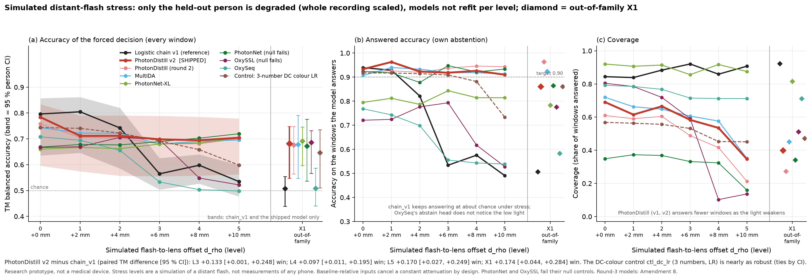

# OxyDrop round 3: the shipped model in brief

Every number here comes from `results/photon/TABLE.csv` (scored by `python -m oxydrop_ml.photon.evalkit`), `results/photon/distill2_compare.csv` and `results/photon/WINNER3.csv` (verdict in `results/photon/WINNER3.md`) and is checked by `scripts/check_claims.py`. Full model card: [MODEL.md](../../MODEL.md) section 0. Research prototype, not a medical device.

## Why this is new (3 sentences)

Phone-camera low-oxygen detection depends on how far the flash sits from the lens, and the only open phone hypoxia data come from one phone model, so we built a leave-one-person-out stress test that simulates a flash farther from the lens and trained one small network, PhotonDistill v2, against it, with two simple teachers fitted on clean and physics-degraded copies of the training people only. On clean light it **ties** our logistic chain (0.784 against 0.796 time-matched balanced accuracy, paired -0.012 [-0.091, 0.012]; it does not beat it), and under the simulated distant flash it holds up where the chain falls to chance (out-of-family stress X1: 0.682 against 0.508, paired +0.174 [0.044, 0.284]). The stress test is a simulation, a three-number colour control is nearly as robust, the model was designed after earlier results on the same six people were seen, and six people is a small test, so this is a tested idea, not a validated device.

## The model

PhotonDistill v2 is one trained student network per seed, the app's default engine (`?engine=distill`, model file `data/distill.json`; the previous hybrid stays behind `?engine=hybrid`, the logistic chain behind `?engine=logistic`). Per 10 s window it reads the same 39 causal features as round 2, computed from the per-frame mean R, G, B, each relative to the person's own label-free first minute. A multilayer perceptron (39 -> H -> H -> 3 heads, H = 32 / 32 / 64 for the three seeds, 2,435 / 2,435 / 6,915 parameters, seed outputs averaged) outputs P(SpO2 < 90), an SpO2 estimate that is never shown, and its own abstain output. In every leave-one-person-out fold it was trained on the five training people only, with soft targets from logistic chain v1 on clean windows and from a DC-colour logistic regression on physics-simulated distant-flash copies. Round 3 widened the nested search (distillation weight up to 32 or pure distillation, temperature, width); a gradient-boosted tree teacher was offered and never chosen (18 of 18 folds chose the base teachers), and no physics teacher was used. Only the student runs in the app.

## Results (six held-out people, 95% person-bootstrap intervals, paired differences to the logistic chain)

| | PhotonDistill v2 | Logistic chain v1 | Paired difference | People better |
|---|---|---|---|---|
| Clean light (L0) | 0.784 [0.596, 0.834] | 0.796 [0.636, 0.857] | -0.012 [-0.091, 0.012], **tie** | 4/6 |
| Simulated distant flash L3 | 0.698 [0.555, 0.789] | 0.565 [0.503, 0.625] | +0.133 [0.001, 0.248], win | 4/6 |
| Simulated distant flash L4 | 0.695 [0.558, 0.785] | 0.598 [0.526, 0.640] | +0.097 [0.011, 0.195], win | 6/6 |
| Simulated distant flash L5 | 0.704 [0.562, 0.779] | 0.535 [0.477, 0.598] | +0.170 [0.027, 0.249], win | 5/6 |
| Out-of-family stress X1 | 0.682 [0.547, 0.748] | 0.508 [0.439, 0.554] | +0.174 [0.044, 0.284], win | 6/6 |

Against round 2's PhotonDistill on clean light: +0.026 [-0.010, 0.040], 4/6 people better. Worst person 0.500 (chain 0.458). Null control (labels permuted): 0.543, 0.525 and 0.444, mean 0.504 over three draws. Other baselines on clean light: hybrid (nested) 0.779 [0.638, 0.831]; shipped pipeline R 0.809 [0.644, 0.863], optimistic because it was chosen after the outer scores were seen; CNN alone 0.739 [0.574, 0.811] in the model card (0.753 when re-scored on this harness).

## Every candidate of the three rounds (clean light L0 and out-of-family X1)

| Round | Model | Clean light (L0) TM [95% CI] | Paired vs chain [95% CI] | People better | Null mean | X1 paired vs chain |
|---|---|---|---|---|---|---|
| Baseline | Logistic chain v1 | 0.796 [0.636, 0.857] | reference | | | |
| Round 3 | PhotonDistill v2 (**shipped**) | 0.784 [0.596, 0.834] | -0.012 [-0.091, 0.012] tie | 4/6 | 0.504 | +0.174 [0.044, 0.284] win |
| Round 3 | MultiDA | 0.744 [0.553, 0.807] | -0.053 [-0.142, -0.010] loss | 3/6 | 0.522 | +0.170 [0.027, 0.328] win |
| Round 3 | PhotonNet-XL | 0.660 [0.545, 0.762] | -0.136 [-0.210, -0.033] loss | 2/6 | 0.412 | +0.184 [0.072, 0.290] win |
| Round 2 | PhotonDistill (round-2 winner, replaced) | 0.758 [0.603, 0.813] | -0.038 [-0.103, -0.001] loss | 2/6 | 0.492 | +0.169 [0.058, 0.285] win |
| Round 2 | OxySeq | 0.708 [0.452, 0.790] | -0.088 [-0.221, -0.023] loss | 2/6 | 0.475 | +0.001 [-0.047, 0.059] tie |
| Round 2 | PhotonNet | 0.668 [0.508, 0.785] | -0.128 [-0.208, -0.047] loss | 2/6 | 0.618 (fails) | +0.165 [0.020, 0.316] win |
| Round 2 | OxySSL | 0.667 [0.498, 0.741] | -0.130 [-0.274, -0.044] loss | 1/6 | 0.643 (fails) | +0.178 [0.043, 0.214] win |
| Round 1 | PhotonTwin gate (hand-coded, ruled out) | 0.796 [0.636, 0.857] | identical to the chain at L0 |  | 0.584 (fails) | +0.007 [0.000, 0.026] tie |
| Round 1 | OxyTrack | 0.809 [0.656, 0.893] | +0.013 [-0.052, 0.092] tie | 3/6 | n/a | +0.044 [-0.001, 0.104] tie |
| Round 1 | PhotonTwin-Inverse | 0.752 [0.577, 0.810] | -0.044 [-0.127, -0.000] loss | 2/6 | 0.406 | +0.107 [0.023, 0.213] win |
| Round 1 | FlashGap | 0.740 [0.607, 0.831] | -0.057 [-0.127, 0.021] tie | 1/4 | 0.532 | +0.121 [-0.000, 0.240] tie |
| Round 3 | ens3 (stack of three models; landed after the lock, no null controls) | 0.789 [0.621, 0.842] | -0.007 [-0.092, 0.043] | 4/6 | none | candidate only |
| Round 3 | ssl3 | no score file | | | | |

No model of any round beats the chain on clean light (that needs the paired interval above 0 and at least 5 of 6 people better). OxyTrack's tie is optimistic: four versions were scored on the outer folds. The PhotonTwin gate is hand-coded, and its null control fails.

## How it was chosen

The round-3 rule was fixed at 19:55 CT, before any round-3 score (Amendment 8): replace round 2's PhotonDistill only if a candidate's clean-light point estimate is higher (0.784 against 0.758), its paired difference to PhotonDistill has a lower bound above -0.02 (-0.010), and its mean paired stress difference to the chain over L3, L4, L5 and X1 is at least 0 (+0.144), with null controls passed (mean 0.504). PhotonDistill v2 is the only candidate that meets all four. The planner locked it at 20:22 CT.

## Disclosures

* All round-3 models were designed after the round-1 and round-2 outer results on the same six people were seen (Amendment 8); the wider grid was chosen because round 2's distillation weight hit the edge of its grid in every fold. Clean-light numbers are optimistic, not a blind test.
* PhotonDistill v2's clean-light files arrived at 20:08 CT; its null and stress files arrived at 20:16 CT, one minute after the stated 20:15 CT cutoff. The winner script flags them as late, and the planner's lock accepted them with this disclosure.
* The 90% target set for round 3 was not reached.
* The stress test is a simulation that scales whole recordings; features relative to the first minute cancel a constant attenuation by design. A DC-colour control with three numbers is nearly as robust (0.646 at X1, a tie with the chain by its interval).
* Teachers: the gradient-boosted tree teacher was never chosen, the physics teacher (PhotonTwin inversion) was not used, and OxySeq and OxyTrack outputs were not used as teachers because they would leak the held-out person.
* `ssl3` produced no score file. `ens3` (a stack of PhotonDistill, OxySeq and the no-teacher student) landed after the lock with no null controls and is three models, not one shippable network: candidate only.
* One dark-skinned person among the six: no skin-tone claim. Six people, 12 recordings, Nexus 6P phones; real distant-flash phones are untested.
