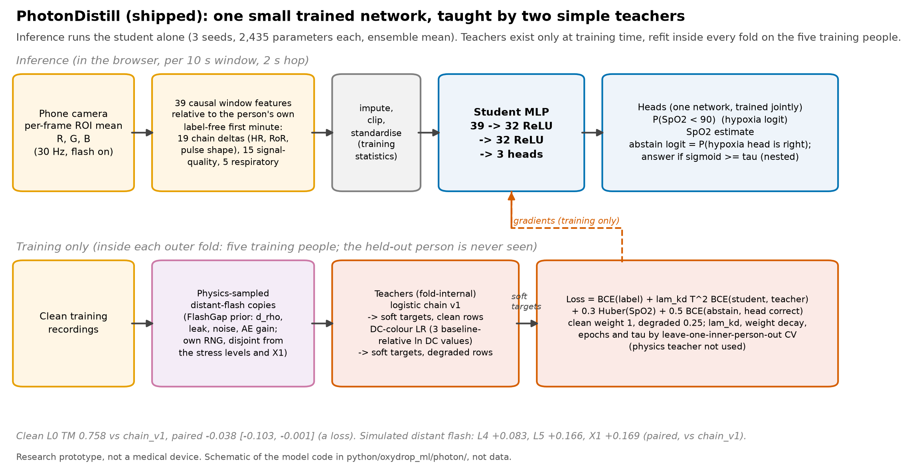

# OxyDrop round 2: the shipped model in brief

Every number here comes from `results/photon/TABLE.csv` (scored by `python -m oxydrop_ml.photon.evalkit`; verdict in `results/photon/WINNER2.md`) and is checked by `scripts/check_claims.py`. Full model card: [MODEL.md](../../MODEL.md) section 0. Research prototype, not a medical device.

## Why this is new (3 sentences)

Phone-camera low-oxygen detection depends on how far the flash sits from the lens, and the only open phone hypoxia data were recorded on one phone model; we built a leave-one-person-out stress test that simulates a flash farther from the lens than on the recording phone, and trained one small network, PhotonDistill, against it, using two simple teachers fitted on clean and physics-degraded copies of the training people only. On clean light it **loses** to our logistic chain by 0.038 (0.758 against 0.796 time-matched balanced accuracy), but under the simulated distant flash it stays above chance where the chain falls to it (out-of-family stress X1: 0.676 against 0.508) and it answers fewer windows as the light weakens. The stress test is a simulation, a three-number colour control is nearly as robust, and there are six people, so this is a tested idea, not a validated device.

## The model

PhotonDistill is one trained student network, the app's default engine (`?engine=distill`; the previous hybrid stays behind `?engine=hybrid`, the logistic chain behind `?engine=logistic`). Per 10 s window it reads 39 causal features computed from the per-frame mean R, G, B, each relative to the person's own label-free first minute, and a multilayer perceptron (39 -> 32 -> 32 -> 3 heads, 2,435 parameters per seed, three seeds averaged) outputs P(SpO2 < 90), an SpO2 estimate that is never shown, and its own abstain output. In every leave-one-person-out fold it was trained on the five training people only, with soft targets from logistic chain v1 on clean windows and from a DC-colour logistic regression on physics-simulated distant-flash copies. Only the student runs in the app.

## Results (six held-out people, 95% person-bootstrap intervals, paired differences to the logistic chain)

| | PhotonDistill | Logistic chain v1 | Paired difference | People better |
|---|---|---|---|---|
| Clean light (L0) | 0.758 [0.603, 0.813] | 0.796 [0.636, 0.857] | -0.038 [-0.103, -0.001], **loss** | 2/6 |
| Simulated distant flash L4 | 0.681 [0.566, 0.772] | 0.598 [0.526, 0.640] | +0.083 [0.008, 0.178], win | 6/6 |
| Simulated distant flash L5 | 0.701 [0.570, 0.770] | 0.535 [0.477, 0.598] | +0.166 [0.035, 0.242], win | 5/6 |
| Out-of-family stress X1 | 0.676 [0.564, 0.747] | 0.508 [0.439, 0.554] | +0.169 [0.058, 0.285], win | 6/6 |

Other baselines on clean light: hybrid (nested) 0.779 [0.638, 0.831]; shipped pipeline R 0.809 [0.644, 0.863], optimistic because it was chosen after the outer scores were seen; CNN alone 0.739 [0.574, 0.811] in the model card (0.753 when re-scored on this harness). Null control (labels permuted): mean 0.492 over three draws.

## Why it was shipped although it loses on clean light

Round 2 required a genuinely trained end-to-end model with real in-browser inference, so the logistic chain and the round-1 hand-coded gate could not be the headline. No round-2 model beat or tied the chain on clean light. PhotonDistill had the highest clean-light point estimate of the eligible models with a passed null control and is the most robust of them under the simulated distant flash. The pre-stated rule had no branch for "every model loses"; the extension that picked PhotonDistill was written after the results were seen (Amendment 7, Outcome).

## Disclosures

* All round-2 models were designed after the round-1 results on the same six people were seen; PhotonDistill v2 was tuned after its v1 held-out result (0.696).
* The stress test is a simulation that scales whole recordings; features relative to the first minute cancel a constant attenuation by design. A DC-colour control with three numbers is nearly as robust (0.646 at X1, a tie with the chain by its interval).
* The planned physics teacher (PhotonTwin) was not used.
* One dark-skinned person among the six: no skin-tone claim. Six people, 12 recordings, Nexus 6P phones; real distant-flash phones are untested.
* Other candidates are reported as candidates: OxySeq 0.708 (its abstain head does not notice low light), PhotonNet 0.668 and OxySSL 0.667 (both fail their null controls, means 0.618 and 0.643).
